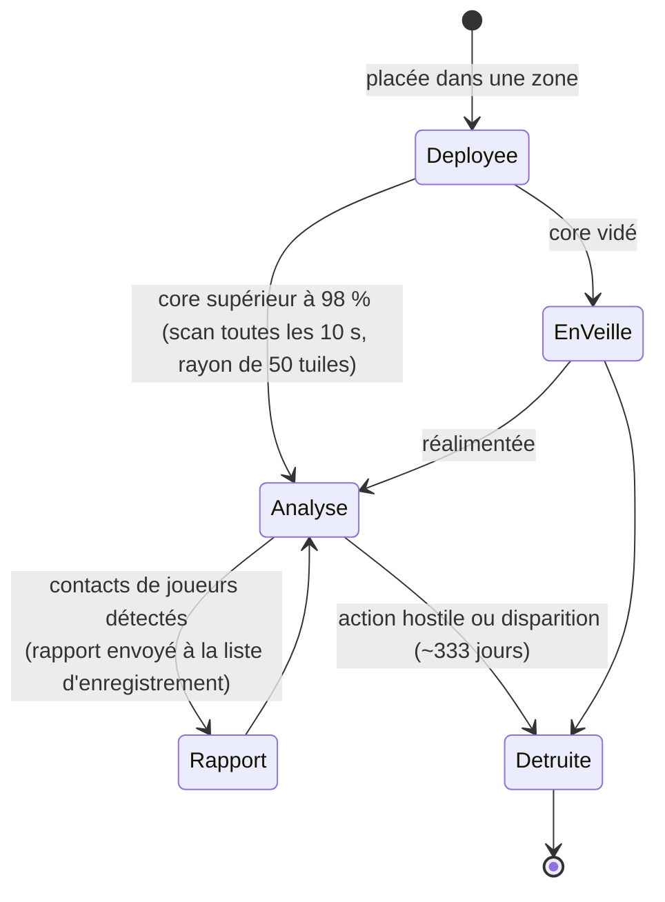

# Sondes de proximité

Les sondes se divisent en deux familles :

- **Sondes de visibilité (proximité)** — petits dispositifs déployables dans une zone pour **surveiller un secteur**.
  Tant qu'elles sont alimentées, elles scannent les unités de joueurs alentour et transmettent des rapports aux personnages
  enregistrés. C'est un outil de surveillance et de reconnaissance.
- **Sondes minières** — un **module** équipé sur votre robot (du niveau *débutant* jusqu'à *standard*, *industriel*,
  *nommé*, *élite* et *artefact*) combiné à des **munitions de sonde par minerai** (variantes tuile / direction / zone pour chaque minerai).
  Leur tir génère un résultat d'analyse pour ce minerai dans la zone, stocké par personnage (voir [collecte → analyse](/fr/features/gathering/)).

> Les emplacements dans l'interface suivent la [vue d'ensemble de l'interface](/fr/features/ui/). Les mécaniques ci-dessous
> sont confirmées par le serveur.

## Gérer vos sondes

- **Lister** vos sondes — consulter les sondes en votre possession.
- **Informations d'enregistrement** — état et détails d'enregistrement d'une sonde.
- **Définir l'enregistrement** — associer des personnages à la liste de diffusion de la sonde.
- **Définir un nom** — attribuer un label à une sonde.
- **Supprimer** l'enregistrement d'une sonde (dans une zone) — cesser la surveillance / réinitialiser la sonde.

### Fonctionnement d'une sonde de visibilité

- Elle est **alimentée par son core** : elle ne scanne que lorsque son énergie de core est quasiment pleine (au-delà de 98 % de `core_max`) ;
  une sonde déchargée reste inactive.
- Lorsqu'elle est active, elle scanne **toutes les 10 secondes** la présence de robots de joueurs dans son **rayon de détection (50 tuiles)**
  et envoie un rapport (l'ID de personnage et la position de chaque contact) à tous les membres de la liste d'enregistrement.
- L'**enregistrement** est une activité de corporation : vous ne pouvez enregistrer que des **membres de votre propre corporation**,
  et le **PDG ainsi que son adjoint figurent toujours automatiquement sur la liste**. La liste est plafonnée à une taille maximale.
- **Durée de vie** : une sonde déployée disparaît après le `despawn_time` fixé dans ses données de contenu (la sonde de visibilité
  est réglée à ~333 jours) ou lors de sa destruction au combat.

## Événements du cycle de vie

Le serveur diffuse les événements du cycle de vie des sondes en temps réel :
- **créée**, **mise à jour**, **détruite** — une sonde est déployée, transmet un rapport ou est abattue.

Ces événements arrivent sous forme de notifications directes ; vous ne les émettez pas, vous y réagissez.

## Notes pratiques

- **Enregistrez avant de consulter** — une sonde ne transmet ses rapports qu'aux personnages inscrits.
- **Les sondes sont destructibles** — un tir ennemi ou l'expiration peut détruire une sonde ; surveillez les événements du cycle de vie.
- **Nommez-les clairement** — lorsque plusieurs sondes sont sur le terrain, des libellés précis vous évitent toute confusion.
- **Reconnaissance, pas combat** — les sondes collectent des renseignements ; elles ne se défendent pas.

<!-- TODO: only the UI remains (probe list, registration picker).
     Confirmed: visibility probe (def_visibility_probe): core_max 50, active only at
     core>98%, 10 s scan interval (ProximityDevice.cs _probingInterval), detection via
     blob_emission 10 / blob_emission_radius 50, report = characterID + x/y per contact
     pushed to registered characters (ProximityProbe.OnUnitsFound); registration =
     own-corp members only, CEO+Deputy always included, max count
     (ProximityProbeRegisterSet.cs); despawn_time 28,800,000 s (~333 d) on the capsule;
     stealth_strength 275 / detection_strength 45. Mining probes: tiered modules
     (noob/standard/industrial1-2/named1-3/elite t2-t4/artifact) + per-ore tile/
     direction/area ammo (79 def_*probe* definitions).
     Developer notes: ProximityProbeList.cs / ProximityProbeGetRegistrationInfo.cs /
     ProximityProbeRegisterSet.cs / ProximityProbeSetName.cs; Zone/ProximityProbeRemove.cs;
     Zones/ProximityProbes/ProximityProbe.cs + ProximityProbeDeployer.cs +
     ProximityDevice.cs; Zones/Blobs/* (blob emission/stealth); lifecycle events via
     ProximityProbeCreated/Update/Dead/Info commands. -->
     Developer notes: ProximityProbeList.cs / ProximityProbeGetRegistrationInfo.cs /
     ProximityProbeRegisterSet.cs / ProximityProbeSetName.cs; Zone/ProximityProbeRemove.cs;
     Zones/ProximityProbes/ProximityProbe.cs + ProximityProbeDeployer.cs; lifecycle
     events via ProximityProbeCreated/Update/Dead/Info commands. -->
