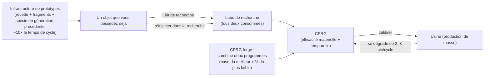

# Production

La production est le moyen de transformer des ressources brutes et des composants en objets utilisables.
Elle se déroule au sein d'une **infrastructure de production** (une « usine » ou mill) dans la base où vous êtes amarré.
Toutes les opérations présentées ici sont **réalisables à quai uniquement**.

> Les emplacements dans l'interface suivent la [vue d'ensemble de l'interface](/fr/features/ui/) (les catégories
> **Raffinerie / Recyclage / Réparation / Assurance** sur la barre supérieure). Les mécaniques ci-dessous sont confirmées par le serveur.

## Lignes de production

Une **ligne de production** est une recette enregistrée : elle définit ce que vous produisez et à partir de quoi.
La liste complète des composants de chaque objet fabricable (avec les niveaux de recherche) est générée dans
[Recettes](/fr/content/recipes/). Vous lancez une ligne pour un certain nombre de **cycles (rounds)**.

- **Lister les lignes** — consulter vos lignes disponibles.
- **Démarrer une ligne** — la lancer dans une usine pour un nombre de cycles choisi (minimum 1).
  - Vous pouvez régler les coûts depuis votre **portefeuille personnel** ou le **portefeuille de corporation**.
  - Les composants requis peuvent être recherchés dans votre **inventaire** ou vos **robots**.
- **Calibrer une ligne** — ajuster les réglages d'une ligne.
- **Définir les cycles** — choisir le nombre de cycles à exécuter.
- **Interroger le cycle suivant** — prévisualiser ce que le prochain cycle consommera et produira.
- **Annuler** — interrompre une production en cours.
- **Supprimer une ligne** — retirer une ligne enregistrée.

L'exécution d'une ligne consomme des composants (et des crédits) et produit l'objet ciblé au fil des cycles.

## Opérations ponctuelles

Il s'agit d'actions uniques plutôt que de lignes à cycles multiples. Chacune dispose d'une variante **Requête (Query)**
qui prévisualise le coût et le rendement avant engagement.

- **Raffiner** — matières brutes → commodités, selon la recette de l'objet (voir [Recettes](/fr/content/recipes/)).
  Vous choisissez la quantité de l'objet ciblé à fabriquer ; les intrants nominaux de la recette sont modulés par un multiplicateur
  de matériau de `1 + 50/(bonus + 100)` où *bonus* correspond à votre compétence de raffinage (extensions + points d'infrastructure + points de réputation).
  Sans bonus, vous consommez **150 %** de la recette nominale ; avec le bonus maximal, ce taux descend vers **100 %**.
- **Recycler / reprocesseur** — décompose un objet en ses composants d'origine (la recette inverse).
  Le rendement est de `nominal × (1 − 75/(bonus + 100)) × ratio de santé de l'objet` — sans bonus de compétence, la base est de **25 %**,
  progressant vers 100 %, et un **objet endommagé rapporte proportionnellement moins** (réparez-le d'abord s'il a de la valeur).
  Seuls les « lots » entiers (quantités complètes par défaut) sont recyclés ; le reliquat est conservé. Les objets de mission sont supprimés et non recyclés.
- **Réparer** — restaure un objet ou un robot endommagé à sa pleine durabilité. Le tarif est de
  `(pourcentage de PV manquants) × valeur matérielle de l'objet × 75/(bonus + 100)`. La « valeur matérielle » est calculée récursivement :
  la recette de l'objet est décomposée en matières premières et évaluée aux **moyennes du marché mondial**, le coût de réparation fluctue donc
  avec le marché. Le multiplicateur de compétence démarre à **75 %** sans bonus et tend vers 0 avec le bonus maximal.
- **Rechercher des composants** — produire des composants de recherche (requête + exécution).

## Le cycle de vie des objets (le processus circulaire)

La création d'objets forme une boucle associant trois infrastructures interdépendantes :

1. **Recherche (rétro-ingénierie)** — fournissez un exemplaire de l'objet que vous souhaitez fabriquer, accompagné d'un
   **kit de recherche** dont le niveau atteint au moins le niveau de recherche de l'objet (les kits vont du niveau 0 au niveau 10),
   dans le laboratoire de recherche. Les deux intrants sont **consommés**, et l'opération produit un **CPRG** pour cet objet.
   Les rendements du programme débutent à la valeur de base de l'objet (la plupart à 50, les munitions plus haut, les tourelles jusqu'à 90)
   et sont augmentés de *(niveau du kit − niveau requis) × 5* plus votre bonus de compétence de recherche (jusqu'à +50 de plus).
   Un kit de quelques niveaux supérieur à l'objet — assorti de bonnes extensions de production — permet donc de transformer un programme
   neuf de 50/50 en un programme compétitif. C'est ainsi que de nouveaux objets rejoignent votre répertoire de fabrication.
2. **L'usine (production de masse)** — produisez en série à partir du programme. Chaque cycle **dégrade** les rendements de la ligne
   (2 à 3 points par cycle selon la catégorie d'objet ; voir [CPRG](#cprg-programmes-de-calibrage)) — lorsque le gaspillage devient excessif,
   calibrez un nouveau programme sur la ligne. Les objets prototypes consomment également un **spécimen de la génération précédente**
   en tant que composant (un module standard pour fabriquer un prototype T2, un T2 pour faire un T3), qui est consommé au cours du processus.
3. **L'infrastructure de prototypes** — fabriquez directement un **prototype** d'un objet : les matériaux de la recette accompagnés de
   fragments de robot *et* du spécimen de génération précédente, pour environ **10× le temps de cycle de l'usine** (plus le multiplicateur
   de temps habituel). Vous ne pouvez prototyper que les objets débloqués dans votre arbre technologique. Les prototypes coûtent bien plus cher
   que leurs équivalents standards ; leur fonction principale est d'être **analysés en recherche pour produire des programmes de haute qualité**
   (rechercher un objet prototype est ce qui débloque le palier suivant) — ou d'être montés sur un robot lorsque l'objet est introuvable en butin
   et hors de prix sur le marché.

## Progression par tiers

La majorité des modules et des robots se déclinent en **tiers T1 → T4** (insigne de rang du client ; lignées de définition
`standard → named1 → named2 → named3`, puis les séries spéciales `elitet4` / `artifact`). Les règles :

- **Chaque palier constitue un objet distinct avec son propre nœud d'arbre technologique.** Débloquer un nœud coûte des points de recherche
  (issus des noyaux) et requiert le **nœud parent** — les paliers doivent donc être débloqués séquentiellement. Vous ne pouvez **prototyper**
  (ou produire en série) qu'un objet dont le nœud est déjà débloqué : aucun moyen de fabriquer un palier supérieur sans la recherche préalable.
- **Chaque palier supérieur consomme un spécimen du palier précédent** comme composant (en plus des matériaux et des fragments de robot).
  Un objet T1 ne peut donc jamais être directement « converti » en T3 — le prototype T3 exige un objet **T2**, et ce spécimen est **consommé**
  et non transformé : la sortie est un objet entièrement neuf.
- Chaque fiche d'objet présente sa **lignée de tiers** — l'enchaînement complet `T1 → T2 → T3 → T4` sous forme de liens — et les
  [pages des nœuds de l'arbre technologique](/fr/content/techtree/) détaillent les nœuds parents/suivants ainsi que les coûts en points de chaque palier.

Exemple pour la lignée du petit module de minage : [standard small miner (T1)](/content/items/standard-small-driller/) →
[Biroter 5050 small miner module (T2)](/content/items/named1-small-driller/) →
[Sublimator Low-D small miner module (T3)](/content/items/named2-small-driller/) →
[Scraper-990 small miner module (T4)](/content/items/named3-small-driller/) —
et la même logique s'applique à chaque famille de module ou de robot.

## Prototypes & kits de recherche

- **Prototype** — fabriquer un objet prototype (lancer + requête). Un prototype par emplacement ; les extensions de production
  permettent d'exécuter davantage de fabrications de prototypes en parallèle.
- **Fusionner des kits de recherche** — combiner plusieurs kits de recherche pour en obtenir un de rang supérieur (exécution + requête).
  Un kit supérieur écourte le temps de recherche et augmente les rendements du programme produit.

## CPRG (programmes de calibrage)

Un **CPRG** (programme de calibrage) est l'élément qui pilote une ligne de production — un programme propre à un objet doté de points
d'**efficacité matérielle** et d'**efficacité temporelle** (de 0 à 100 chacun). Vous l'obtenez en **recherchant l'objet** dans un laboratoire
de recherche (le niveau de recherche détermine les objets que vous pouvez fabriquer) ou en activant une **capsule de calibrage**.

- Un CPRG fraîchement recherché démarre à **50/50** points.
- **Forger des CPRG** à la forge de programmes de calibrage : combinez deux CPRG d'un même objet ; le résultat conserve les points du meilleur
  programme comme base et y ajoute un tiers de ceux du plus faible. La forge demande du temps et coûte des crédits (temps × tarif par seconde de l'infrastructure).
- **Calibrer une ligne** avec un CPRG pour lui appliquer ses rendements. Chaque cycle de production **dégrade** l'efficacité de la ligne
  (une valeur de décalibrage par objet), les lignes perdent donc de leur rentabilité au fil du temps — recalibrez avant de longues séries.

Ces rendements alimentent les formules de l'usine (par cycle de production) :

- **Matériaux consommés** = recette × `1 + 50/(points matériels + compétence + 100 + bonusUsine)` — un CPRG neuf de 50 points sans compétence
  ni bonus de production de masse consomme ≈ **133 %** de la recette nominale.
- **Temps de production** = temps de base de l'infrastructure (3 600 s par cycle pour une usine) × `1 + 100/(points temporels + compétence + 100)`
  × modificateur de durée de l'objet — un nouveau CPRG sans compétence prend ≈ **1 heure et 40 minutes** par objet.
- **Tarif** = temps de production × tarif par seconde de l'infrastructure (7 crédits/s pour l'usine PBS, 3 pour les grands/moyens labos de recherche PBS)
  × modificateur de prix de l'objet (1–10).
- Les CPRG de mission sont gratuits et fixés à 10 secondes.

## Assurance

L'infrastructure d'assurance couvre **vos robots**, et non votre production d'objets :

- **Souscrire** une police pour un robot (il doit être intact, déballé et ne pas être un robot de débutant), **lister** vos polices,
  **consulter** une police, **résilier** une police.
- La couverture dure **15 jours** (+ jours bonus d'extension) ; vous pouvez assurer 1 + (bonus d'extension) robots simultanément.
- Chaque robot a un **coût** et une **indemnisation** fixés dans les données de contenu (table `insuranceprices`, 67 définitions de robots) ;
  le coût est réduit par le bonus d'extension de tarif et peut être réglé depuis le portefeuille de la corporation.
- Si le robot assuré est détruit, l'**indemnisation est versée en crédits** (le robot reste perdu) — voir [combat](/fr/features/combat/).

## Infrastructure & statut

- **Infos sur l'infrastructure / description** — prestations offertes par une installation de production.
- **En cours (personnel / corporation)** — productions actuellement actives.
- **Historique de production** — vos productions passées.
- **Liste des composants** — composants de production disponibles.
- **État du serveur** — statut du serveur de production.

## Notes pratiques

- **Vous devez être amarré à une base équipée d'infrastructures de production.**
- **Interrogez (Query) avant de lancer** — les variantes de requête affichent le coût et le résultat afin de ne pas gâcher de composants par inadvertance.
- **Portefeuille de corporation** — vous pouvez utiliser les fonds de la corpo pour la production si les droits vous y autorisent.
- **Les composants proviennent aussi des robots** — une ligne peut puiser ses composants dans vos robots équipés, et pas seulement dans votre inventaire.
- **Recyclez à pleine durabilité** — un objet endommagé rapporte moins ; réparez les objets précieux avant de les retraiter.
- **Les multiplicateurs de compétence sont les vrais leviers économiques** — les bonus de raffinage/recyclage/réparation/usine obéissent tous à la même courbe ; investir dans les extensions de production génère d'importantes économies de matériaux à chaque cycle.
- **L'assurance est un filet de sécurité** — souscrivez-en pour les équipements coûteux avant de partir en JcJ en espace profond.
- **Les kits de recherche dictent l'accès** — le niveau de recherche d'un objet (1–9) détermine quels kits peuvent le décoder, et utiliser un kit de plusieurs niveaux supérieur à l'objet est le moyen le plus économique de doper les rendements du programme obtenu.

<!--
Developer notes: rewritten 2026 from backend sources; no community-wiki text reused.
Verified against:
- refine = 1 output per unit, input = nominal x (1+50/(bonus+100)) (Refinery.cs);
- recycle = reverse recipe x (1-75/(bonus+100)) x healthRatio, whole batches only,
  mission items deleted (ReprocessSessionMember.cs);
- repair price = (1-healthRatio) x PriceCalculator world-market value x
  75/(bonus+100) (Repair.cs + PriceCalculator.cs);
- ResearchLab.cs (StartResearch/EndResearch: source item + research kit both
  consumed; kit level must be >= itemresearchlevels.researchlevel (1-9);
  efficiency = per-item base + levelDifference*5 + (1-100/(100+skill))*50);
- itemresearchlevels (1101 rows, levels 1-9), research kits def_research_kit_0..10
  (#level option), RandomResearchKit (mission kits, fake 100/100);
- calibrationdefaults (per-CPRG base efficiencies 50-90; default fallback 50/50;
  CalibrationProgram.OnInsertToDb sets 50/50);
- PBSFacilities.cs CalculateResultingPoints (forge = better base + weak/3 +
  (1-100/(100+skill))*25);
- productiondecalibration (2-3 points decrease per round per category,
  distorsion 0.5-1%);
- Prototyper.cs (StartPrototype: components include previous-gen specimen via the
  components table — e.g. T2 NEXUS consumes 1x standard module, T3 consumes 1x T2;
  time = 10x cycle x multiplier; tech-tree unlock check in
  ProductionPrototypeStart.cs);
- prototypes table (339 rows, standard->prototype mapping);
- Mill.cs (CalculateFinalMaterialMultiplier 1+50/(pts+skill+100+millBonus) with
  tech-tree mass-production bonus; CalculateFinalTimeMultiplier;
  productionduration table);
- Insurance: InsuraceFacility.cs (15d + time-extension bonus, 1+slot-extension
  policies, noob bot excluded, must be single+unpacked), InsuranceDescription.cs
  (payout in credits via central bank), insuranceprices (67 robot definitions,
  payout = 80x fee except noob/arkhe2 at 4x).
- Facility options (entitydefaults): def_pbs_facility_mill #perSecondPrice=7
  #productionTime=3600; refinery #materialEfficiency=0.95;
  calibration_program_forge #perSecondPrice=7; def_production_public_factory
  #materialEfficiency=0.6 #manufactureTime=3600 #perSecondPrice=3.
Developer files: Production/ProductionLineStart.cs (PrepareProductionForPublicContainer,
LineStartInMill, corp wallet, search-in-robots, rounds); Production/ProductionLine*.cs;
Production/ProductionRefine*.cs, ProductionReprocess*.cs, ProductionRepair*.cs,
ProductionResearch*.cs (query+run pairs); Production/ProductionPrototype*.cs,
ProductionMergeResearchKitsMulti*.cs; Production/ProductionCPRG*.cs,
ProductionGetCPRGFromLine*.cs; Production/ProductionInsurance*.cs;
Production/ProductionFacility*.cs, ProductionInProgress*.cs, ProductionHistory.cs;
Services/ProductionEngine/Facilities/*.cs; Services/ProductionEngine/PBSFacilities.cs;
Services/ProductionEngine/ResearchKits/*.cs; Services/ProductionEngine/CalibrationPrograms/*;
Services/Insurance/InsuranceHelper.cs; Items/PriceCalculator.cs.
Corrections vs ingested page: no "decoder" item exists (research kits are the
level-gated inputs); the "researched to 100%" claim is wrong (tech-tree unlock is
the gate; research levels run 1-9); prototype time is 10x the mill cycle; specimen
consumption verified from the components table; insurance payout is 80x the fee.
-->
