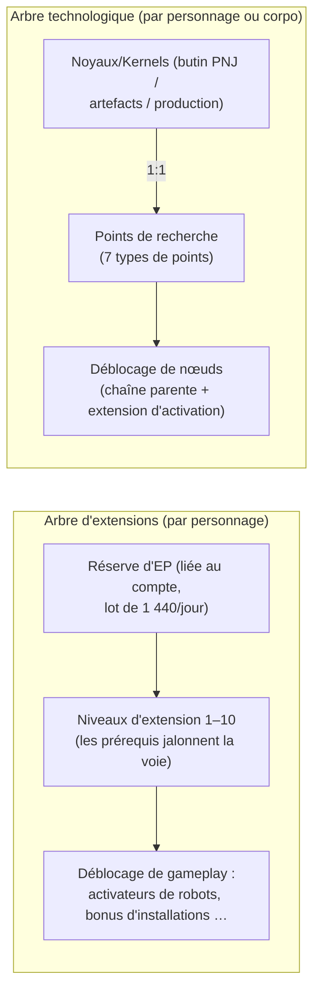

# Recherche

Il existe **deux systèmes de progression distincts**. Tous deux s'utilisent à quai uniquement.

> Les emplacements dans l'interface suivent la [vue d'ensemble de l'interface](/fr/features/ui/) (Fenêtre de personnage → extensions ;
> l'arbre technologique possède sa propre fenêtre). Les mécaniques ci-dessous sont confirmées par le serveur.

## L'arbre d'extensions (compétences du personnage)

Les extensions sont des niveaux de compétence propres à chaque personnage qui débloquent des pans de gameplay —
plus particulièrement les **extensions d'activation (enablers)** autorisant le pilotage d'une classe de robot
(indispensables pour se désamarrer et sélectionner un robot, voir [déplacement](/fr/features/movement/) et [robots](/fr/features/robots/)).

### Fonctionnement de l'apprentissage

- Vous devez être **amarré** pour apprendre.
- Chaque extension peut être montée aux **niveaux 1 à 10** (le niveau 10 est le plafond).
- **Le niveau 1 coûte des crédits** (le `price` de l'extension), prélevés de votre portefeuille.
- **Chaque niveau coûte des points d'extension (EP)** selon une table fixe rang × niveau — pour les niveaux 1 à 5,
  le coût est de `60 × rang × niveau` ; les niveaux 6 à 10 bondissent à `rang × (1440, 2520, 3840, 5400, 12000)`.
  Les dix niveaux d'une extension de rang 1 coûtent de 60 à 6 000 EP, pour un total de 13 500 EP ; une extension de rang 10
  coûte dix fois plus à chaque niveau.
- Les **prérequis** doivent être maîtrisés au préalable pour pouvoir acquérir une extension (la liste des « prérequis »).
- L'EP constitue une **réserve liée au compte** : elle est partagée entre vos différents personnages et s'accumule avec le temps
  (voir « Sources d'EP » ci-dessous).

### Gestion des extensions

- **Liste des catégories / tout afficher / appris / prérequis** — parcourir l'arbre et consulter vos acquis.
- **Points disponibles** — visualiser votre réserve d'EP actuelle.
- **Retirer un niveau** — abandonner un niveau individuel d'une extension.
- **Réinitialiser les extensions du personnage** — remettre à zéro l'arbre complet d'un personnage.
- **Libérer les EP verrouillés** — débloquer les EP immobilisés (par exemple après le retrait de niveaux).
- **Acheter un boost d'EP** — accélérateur payant augmentant le gain d'EP.
- **Journal quotidien d'EP par activité** — suivre le détail des EP remportés en jeu.

### Sources d'EP

L'EP n'est pas une monnaie achetable à la dépense — elle s'accumule par **lots quotidiens** :

- Chaque compte reçoit **1 440 EP par jour** (attribués une fois par jour entre 08h00 et 11h00 heure du serveur par la procédure `extensionPointsAdd`).
  Le code prévoit également un lot doublé de **2 880 EP** pour les comptes à abonnement payant, mais la procédure actuelle accorde le lot de base à tous les comptes.
- Les **boosts payants** (achats de boost d'EP) s'y ajoutent en surplus.
- Votre **EP disponible** = somme des lots quotidiens reçus − pénalités − EP dépensés en jeu. (Le journal d'EP par activité détaille la répartition journalière.)

**Catalogue complet** — chaque extension (rang, tarif niveau 1, bonus, prérequis) se trouve dans [Extensions](/fr/content/extensions/),
et chaque nœud d'arbre technologique (objet débloqué, extension d'activation, tarifs en points) se trouve dans [Arbre technologique](/fr/content/techtree/).

## L'arbre technologique (déblocages)

L'arbre technologique est un graphe de **nœuds** que vous débloquez en dépensant des **points de recherche**.
À la différence de l'EP (réserve de compte), les points d'arbre technologique s'**obtiennent en consommant des « noyaux » (kernels)** — des objets que vous analysez puis soumettez.

### Comment cela fonctionne

- **Rechercher des noyaux** — soumettre des noyaux depuis un conteneur. Chaque noyau se convertit en **1:1** en points
  de recherche d'un **type de points** donné ; les noyaux sont consommés. Il existe sept types de noyaux correspondant
  chacun à un type de points : Thelodica, Pelistal, Nüimqol, Industriel, Commun, High-Tech et NewTech.
- **Débloquer un nœud** — dépenser les points de recherche requis. Un nœud ne peut être débloqué que si :
  - l'ensemble de ses **nœuds parents** est déjà débloqué, et
  - vous maîtrisez l'**extension d'activation** du nœud sur votre personnage.
- **Déblocages de corporation** — avec le rôle de corporation approprié, un nœud peut être débloqué **pour la corporation**
  (partagé). Les déblocages de corporation coûtent plus cher (un multiplicateur de tarif de corporation s'applique) et sont réglés
  depuis la réserve de points de la corporation.
- **Faire un don** — donner des points de recherche (par exemple à votre corporation).
- **Infos / journaux** — consulter les détails d'un nœud et l'historique de vos déblocages/recherches.

### Pourquoi cela compte

Les nœuds débloqués de l'arbre technologique conditionnent l'accès aux contenus et fonctionnalités de rang supérieur.
Vérifiez toujours les prérequis d'un nœud (chaîne parente + extension d'activation) avant d'y investir des points.

## Notes pratiques

- **Les extensions d'activation conditionnent les robots** — impossible de piloter une classe de robot non apprise (le même test bloque le désamarrage et la sélection).
- **Le niveau 1 est le seul coût en crédits** dans l'arbre d'extensions ; tous les niveaux suivants se règlent exclusivement en EP.
- **L'arbre technologique est irréversible** — les points investis dans un déblocage sont définitivement consommés ; planifiez votre cheminement.
- **La recherche de corporation est un effort d'équipe** — elle s'appuie sur des points partagés assortis d'un multiplicateur de coût.

<!-- TODO: only the research UI remains (window layout, point display).
     Confirmed: EP earn = 1440/day flat via dbo.extensionPointsAdd (08:00-11:00 window,
     once per day; 2880 bonus constant exists in GiveExtensionPointsService for paid
     subscriptions but the current SP pays base to all); available = batches -
     penalties - spent (extensionPointsAvailable fn); EP cost table in
     Services/ExtensionService/ExtensionPoints.cs (60*rank*level for levels 1-5, then
     rank*(1440,2520,3840,5400,12000)); kernels convert 1:1 (TechTreeResearch.cs), 7
     kernel definitions -> point types n1..n7 (Theodica/Pelistal/Nuimqol/Industrial/
     Common/HiTech/NewTech).
     Developer notes: Extensions/ExtensionBuyForPoints.cs (docked, prereq, level cap 10,
     level-1 credit price, EP by rank/level, account pool, training-char free);
     Extensions/ExtensionGetAvailablePoints.cs; Extensions/ExtensionBuyEpBoost.cs,
     ExtensionFreeLockedEp.cs, ExtensionRemoveLevel.cs, ExtensionResetCharacter.cs;
     EpForActivityDailyLog.cs; TechTree/TechTreeResearch.cs (kernels → points);
     TechTree/TechTreeUnlock.cs (parent chain + enabler extension, corp multiplier);
     TechTree/TechTreeDonate.cs; Services/ExtensionService/GiveExtensionPointsService.cs;
     Services/ExtensionService/ExtensionPoints.cs. -->
     Developer notes: Extensions/ExtensionBuyForPoints.cs (docked, prereq, level cap 10,
     level-1 credit price, EP by rank/level, account pool, training-char free);
     Extensions/ExtensionGetAvailablePoints.cs; Extensions/ExtensionBuyEpBoost.cs,
     ExtensionFreeLockedEp.cs, ExtensionRemoveLevel.cs, ExtensionResetCharacter.cs;
     EpForActivityDailyLog.cs; TechTree/TechTreeResearch.cs (kernels → points);
     TechTree/TechTreeUnlock.cs (parent chain + enabler extension, corp multiplier);
     TechTree/TechTreeDonate.cs. -->
