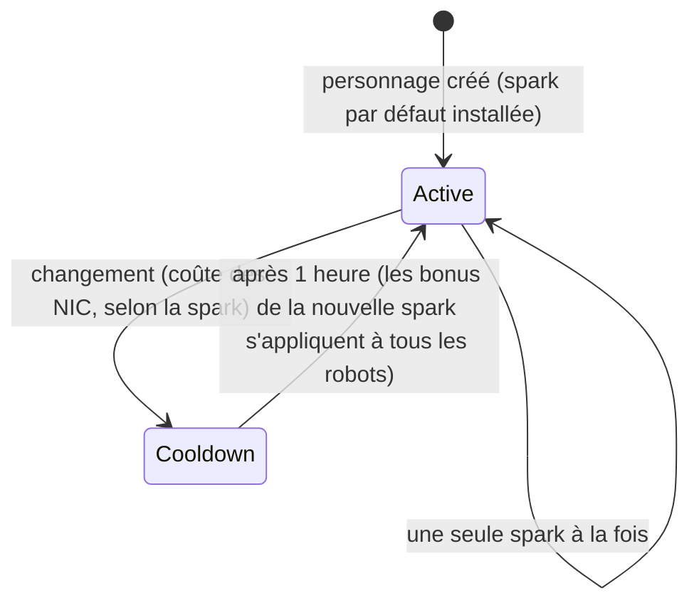

# Sparks

Une **spark** est une spécialisation nanotechnologique installée sur votre personnage. Tant qu'elle est
active, ses bonus s'appliquent à tous les robots que vous pilotez — la spark d'une ligne de
combat d'une faction, par exemple, augmente les dégâts des armes et les chances de coup critique niveau
par niveau, tandis qu'une ligne industrielle augmente la capacité du core et le rendement minier.

Chaque personnage dispose d'une **spark par défaut** attribuée à sa création. Au-delà de cela, les sparks
se déclinent en familles — les lignes de base par défaut, les lignes de combat/industrielles/sociales
par faction (trois niveaux chacune), les lignes payantes du Syndicat et les lignes spéciales limitées
— et les bonus exacts d'une spark ne sont qu'un ensemble de niveaux de compétences fixes que vous pouvez
consulter sur la [page des extensions](/fr/content/extensions/). L'[aperçu des familles ci-dessous](#familles-de-sparks)
permet d'accéder directement aux sparks de chaque famille.

## Déverrouiller (autoriser) une spark

Installer une spark que vous ne possédez pas encore nécessite d'abord de la **déverrouiller** (à quai
uniquement). Selon la spark, le serveur vérifie :

- un **prix** en NIC (les lignes payantes — par ex. les sparks utilitaires du Syndicat et les
  sparks spéciales limitées),
- le **standing** auprès de la mégacorporation fondatrice (les lignes spécifiques aux factions nécessitent un
  standing minimum auprès de la mégacorp de cette faction, accumulé en accomplissant ses
  [missions](/fr/features/missions/)),
- ou un **objet** prélevé dans votre inventaire (certaines sparks spéciales sont déverrouillées
  avec un objet clé).

Le déverrouillage est définitif : une fois déverrouillée, la spark reste dans votre collection.

## Changer de spark

- Vous ne pouvez avoir qu'**une seule spark active** à la fois ; en installer une autre la remplace.
- Chaque changement **coûte des NIC** — le montant dépend de la spark (les lignes courantes coûtent
  10k, les lignes spéciales payantes jusqu'à un million).
- Il existe un **temps de recharge d'une heure** entre les changements : le serveur enregistre l'heure à laquelle
  votre spark actuelle a été activée et refuse tout nouveau changement avant la fin de l'heure.

Puisqu'un changement coûte toujours des NIC et prend une heure, choisissez la spark qui correspond
à l'activité à laquelle vous consacrez le plus de temps, et traitez la respécialisation comme
une décision occasionnelle plutôt que par session.
<!-- sparkfamilies:generated -->

## Familles de sparks

Les 47 sparks réparties en 6 familles en un coup d'œil : un encadré par famille (nombre de sparks, mode de déverrouillage de la ligne), dans l'ordre où les lignes ont été ajoutées (de gauche à droite, de haut en bas). **Cliquez sur un encadré pour accéder directement aux sparks de cette famille ci-dessous.** **Faites défiler le curseur sur le diagramme pour zoomer**, faites glisser pour déplacer la vue, et utilisez le bouton ⟲ pour réinitialiser.

<button type="button" class="zoommap-reset" title="Réinitialiser le zoom">⟲</button>
<svg class="zoommap" xmlns="http://www.w3.org/2000/svg" viewBox="0 0 1008 278" width="960" height="264" role="img" aria-label="Familles de sparks : 6 familles, 47 sparks ; cliquez sur une famille pour accéder à ses sparks ci-dessous">
  <rect x="0" y="0" width="1008" height="278" fill="#10151f" stroke="#39445a" stroke-width="1"/>
  <g><title>Événement &amp; spécial : 9 sparks, déverrouillage gratuit</title><a href="#family-special"><rect x="24" y="40" width="300" height="84" rx="10" fill="#10151f" stroke="#c8d2e0" stroke-width="1.5"/><text x="174" y="68" text-anchor="middle" fill="#e8eefc" font-size="15" font-weight="700">Événement &amp; spécial</text><text x="174" y="92" text-anchor="middle" fill="#c8d2e0" font-size="12">9 sparks · gratuit</text></a></g>
  <g><title>TM (Truhold-Markson) : 9 sparks, déverrouillage par standing TM</title><a href="#family-tm"><rect x="354" y="40" width="300" height="84" rx="10" fill="#10151f" stroke="#41d3ff" stroke-width="1.5"/><text x="504" y="68" text-anchor="middle" fill="#e8eefc" font-size="15" font-weight="700">TM (Truhold-Markson)</text><text x="504" y="92" text-anchor="middle" fill="#41d3ff" font-size="12">9 sparks · standing TM</text></a></g>
  <g><title>ICS : 9 sparks, déverrouillage par standing ICS</title><a href="#family-ics"><rect x="684" y="40" width="300" height="84" rx="10" fill="#10151f" stroke="#6ee7a0" stroke-width="1.5"/><text x="834" y="68" text-anchor="middle" fill="#e8eefc" font-size="15" font-weight="700">ICS</text><text x="834" y="92" text-anchor="middle" fill="#6ee7a0" font-size="12">9 sparks · standing ICS</text></a></g>
  <g><title>ASI : 9 sparks, déverrouillage par standing ASI</title><a href="#family-asi"><rect x="24" y="154" width="300" height="84" rx="10" fill="#10151f" stroke="#f5a05a" stroke-width="1.5"/><text x="174" y="182" text-anchor="middle" fill="#e8eefc" font-size="15" font-weight="700">ASI</text><text x="174" y="206" text-anchor="middle" fill="#f5a05a" font-size="12">9 sparks · standing ASI</text></a></g>
  <g><title>Syndicat (NIC) : 5 sparks, déverrouillage avec prix en NIC</title><a href="#family-syndicate"><rect x="354" y="154" width="300" height="84" rx="10" fill="#10151f" stroke="#a78bfa" stroke-width="1.5"/><text x="504" y="182" text-anchor="middle" fill="#e8eefc" font-size="15" font-weight="700">Syndicat (NIC)</text><text x="504" y="206" text-anchor="middle" fill="#a78bfa" font-size="12">5 sparks · prix en NIC</text></a></g>
  <g><title>Limitées : 6 sparks, déverrouillage avec prix en NIC</title><a href="#family-limited"><rect x="684" y="154" width="300" height="84" rx="10" fill="#10151f" stroke="#f472b6" stroke-width="1.5"/><text x="834" y="182" text-anchor="middle" fill="#e8eefc" font-size="15" font-weight="700">Limitées</text><text x="834" y="206" text-anchor="middle" fill="#f472b6" font-size="12">6 sparks · prix en NIC</text></a></g>
</svg>

### Événement &amp; spécial (9)

Déverrouillage : aucun — ce sont les lignes de base par défaut. Chaque changement coûte des NIC (le montant dépend de la spark, voir les cartes) et nécessite un temps de recharge d'une heure — voir [Changer de spark](#switching-sparks) ci-dessus.

ww

déverrouillage gratuit · changement 10k NIC

Spark par défaut — installée à la création du personnage

wi

déverrouillage gratuit · changement 10k NIC

Spark par défaut — installée à la création du personnage

ws

déverrouillage gratuit · changement 10k NIC

Spark par défaut — installée à la création du personnage

iw

déverrouillage gratuit · changement 10k NIC

Spark par défaut — installée à la création du personnage

ii

déverrouillage gratuit · changement 10k NIC

Spark par défaut — installée à la création du personnage

is

déverrouillage gratuit · changement 10k NIC

Spark par défaut — installée à la création du personnage

sw

déverrouillage gratuit · changement 10k NIC

Spark par défaut — installée à la création du personnage

si

déverrouillage gratuit · changement 10k NIC

Spark par défaut — installée à la création du personnage

ss

déverrouillage gratuit · changement 10k NIC

Spark par défaut — installée à la création du personnage

### TM (Truhold-Markson) (9)

Déverrouillage : standing auprès de la mégacorporation TM (2 → 4 → 6 selon le niveau). Chaque changement coûte des NIC (le montant dépend de la spark, voir les cartes) et nécessite un temps de recharge d'une heure — voir [Changer de spark](#switching-sparks) ci-dessus.

Combat Lvl1

déverrouillage standing 2 auprès de TM · changement 10k NIC

Regroupe 2 niveaux d'extension

Combat Lvl2

déverrouillage standing 4 auprès de TM · changement 100k NIC

Regroupe 3 niveaux d'extension

Combat Lvl3

déverrouillage standing 6 auprès de TM · changement 1M NIC

Regroupe 3 niveaux d'extension

Indy Lvl1

déverrouillage standing 2 auprès de TM · changement 10k NIC

Regroupe 2 niveaux d'extension

Indy Lvl2

déverrouillage standing 4 auprès de TM · changement 100k NIC

Regroupe 3 niveaux d'extension

Indy Lvl3

déverrouillage standing 6 auprès de TM · changement 1M NIC

Regroupe 3 niveaux d'extension

Social Lvl1

déverrouillage standing 2 auprès de TM · changement 10k NIC

Regroupe 2 niveaux d'extension

Social Lvl2

déverrouillage standing 4 auprès de TM · changement 100k NIC

Regroupe 3 niveaux d'extension

Social Lvl3

déverrouillage standing 6 auprès de TM · changement 1M NIC

Regroupe 3 niveaux d'extension

### ICS (9)

Déverrouillage : standing auprès de la mégacorporation ICS (2 → 4 → 6 selon le niveau). Chaque changement coûte des NIC (le montant dépend de la spark, voir les cartes) et nécessite un temps de recharge d'une heure — voir [Changer de spark](#switching-sparks) ci-dessus.

Combat Lvl1

déverrouillage standing 2 auprès d'ICS · changement 10k NIC

Regroupe 2 niveaux d'extension

Combat Lvl2

déverrouillage standing 4 auprès d'ICS · changement 100k NIC

Regroupe 3 niveaux d'extension

Combat Lvl3

déverrouillage standing 6 auprès d'ICS · changement 1M NIC

Regroupe 3 niveaux d'extension

Indy Lvl1

déverrouillage standing 2 auprès d'ICS · changement 10k NIC

Regroupe 2 niveaux d'extension

Indy Lvl2

déverrouillage standing 4 auprès d'ICS · changement 100k NIC

Regroupe 3 niveaux d'extension

Indy Lvl3

déverrouillage standing 6 auprès d'ICS · changement 1M NIC

Regroupe 3 niveaux d'extension

Social Lvl1

déverrouillage standing 2 auprès d'ICS · changement 10k NIC

Regroupe 2 niveaux d'extension

Social Lvl2

déverrouillage standing 4 auprès d'ICS · changement 100k NIC

Regroupe 3 niveaux d'extension

Social Lvl3

déverrouillage standing 6 auprès d'ICS · changement 1M NIC

Regroupe 3 niveaux d'extension

### ASI (9)

Déverrouillage : standing auprès de la mégacorporation ASI (2 → 4 → 6 selon le niveau). Chaque changement coûte des NIC (le montant dépend de la spark, voir les cartes) et nécessite un temps de recharge d'une heure — voir [Changer de spark](#switching-sparks) ci-dessus.

Combat Lvl1

déverrouillage standing 2 auprès d'ASI · changement 10k NIC

Regroupe 2 niveaux d'extension

Combat Lvl2

déverrouillage standing 4 auprès d'ASI · changement 100k NIC

Regroupe 3 niveaux d'extension

Combat Lvl3

déverrouillage standing 6 auprès d'ASI · changement 1M NIC

Regroupe 3 niveaux d'extension

Indy Lvl1

déverrouillage standing 2 auprès d'ASI · changement 10k NIC

Regroupe 2 niveaux d'extension

Indy Lvl2

déverrouillage standing 4 auprès d'ASI · changement 100k NIC

Regroupe 3 niveaux d'extension

Indy Lvl3

déverrouillage standing 6 auprès d'ASI · changement 1M NIC

Regroupe 3 niveaux d'extension

Social Lvl1

déverrouillage standing 2 auprès d'ASI · changement 10k NIC

Regroupe 5 niveaux d'extension

Social Lvl2

déverrouillage standing 4 auprès d'ASI · changement 100k NIC

Regroupe 6 niveaux d'extension

Social Lvl3

déverrouillage standing 6 auprès d'ASI · changement 1M NIC

Regroupe 6 niveaux d'extension

### Syndicat (NIC) (5)

Déverrouillage : un prix en NIC (1M par spark). Chaque changement coûte des NIC (le montant dépend de la spark, voir les cartes) et nécessite un temps de recharge d'une heure — voir [Changer de spark](#switching-sparks) ci-dessus.

Syndicate Nic Combat

déverrouillage 1M NIC · changement 100k NIC

Regroupe 2 niveaux d'extension

Syndicate Nic Scout

déverrouillage 1M NIC · changement 100k NIC

Regroupe 2 niveaux d'extension

Syndicate Nic Coreboost

déverrouillage 1M NIC · changement 100k NIC

Regroupe 2 niveaux d'extension

Syndicate Nic Allresist

déverrouillage 1M NIC · changement 100k NIC

Regroupe 4 niveaux d'extension

Syndicate Nic Fitboost

déverrouillage 1M NIC · changement 100k NIC

Regroupe 2 niveaux d'extension

### Limitées (6)

Déverrouillage : un prix en NIC (25–50M par spark). Chaque changement coûte des NIC (le montant dépend de la spark, voir les cartes) et nécessite un temps de recharge d'une heure — voir [Changer de spark](#switching-sparks) ci-dessus.

Anniversary Combat

déverrouillage 25M NIC · changement 1M NIC

Regroupe 6 niveaux d'extension

Anniversary Logistic

déverrouillage 25M NIC · changement 1M NIC

Regroupe 6 niveaux d'extension

Amazon c1 Combat

déverrouillage 25M NIC · changement 1M NIC

Regroupe 2 niveaux d'extension

Amazon c1 Indy

déverrouillage 25M NIC · changement 1M NIC

Regroupe 2 niveaux d'extension

Steam a

déverrouillage 50M NIC · changement 1M NIC

Regroupe 2 niveaux d'extension

Steam b

déverrouillage 50M NIC · changement 1M NIC

Regroupe 2 niveaux d'extension

<!--
Écrit à partir de zéro d'après le backend du serveur, 27-09-2026 :
RequestHandlers/Sparks/SparkUnlock.cs (règles de déverrouillage : prix, standing, objet),
RequestHandlers/Sparks/SparkChange.cs + Services/Sparks/SparkHelper.cs
(temps de recharge de changement de 60 minutes, prix de changement par spark),
Services/Sparks/Spark.cs, tables sparks + sparkextensions (47 sparks, paquets de
bonus par ligne).
Une version antérieure de cette page a été adaptée du wiki communautaire d'Open Perpetuum
(perpetuum.miraheze.org) et a été entièrement réécrite à partir des sources du backend ;
aucun texte n'a été réutilisé.
-->
