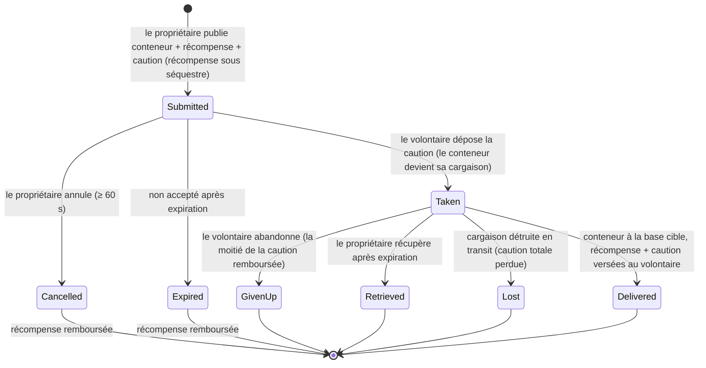

# Transport (expédition d'objets)

Une **mission de transport** déplace un conteneur d'objets d'une base à une autre, grâce à un
**transporteur volontaire** qui est rémunéré. Il s'agit d'un marché bilatéral : le **propriétaire** publie une
expédition, un **volontaire** la prend en charge et la livre.

> Les emplacements dans l'interface suivent la [vue d'ensemble de l'interface client](/fr/features/ui/) (la catégorie **Assignments** [Missions] dans la
> barre supérieure). Les mécaniques ci-dessous sont confirmées d'après le serveur.

## Les deux parties

- **Propriétaire (donneur d'ordre)** — publie une expédition : un conteneur à déplacer, d'une **base de départ**
  vers une **base de destination**, pour une **récompense**, avec une **caution**, sur une certaine **durée**.
- **Volontaire (transporteur)** — prend en charge la mission, transporte le conteneur et le livre.

## Publier un transport (propriétaire)

**Soumettez un transport** avec :
- le **conteneur** (un emballage volumétrique) à expédier,
- la **récompense** que vous versez à la livraison,
- la **caution** (une garantie financière déposée par le transporteur),
- la **base de départ** et la **base de destination**,
- une **durée** (en jours) pendant laquelle la mission reste ouverte.

Lors de la soumission, la **récompense est prélevée** sur votre portefeuille (mise sous séquestre / escrow).

## Prendre en charge un transport (volontaire)

- **Prenez en charge** une mission — vous déposez la **caution** sous forme de garantie, et le conteneur
  devient votre cargaison à transporter.

## Livraison & récupération

- **Livrer** — amenez le conteneur à la base de destination. À la livraison, le **volontaire reçoit la
  récompense + la caution**, et le propriétaire reçoit les biens.
- **Récupérer** — le propriétaire (ou le volontaire, dans le cas approprié) rapatrie le
  conteneur vers une base ; lors de la récupération, la **caution est restituée** et la **récompense
  est remboursée** au propriétaire.

## Annuler / abandonner

- **Annuler** — annule la mission.
- **Abandonner** — le volontaire abandonne la mission. L'abandon applique une **pénalité sur la caution** :
  seule la **moitié** de la caution est remboursée (le reste est perdu) — la constante de pénalité
  est de 0,5 dans `TransportAssignment.cs`.

## Inspection

- **Lister** les transports, **consulter le contenu** d'un transport, **informations sur le conteneur**, **est-il en cours ?**,
  et le **journal des transports**.

## Flux financier (en un coup d'œil)

La **récompense** est le paiement du propriétaire, mis sous séquestre lors de la soumission et versé uniquement à la livraison.
La **caution** est la garantie du volontaire : versée au propriétaire lors de la prise en charge, conservée tant que la
cargaison est en transit, et restituée (avec la récompense) à la livraison.

| Événement | Condition | Propriétaire | Volontaire | Conteneur |
|---|---|---|---|---|
| Soumission | — | récompense sous séquestre | — | déplacé vers le stockage de transport |
| Prise en charge | non accepté | reçoit le dépôt de caution | paie la caution | devient la cargaison du volontaire |
| Livraison | à la base cible | marchandises reçues | payé **récompense + caution** | livré |
| Annulation | non accepté, ≥ 60 s après soumission | récompense remboursée | — | retour à la base d'origine |
| Abandon | pris en charge | récompense remboursée | **moitié** de caution remboursée (pénalité de 0,5) | retour à la base d'origine |
| Expiration | non accepté, délai dépassé | récompense remboursée | — | retour à la base d'origine |
| Récupération | pris en charge **et** délai dépassé | récompense remboursée | — | retour à la base d'origine (immédiatement si amarré, sinon au prochain amarrage du volontaire) |
| Cargaison détruite | en transit | récompense remboursée **+ caution totale** | caution totale perdue | perdu |

## Remarques pratiques

- **Aucuns frais annexes** — le seul argent en mouvement est la récompense et la caution.
- **La récompense est sous séquestre** — le propriétaire ne peut pas la dépenser tant que le transport n'est pas résolu.
- **La caution est la garantie du transporteur** — la déposer est ce qui vous permet de prendre en charge une expédition ;
  perdre la cargaison en transit entraîne la perte de la **totalité** du montant.
- **Abandonner coûte cher** — abandonner un transport vous fait perdre la moitié de votre caution.
- **La durée compte, mais seulement tant que la mission n'est pas acceptée** — le délai d'expiration défini lors de la soumission ne
  ferme automatiquement que les missions que personne n'a prises en charge (le serveur nettoie les missions non acceptées expirées
  toutes les heures). Une mission **prise en charge** n'expire jamais d'elle-même ; l'issue de secours du propriétaire est la commande
  **Récupérer**, qui devient disponible dès que l'expiration est passée et rappelle la cargaison (et la récompense) vers la base d'origine —
  immédiatement si le transporteur est amarré, ou automatiquement lors de son prochain amarrage.
- **Vérifiez le contenu avant de prendre en charge** — inspectez ce qui se trouve dans le conteneur et vérifiez l'itinéraire.

<!-- TODO: only the client UI remains (assignments screen layout).
     Money model confirmed: reward escrowed at submit (CashInOnSubmit), collateral paid
     by the volunteer on take (TakeCollateral -> PayCollateralToPrincipal), delivery pays
     volunteer reward+collateral (PayOutReward); cancel needs 60s after creation;
     expiry = submit time + client duration days (<=0 -> 1), cleaned hourly by
     MissionProcessor (_transportAssignmentInterval 1h), taken=0 only; retrieve requires
     expiry passed + taken, auto-completes on next dock; destroyed cargo refunds reward
     and forfeits full collateral to the owner.
     Developer notes: TransportAssignments/TransportAssignmentSubmit.cs;
     Services/MissionEngine/TransportAssignments/TransportAssignment.cs (reward/collateral
     escrow, PayOutReward = reward+collateral, PaybackCollateral, PaybackHalfCollateral
     = COLLATERAL_PENALTY on give-up, RetrieveToBasePublicContainer, expiry);
     TransportAssignmentTake/Deliver/Retrieve/Cancel/GiveUp/List/ListContent/
     ContainerInfo/Running/Log. -->
