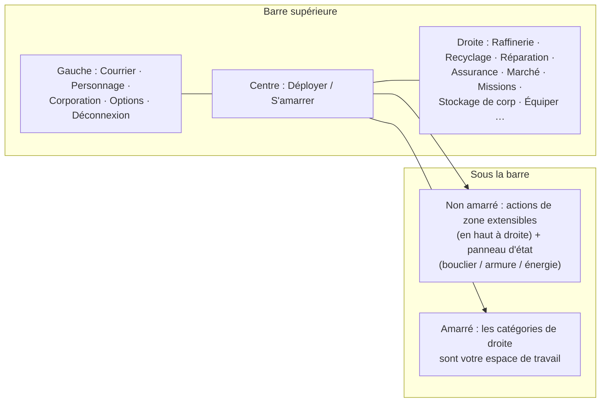

# Vue d'ensemble de l'interface client

Le client propose une interface dans le style d'**EVE Online** : une vue plein écran de l'espace/zone avec
des fenêtres flottantes, **redimensionnables et déplaçables**, qui peuvent être **fermées et rouvertes** à volonté.
L'intégration s'effectue système par système — voir les pages liées ci-dessous.

> Cette disposition est un modèle de travail fourni par le projet, utilisé pour décrire l'emplacement des
> actions. Les intitulés exacts à l'écran peuvent différer légèrement ; la structure fait référence.

## La barre supérieure

Une barre persistante s'étendant sur toute la largeur supérieure de l'écran.

| Zone | Contenu |
|---|---|
| **Gauche** | Boutons principaux : **Courrier** (Mail), **Personnage** (Character), **Corporation**, autres **Options** et **Déconnexion** (Disconnect) |
| **Centre** | Le bouton **Déployer / S'amarrer** (Deploy / Dock) — votre bascule principale amarré⇄non amarré (voir [déplacement](/fr/features/movement/)) |
| **Droite** | Catégories d'actions sous forme de boutons : **Raffinerie**, **Recyclage**, **Réparation**, **Assurance**, **Marché**, **Missions** (Assignments / transports), **Stockage de corp**, **Équiper**, … |

Les catégories de droite ouvrent leurs fenêtres système respectives :

| Bouton | Ouvre / effectue | Page du wiki |
|---|---|---|
| Raffinerie | Traiter les ressources brutes en composants | [production](/fr/features/production/) |
| Recyclage | Décomposer les objets en matériaux de base | [production](/fr/features/production/) |
| Réparation | Réparer les robots/modules endommagés | [production](/fr/features/production/) |
| Assurance | Polices d'assurance de robots/production | [production](/fr/features/production/) |
| Marché | Ordres de marché et achats directs | [marché](/fr/features/market/) |
| Missions (Assignments) | Missions de transport (expéditions) | [transport](/fr/features/transport/) |
| Stockage de corp | Hangar/stockage de la corporation | [groupes](/fr/features/groups/) |
| Équiper | Installer des modules et munitions sur votre robot actif | [robots](/fr/features/robots/) |

## État amarré (Docked)

Tant que vous êtes **amarré**, les catégories d'actions situées sur la droite constituent votre espace de travail
principal : vous pouvez raffiner, commercer, équiper et gérer vos stocks sans quitter la base. Le bouton Déployer
(Deploy) vous désamarre dans la zone (voir [déplacement](/fr/features/movement/) pour les conditions préalables
au désamarrage).

## État non amarré (Undocked)

Lorsque vous êtes **non amarré** (en pilotant votre robot actif dans une zone) :

- La zone **en haut à droite** gagne un **bouton d'actions extensible** : cliquez dessus pour dérouler vers le bas
  une liste d'actions de zone supplémentaires (analyse, récolte/interactions, outils de zone — les actions documentées
  dans [récolte](/fr/features/gathering/) et [combat](/fr/features/combat/)).
- Le **panneau d'état principal** affiche l'état de votre robot : **bouclier, armure/coque, énergie**, ainsi que le
  statut de combat associé — les mêmes données auxquelles votre page de [combat](/fr/features/combat/) fait référence
  (par ex. la vérification de « système d'énergie intact » pour le désamarrage).
- Les catégories réservées aux bases (raffinerie, marché, …) sont indisponibles jusqu'à votre prochain amarrage.

## Fenêtres courantes

La plupart des systèmes s'ouvrent dans une fenêtre flottante standard : barre de titre, bouton de fermeture, bordures
redimensionnables, contenu sous forme d'onglets ou de listes. Les systèmes récurrents (inventaire/conteneurs, marché,
lignes de production) peuvent avoir plusieurs fenêtres ouvertes simultanément.

- **Inventaire / conteneurs** — lister un conteneur, déplacer/empiler/emballer des objets, renommer, jeter — voir
  [objets](/fr/features/items/).
- **Fenêtre du personnage** (bouton en haut à gauche) — profil, extensions (recherche), paramètres, crédits — voir
  [pour commencer](/fr/features/getting-started/) et [recherche](/fr/features/research/).
- **Fenêtre de corporation** (bouton en haut à gauche) — informations sur la corporation, hangar, documents, votes,
  bulletin — voir [groupes](/fr/features/groups/).
- **Fenêtre de messagerie** (bouton en haut à gauche) — courrier personnel et courriers groupés — voir
  [social](/fr/features/social/).

## Conventions utilisées dans ce wiki

- **« Barre supérieure → X »** = le bouton nommé X sur la barre supérieure.
- **« Actions non amarré »** = la liste déroulante en haut à droite lorsque vous êtes dans une zone.
- **Bouton Déployer / S'amarrer** = la bascule centrale de la barre supérieure.

<!-- Remarque : cette page constitue le modèle d'interface convenu (fourni par le projet). Si le véritable client
     diffère dans le nom ou l'emplacement des boutons, mettez d'abord à jour cette page — toutes les autres
     pages de features/ font référence aux conventions définies ici. -->
