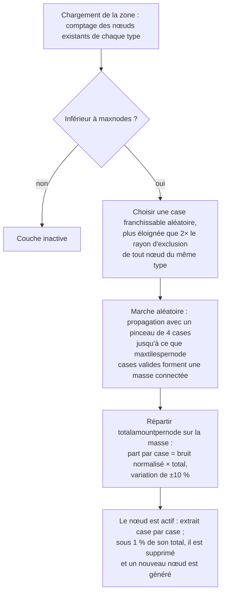

# Génération des ressources de zone

Cette page explique comment le serveur maintient approvisionnées les ressources d'une zone. Les deux systèmes fonctionnent
en continu en arrière-plan pendant que la zone est chargée ; aucune action d'un joueur n'est
requise pour qu'ils s'exécutent.

## La configuration des ressources de la zone

Chaque zone est configurée dans la base de données avec deux listes indépendantes :

- **Configuration des minerais** (`mineralconfigs`) — une ligne par type de minerai présent dans la zone,
  avec quatre paramètres par type :
  | Colonne | Signification |
  |---|---|
  | `maxnodes` | Nombre de nœuds de ce type maintenus par la zone |
  | `maxtilespernode` | Nombre maximal de cases qu'un seul nœud peut couvrir |
  | `totalamountpernode` | Quantité totale de matériau dans un nœud neuf, répartie sur ses cases |
  | `minthreshold` | Ratio de remplissage minimal par case (0–1) ; les cases inférieures après extraction sont éliminées |
- **Configuration des plantes** (`zones.fertility` + un jeu de règles végétales) — l'objectif de couverture
  végétale de la zone (un pourcentage) et la liste des espèces de plantes autorisées à y pousser
  (le comportement de chaque espèce est consigné dans un fichier de règles documenté dans
  [Plantes](/fr/content/plants/)).

Les zones sans configuration de minerai (arènes, zones d'entraînement, forteresses, certaines zones
gamma) ne possèdent aucune couche de minerai.

## Nœuds de minerai

### Comment un nœud est placé

Lorsqu'une zone se charge, la couche de chaque type de minerai compte ses nœuds existants (conservés dans la
table `mineralnodes`) et en génère de nouveaux jusqu'à ce que `maxnodes` soit atteint. Un nouveau nœud est
placé par une **marche aléatoire** :

1. Choisir une case franchissable aléatoire.
2. Elle doit être éloignée du nœud existant le plus proche du même type — le rayon d'exclusion
   est dérivé de `maxtilespernode` (`√(maxtilespernode/π) × 2`, puis le point de départ
   doit être au moins deux fois plus éloigné), de sorte que les nœuds ne fusionnent jamais en un unique gisement géant.
3. À partir de la case initiale, une marche se propage aléatoirement vers l'extérieur (un pinceau de 4 cases à la fois),
   rassemblant jusqu'à `maxtilespernode` cases valides en une masse connectée.
4. Le matériau `totalamountpernode` du nœud est réparti sur la masse : la part de chaque case
   est sa valeur de bruit (normalisée) multipliée par le total, avec une variation aléatoire de ±10 %, afin qu'aucun
   nœud du même type ne se ressemble.

Une case n'est valide pour un nœud que si elle se trouve à l'intérieur de la zone, n'est pas une île, n'est pas
protégée par la terraformation PBS et est franchissable. Deux types rares bénéficient de **zones d'exclusion** autour
des bases d'amarrage et des téléporteurs : l'**épriton** conserve une distance minimale, et le **minerai flux**
conserve le double de cette distance — le minerai flux ne se trouve donc jamais juste à côté d'une base.

### Comment un nœud est consommé

- L'extraction retire du matériau case par case.
- Un nœud qui tombe sous **1 % de son total configuré** est supprimé, et un nouveau nœud
  est généré (retour à l'étape 1) pour maintenir la zone à `maxnodes`.
- Les nœuds de minerai flux déclenchent en outre l'**apparition de PNJ** — les nœuds en cours d'extraction (ou supprimés)
  publient des événements écoutés par le système de PNJ, ce qui explique pourquoi les sites de minerai flux attirent
  l'attention.

## Plantes

### Le balayage de la végétation

La zone est divisée en blocs de **32×32 cases**. Un gestionnaire de plantes parcourt ces cases dans l'ordre,
en traitant une par tick, à un rythme réglé pour qu'un **passage complet sur la zone prenne environ 8 heures**
(paramétrable par zone). Chaque « cube » de 32×32 est traité par un pipeline fixe :

1. **Valider** — éliminer les plantes non valides (mauvais sol, mortes, hors de propos).
2. **Croître** — faire progresser chaque plante à travers ses stades de croissance (voir
   [collecte](/fr/features/gathering/) pour `growRate` et la fructification).
3. **Apparaître** — ajouter de nouvelles plantes lorsque le cube est sous son objectif de fertilité.
4. **Endommager les murs** — la hauteur de blocage des plantes diminue avec le temps.
5. **Éliminer par distance** — appliquer l'espacement entre plantes du même type (`killDistance`).
6. **Renouveler le matériau** — une petite quantité de fruits se régénère.

### Comment une nouvelle plante est choisie

Une case ne peut germer que si le fichier de zone lui attribue un **potentiel d'apparition** (un octet par case
intégré dans la couche végétale de la zone — 0 signifie que la case ne germe jamais). À chaque tick, pour
chaque case éligible :

- **Vérification préalable de la fertilité de la zone** : si la couverture en plantes bloquantes du cube atteint déjà
  `fertility%` de ses cases de sol, rien de nouveau n'y apparaît.
- **Chance par case** : un tirage aléatoire doit battre le potentiel d'apparition de la case.
- **Sélection de l'espèce** :
  - Si la case n'a **aucun voisin végétal**, l'espèce est choisie par un tirage aléatoire pondéré
    où le poids de chaque espèce autorisée est sa `fertilité` (les espèces semées par les joueurs sont
    exclues des apparitions naturelles).
  - Si elle en **possède**, c'est un pile ou face : 50 % de chances pour l'espèce voisine actuellement *dominante*
    (la plus fréquente à proximité), 50 % pour un tirage de **propagation** pondéré par
    `(nombre de voisins × spreading)` pour chaque espèce — c'est ce qui fait que les massifs
    s'étendent avec leur propre espèce.
- **Plafonds et espacement** : une espèce dotée d'un plafond `maxAmount` est ignorée dès que la zone en compte
  suffisamment, et une case située à moins de `killDistance` d'une autre plante du même type est
  ignorée.

### Ce que cela signifie pour les joueurs

- La densité végétale est limitée par la fertilité de la zone — vous ne verrez jamais une zone avec
  une couverture végétale de 100 % si sa fertilité est de 20.
- Les massifs sont la norme : la propagation incite chaque espèce à étendre ses propres parcelles, si bien qu'une
  zone tend vers des territoires d'espèces plutôt qu'un mélange disparate.
- Les espèces soumises à `killDistance` (par exemple certaines plantes de grande valeur) sont régulièrement espacées, ce qui
  rend leurs emplacements prévisibles dès que vous en trouvez une.
- De nouveaux nœuds apparaissent là où la marche aléatoire aboutit — il n'y a pas d'« emplacement de minerai » fixe sur une
  zone ; le scan est nécessaire (voir [collecte](/fr/features/gathering/)).

<!-- Developer notes: TerrainsModule.cs (per-zone layer construction: OreLayer for
     Solid, LiquidLayer for Liquid, GravelLayer for TrainingZone; LoadMineralNodes
     top-up); MineralLayer.cs (LoadMineralNodes: delete <1% nodes, generate to
     maxnodes; FluxOre -> OreNpcSpawnMessage on decrease/expiry);
     Generators/MineralNodeGeneratorBase.cs (FindStartPosition keep-out + spacing,
     NormalizeNoise, CreateMineralNode jitter); RandomWalkMineralNodeGenerator.cs
     (flood-fill brush 4, 50k step cap); MineralNodeRepository.cs (mineralnodes table,
     compressed per-tile values); PlantHandler.cs (32x32 areas, 8h full pass,
     PlantsGrowthTimerOverrideMin, scanner modes); NatureCube.cs (ProcessAll pipeline,
     SpawnPlants fertility/spawn/killDistance logic, GetNewPlantRule 50/50 ruling vs
     spreading); PlantRuleExtensions.cs (fertility-weighted + spreading-weighted
     draws); PlantInfo.cs (per-tile spawn byte comes from the zone's plant layer
     file, never assigned by server code). -->
