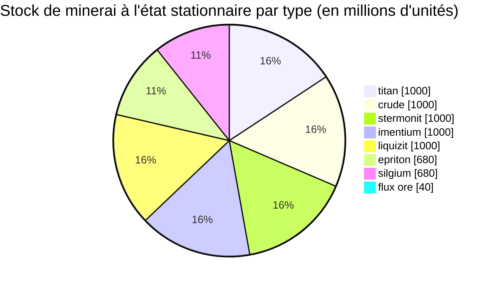

# Daoden (zone_ASI) — exemple concret

  <a href="/fr/zones/map/">
    
    <strong>Carte du monde</strong> — où se situe cette zone parmi toutes les autres, avec les liaisons de téléportation. Ouvrir la carte complète.
  </a>

Emplacement des colonnes de téléportation de cette zone (points, étiquetés avec la destination — estompés lorsque
la colonne est actuellement désactivée), les points d'arrivée des téléportations provenant d'autres
zones (cercles en pointillés), et les portes de sortie (losanges) lorsqu'il en existe. Les positions sont les
coordonnées de cases enregistrées par le serveur.
Les lignes en pointillés relient les paires de colonnes de téléportation locales (au sein de la zone).

Une zone **PvP ouverte** de niveau alpha — la configuration de minerai la plus riche du jeu et
le lieu où résident les types rares. Tout ce que possède New Virginia, plus l'épriton, le silgium et
les sites de minerai flux qui attirent les attaques de PNJ.

| Fait | Valeur |
|---|---|
| Identifiant de zone | 2 |
| Type | PvP (ouvert) |
| Protection | [Bêta](/fr/zones/protection/) — PvP ouvert, terrain standard |
| Taille | 2048 × 2048 cases |
| Fertilité | 20 |
| Jeu de règles végétales | 2 — 19 espèces (dont récoltables de haut niveau) |
| Types de minerai | 8 (titan, crude, stermonit, imentium, liquizit, epriton, silgium, flux ore) |
| Total des nœuds de minerai | 64 (8 par type) |

## Configuration des minerais

| Matériau | Nœuds | Max cases/nœud | Total par nœud | Seuil minimal |
|---|---|---|---|---|
| [titan](/fr/content/ores/titan/) | 8 | 500 | 125,000,000 | 0.5 |
| [crude](/fr/content/ores/crude/) | 8 | 1257 | 125,000,000 | 0.5 |
| [stermonit](/fr/content/ores/stermonit/) | 8 | 500 | 125,000,000 | 0.5 |
| [imentium](/fr/content/ores/imentium/) | 8 | 500 | 125,000,000 | 0.5 |
| [liquizit](/fr/content/ores/liquizit/) | 8 | 500 | 125,000,000 | 0.5 |
| [epriton](/fr/content/ores/epriton/) | 8 | 500 | 85,000,000 | 0.5 |
| [silgium](/fr/content/ores/silgium/) | 8 | 500 | 85,000,000 | 0.5 |
| [fluxore](/fr/content/ores/fluxore/) | 8 | 300 | 5,000,000 | 0.5 |

Points marquants :

- **8× plus de nœuds que New Virginia**, mais chaque nœud est plus petit (500 cases contre 1 000) : le
  rayon de marche tombe de 34 à 24 cases pour les minerais standards. Le scan compte davantage
  ici — les gisements sont plus fins et plus nombreux.
- **L'épriton et le silgium** comportent des totaux réduits (85 M contre 125 M) — une plus grande valeur, un stock
  plus rare. L'épriton conserve en outre une **distance minimale par rapport aux bases et téléporteurs**, de
  sorte que ses nœuds ne se trouvent jamais sur un point d'apparition.
- **Le minerai flux est le cas extrême** : seulement 5 M par nœud sur 300 cases (~16 600 par
  case — un filet, pas un gisement), 8 nœuds, et une zone d'exclusion de **deux fois** la
  distance d'épriton par rapport aux bases. Extraire un nœud de flux diffuse des événements d'apparition au système
  de PNJ — les sites de flux sont disputés par conception (voir les [systèmes d'intrusion et de PNJ](/fr/features/intrusion/)).
- Stock en régime stationnaire : ~6,4 milliards d'unités de matériau au total.

## Mélange végétal

Le jeu de règles 2 autorise 19 espèces — le mélange alpha complet : les basiques, plus **devrinol**,
**wall**, **titanplant**, et les **récoltables de haut niveau** (high electroplant, high
iron tree, high rustbush, high slimeroot). La fertilité est toujours de 20, la densité est donc
identique à celle de New Virginia — ce qui change est *quelles* espèces peuvent remporter le tirage de fertilité. Les
poids de `fertility` propres aux récoltables de haut niveau déterminent la fréquence à laquelle ils supplantent
les herbes.

Les règles par espèce se trouvent dans [Plantes](/fr/content/plants/) ; les rendements par minerai dans
[Minerais](/fr/content/ores/).

## Ce que cela signifie pour un joueur

- L'ensemble de la hiérarchie des minerais est disponible, y compris l'économie du minerai flux — mais c'est du PvP
  ouvert, donc tout ce que vous extrayez peut être pillé (voir
  [transport](/fr/features/transport/) pour déplacer des biens en sécurité entre bases).
- Attendez-vous à une pression de PNJ près des nœuds de minerai flux ; le générateur d'apparition écoute les événements d'extraction sur
  ces nœuds.
- La récolte végétale cible ici les variantes de haut niveau, qui offrent de meilleurs fruits que
  les espèces de bas niveau des zones de départ.

<!-- Developer notes: zones row id 2 (zonetype 2 = PvP, protected 0, fertility 20,
     plantruleset 2); mineralconfigs 8 rows (7 standard + fluxore 8/300/5M);
     MineralNodeGeneratorBase.KeepOutDist: Epriton = MINERAL_DISTANCE_FROM_BASE_MIN,
     FluxOre = 2x; MineralLayer.OnNodeDecrease/OnNodeExpired -> OreNpcSpawnMessage for
     FluxOre; plantrules rulesetid 2 = 19 files (4 harvestable, incl. devrinol and
     wall). -->
