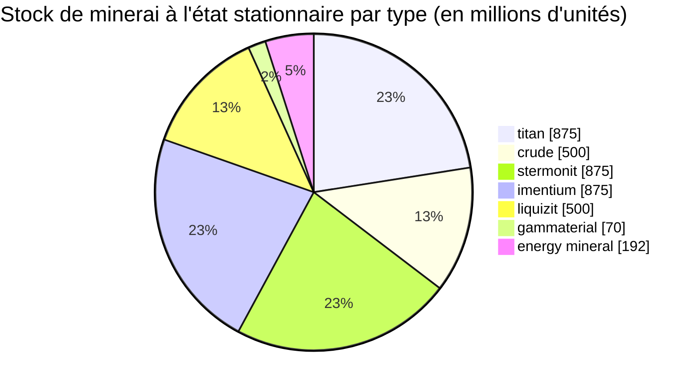

# zone_gamma_z106 — exemple concret

  <a href="/fr/zones/map/">
    
    <strong>Carte du monde</strong> — où se situe cette zone parmi toutes les autres, avec les liaisons de téléportation. Ouvrir la carte complète.
  </a>

Emplacement des colonnes de téléportation de cette zone (points, étiquetés avec la destination — estompés lorsque
la colonne est actuellement désactivée), les points d'arrivée des téléportations provenant d'autres
zones (cercles en pointillés), et les portes de sortie (losanges) lorsqu'il en existe. Les positions sont les
coordonnées de cases enregistrées par le serveur.

Une zone **PvP ouverte** de haut niveau : terraformable, faible fertilité, variantes végétales de rang 2 et
une économie de minerai plus resserrée. C'est la configuration typique de « fin de jeu » d'une zone — des ressources
moins nombreuses et plus disputées.

| Fait | Valeur |
|---|---|
| Identifiant de zone | 106 |
| Type | PvP (ouvert) |
| Protection | [Gamma](/fr/zones/protection/) — PvP ouvert, terraformable |
| Taille | 2048 × 2048 cases |
| Fertilité | 15 |
| Terraformable | oui (limite technologique PBS 2) |
| Jeu de règles végétales | 22 — 17 espèces (« Gamma Plant Rules », mélange rang 2) |
| Types de minerai | 7 (titan, crude, stermonit, imentium, liquizit, gammaterial, energy mineral) |
| Total des nœuds de minerai | 44 |

## Configuration des minerais

| Matériau | Nœuds | Max cases/nœud | Total par nœud | Seuil minimal |
|---|---|---|---|---|
| [titan](/fr/content/ores/titan/) | 7 | 600 | 125,000,000 | 0.5 |
| [crude](/fr/content/ores/crude/) | 4 | 600 | 125,000,000 | 0.5 |
| [stermonit](/fr/content/ores/stermonit/) | 7 | 600 | 125,000,000 | 0.5 |
| [imentium](/fr/content/ores/imentium/) | 7 | 600 | 125,000,000 | 0.5 |
| [liquizit](/fr/content/ores/liquizit/) | 4 | 600 | 125,000,000 | 0.5 |
| [gammaterial](/fr/content/ores/gammaterial/) | 7 | 100 | 10,000,000 | 0.5 |
| [energymineral](/fr/content/ores/energymineral/) | 8 | 300 | 24,000,000 | 0.5 |

Points marquants :

- **Moins de nœuds que dans les zones alpha** (44 contre 64 à Daoden) : crude et liquizit tombent à
  seulement 4 nœuds chacun. Mêmes totaux par nœud que pour les minerais standards alpha, de sorte que l'état
  stationnaire (~3,9 milliards d'unités au total) est plus restreint et plus lent à récupérer.
- **Deux types exotiques** : **gammaterial** dans de minuscules nœuds de 100 cases (rayon de marche de 10 cases —
  petits, faciles à repérer, ~1,4 M par nœud) et **energy mineral** à 24 M par nœud.
- Pas d'épriton, pas de minerai flux — les minerais rares et économiques restent cantonnés au palier alpha.

## Mélange végétal

Le jeu de règles 22 autorise 17 espèces : les basiques, plus les **variantes de rang 2** — arbre de fer
supérieur r2 et rustbush supérieur r2 comme récoltables sauvages, ainsi que les **plantes semées de rang 2**
(electroplant supérieur r2, slimeroot supérieur r2). Les plantes semées ont la propriété `playerSeeded` — elles
n'apparaissent **jamais** naturellement ; elles n'existent que dans les plantations des joueurs (voir
[collecte → plantes](/fr/features/gathering/)).

La fertilité est de **15**, et non 20 : un cube de 32×32 peut contenir au plus environ 15 % de plantes bloquantes, la
couverture végétale est donc visiblement plus clairsemée que dans les zones alpha, et le tirage de fertilité a
légèrement moins d'espace à combler avant que le cube ne soit « saturé ».

Les règles par espèce (y compris les quantités de fruits r2) se trouvent dans
[Plantes](/fr/content/plants/) ; les rendements par minerai dans [Minerais](/fr/content/ores/).

## Ce que cela signifie pour un joueur

- Économie plus sobre et plus lente : moins de nœuds de minerais communs signifie que la pression d'extraction se
  ressent plus vite — un nœud de crude épuisé met plus de temps à être remplacé par la zone.
- Végétation plus clairsemée : avec 15 % de fertilité, le sol dégagé est la norme et les massifs végétaux
  l'exception.
- La collecte à haute valeur se concentre ici sur les plantes sauvages de rang 2 arbre de fer / rustbush, ainsi que
  sur l'exploitation de plantations de joueurs pour les variantes r2 semées d'electroplant et slimeroot.
- La terraformation (limite technologique PBS 2) implique que le sol lui-même peut être remodelé par les joueurs
  (voir [Stations de base énergétiques (PBS)](/fr/features/pbs/)).

<!-- Developer notes: zones row id 106 (zonetype 2 = PvP, protected 0, fertility 15,
     terraformable 1, pbsTechLimit 2, plantruleset 22); mineralconfigs 7 rows (crude
     and liquizit 4 nodes each); plantrules rulesetid 22 = 17 files, note "Gamma
     Plant Rules"; electroplant_seeded_t2.txt / slimeroot_seeded_t2.txt set
     playerSeeded=n1 (inherited via source= from electroplant_hi.txt /
     slimeroot_hi.txt) -> excluded from natural spawns in
     PlantRuleExtensions.GetWinnerPlantTypeBasedOnFertility. -->
