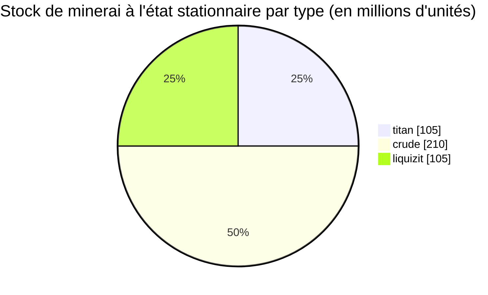

# New Virginia (zone_TM) — exemple concret

  <a href="/fr/zones/map/">
    
    <strong>Carte du monde</strong> — où se situe cette zone parmi toutes les autres, avec les liaisons de téléportation. Ouvrir la carte complète.
  </a>

Emplacement des colonnes de téléportation de cette zone (points, étiquetés avec la destination — estompés lorsque
la colonne est actuellement désactivée), les points d'arrivée des téléportations provenant d'autres
zones (cercles en pointillés), et les portes de sortie (losanges) lorsqu'il en existe. Les positions sont les
coordonnées de cases enregistrées par le serveur.
Les lignes en pointillés relient les paires de colonnes de téléportation locales (au sein de la zone).

Une zone **PvE protégée** de bas niveau — un endroit sûr où les nouveaux personnages récoltent. Sa
configuration illustre l'extrémité la plus simple du spectre : peu de types de minerai, de grands nœuds et
le mélange végétal de base.

| Fait | Valeur |
|---|---|
| Identifiant de zone | 0 |
| Type | PvE (protégée) |
| Protection | [Alpha](/fr/zones/protection/) — protégée, PvP désactivé |
| Taille | 2048 × 2048 cases |
| Fertilité | 20 |
| Jeu de règles végétales | 0 — 15 espèces (mélange de base « tm pve ») |
| Types de minerai | 3 (titan, crude, liquizit) |
| Total des nœuds de minerai | 21 (7 par type) |

## Configuration des minerais

| Matériau | Nœuds | Max cases/nœud | Total par nœud | Seuil minimal |
|---|---|---|---|---|
| [titan](/fr/content/ores/titan/) | 7 | 1000 | 15,000,000 | 0.5 |
| [crude](/fr/content/ores/crude/) | 7 | 1257 | 30,000,000 | 0.5 |
| [liquizit](/fr/content/ores/liquizit/) | 7 | 1000 | 15,000,000 | 0.5 |

Points marquants :

- **Nœuds étendus et dispersés** — 1 000 à 1 257 cases chacun (rayon de marche
  `(int)√(tiles/π)×2` = 34–40 cases), chaque nœud formant donc une grande masse, et il n'y a que 7
  nœuds de chaque type par zone. Le stock en régime stationnaire est d'environ 420 millions d'unités de matériau au total
  (105 M titan + 210 M crude + 105 M liquizit).
- **Aucun type rare** — pas d'épriton, pas de minerai flux, donc aucune zone d'exclusion autour
  des bases et aucun site minier déclenchant l'apparition de PNJ.
- `minthreshold` de 0.5 signifie qu'une case n'est utilisable que si le remplissage de bruit du nœud y atteint au
  moins la moitié de son maximum — les bords de chaque masse sont clairsemés.

Les rendements par type (ce qu'une unité de chaque minerai donne au raffinage, et les formules de génération
de nœuds derrière les chiffres ci-dessus) se trouvent dans [Minerais](/fr/content/ores/).

## Mélange végétal

Le jeu de règles 0 autorise 15 espèces — l'ensemble de départ de base : herbe (a/b), pin, buissons (a/b),
rango, arbre de cuivre, roseau, nanoblé, variantes de bas niveau de rustbush/slimeroot/electroplant, bonsaï,
et arbre de fer de bas niveau. Aucun mur, pas de devrinol, aucune ressource récoltable de haut niveau.

Avec une fertilité de 20, un cube de 32×32 peut contenir au plus environ 20 % de plantes bloquantes ; sur l'ensemble
de la carte de 2048×2048, cela représente une limite supérieure d'environ 838 000 cases de plantes (moins en pratique —
l'eau et les îles ne sont pas du sol). La sélection des espèces est pondérée par la `fertility` de chaque règle,
les herbes et buissons basiques dominent donc tandis que les récoltables de bas niveau restent rares.

Les règles complètes par espèce (growRate, fruits, vie) se trouvent dans [Plantes](/fr/content/plants/).

## Ce que cela signifie pour un joueur

- Économie de départ sûre : trois minerais courants en grandes masses faciles à scanner.
- Les récoltables ici sont les variantes de bas niveau — les plantes de grande valeur (variantes de haut
  niveau d'electroplant/arbre de fer/rustbush/slimeroot) apparaissent dans les zones suivantes.
- Parce que la zone est protégée, le risque PvP est la seule chose absente de la boucle
  de collecte (voir [déplacement](/fr/features/movement/) pour l'entrée en zone).

<!-- Developer notes: zones row id 0 (zonetype 1 = PvE, protected 1, fertility 20,
     plantruleset 0); mineralconfigs 3 rows (titan/crude/liquizit, 7 nodes each);
     plantrules rulesetid 0 = 15 files, note "tm pve". Node radius formula and
     threshold semantics: see generation.md. -->
