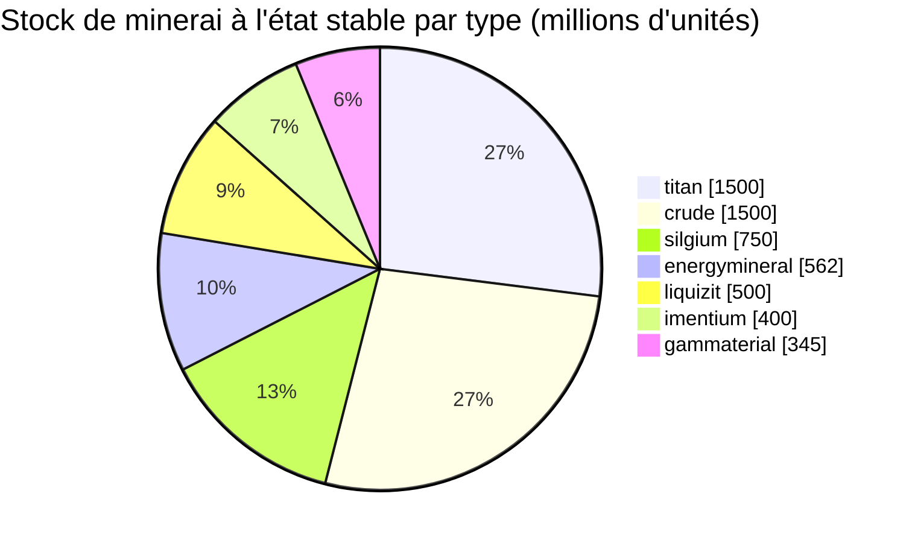

<!-- Generated by tools/generate from the live database (source: zones, mineralconfigs, plantrules, teleportdescriptions, strongholdexitconfig).
     Do not edit by hand; regenerate instead. -->
# Davis Barrier (zone_tm_g_1)

  <a href="/fr/zones/map/">
    
    <strong>Carte du monde</strong> — où se situe cette zone parmi toutes les autres, avec les liaisons de téléportation. Ouvrir la carte complète.
  </a>

Emplacements des colonnes de téléportation de cette zone (points étiquetés avec la destination — estompés si la colonne est désactivée), points d'arrivée des téléportations depuis d'autres zones (cercles en pointillés) et portes de sortie (losanges) le cas échéant. Les positions correspondent aux coordonnées de cases enregistrées par le serveur.

Une île JcJ ouverte et terraformable (gamma) de New Virginia (TM) — le sol peut être remodelé par les joueurs. Elle maintient 7 types de minerai.

| Fait | Valeur |
|---|---|
| ID de zone | 20 |
| Type | PvP |
| Protection | [Gamma](/fr/zones/protection/) — JcJ ouvert, terraformable |
| Taille | 2048×2048 cases |
| Fertilité | 20 |
| Espèces végétales | 17 (ensemble de règles 5) |
| Types de minerai | 7 |
| Nœuds de minerai totaux | 55 |
| Bases d'amarrage max. | 100 |

## Configuration du minerai

La génération de nœuds maintenue par cette zone. Le rendement par minerai et les formules de génération se trouvent dans [Minerais](/fr/content/ores/) (la section de cette zone est liée ci-dessous).

| Matériau | Nœuds | Cases max./nœud | Total par nœud | Seuil min. |
|---|---|---|---|---|
| [titan](/fr/content/ores/titan/) | 10 | 707 | 150M | 0.5 |
| [crude](/fr/content/ores/crude/) | 6 | 1.257k | 250M | 0.5 |
| [imentium](/fr/content/ores/imentium/) | 8 | 314 | 50M | 0.5 |
| [liquizit](/fr/content/ores/liquizit/) | 5 | 1.257k | 100M | 0.5 |
| [silgium](/fr/content/ores/silgium/) | 8 | 314 | 93.75M | 0.5 |
| [gammaterial](/fr/content/ores/gammaterial/) | 3 | 707 | 115M | 0.5 |
| [energymineral](/fr/content/ores/energymineral/) | 15 | 350 | 37.5M | 0.5 |

[Index des zones](/fr/zones/zone-index/) · [Carte du monde](/fr/zones/map/#beta) · [Niveaux de protection](/fr/zones/protection/)
