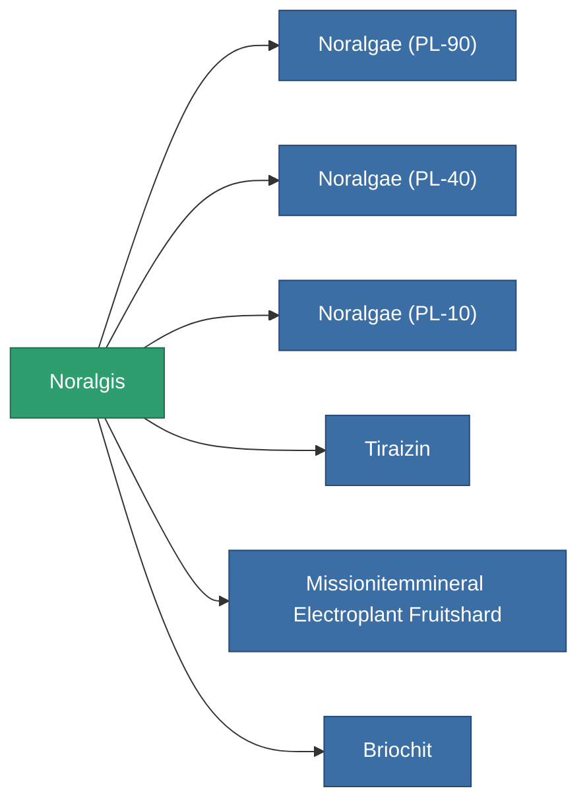

<!-- Generated by tools/generate from the live database (source: entitydefaults definition 2909, aggregatevalues via aggregatefields).
     Do not edit by hand; regenerate instead. -->

# Noralgis

|  |  |
|---|---|
| Definizione | `def_electroplant_fruit` |
| Livello | – |
| Salute | 100 |
| Volume | 0 |
| Massa | 0.02 |
| Categoria | Materials |

_Nessuna statistica — questo oggetto non porta valori aggregati._

<!-- production:generated -->
## Usato in produzione

**Componente di 6 oggetti** — tutto ciò che lo usa in produzione:

