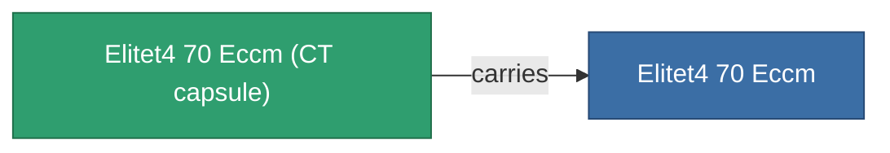

<!-- Generated by tools/generate from the live database (source: entitydefaults definition 5948, aggregatevalues via aggregatefields).
     Do not edit by hand; regenerate instead. -->

# Elitet4 70 Eccm

|  |  |
|---|---|
| Definizione | `def_elitet4_70_eccm` |
| Livello | T4 (special) |
| Salute | 100 |
| Volume | 0.5 |
| Massa | 75 |
| Categoria | Modules / Enhancements |
| Nota | elite module |

## Statistiche

| Campo | Valore |
|---|---|
| cpu_usage | 24 |
| damage_laser_modifier | 0.07 |
| damage_missile_modifier | 0.07 |
| damage_projectile_modifier | 0.07 |
| damage_railgun_modifier | 0.07 |
| powergrid_usage | 16 |
| sensor_strength_modifier | 78 |

## Capsula di trasporto

A transport capsule (CT) exists for this item — it is how the item moves between players and zones.

## Dove acquistare

Fixed-price vendors that sell this item (see the [Item shop](/it/content/shop/) for the full catalog).

| Vendor | Qty | Credits | UniCoin |
|---|---|---|---|
| Daoden outpost | ∞ | 500M | 25k |

<!-- production:generated -->
## Produzione

**Prodotto da 2 componenti** — assembra i componenti per costruirlo (lista completa in [Ricette](/it/content/recipes/)):

**Piano:** [Elitet4 70 Eccm Cprg](/it/content/items/elitet4-70-eccm-cprg/)

<svg class="prod-card-icon" aria-hidden="true"><use href="#mi-grid"/></svg><a class="prod-card-name" href="/it/content/items/material-boss-z70/">Material Boss Z70</a>

richiesto: <b>400</b>

<svg class="prod-card-icon" aria-hidden="true"><use href="#mi-grid"/></svg><a class="prod-card-name" href="/it/content/items/named3-eccm/">Braviar ECCM</a>

richiesto: <b>1</b>

