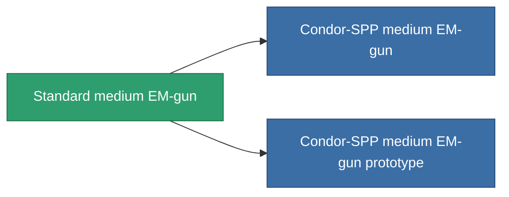

<!-- Generated by tools/generate from the live database (source: entitydefaults definition 1000, aggregatevalues via aggregatefields).
     Do not edit by hand; regenerate instead. -->

# Standard medium EM-gun

|  |  |
|---|---|
| Definizione | `def_longrange_standard_medium_railgun` |
| Livello | T1 |
| Salute | 100 |
| Volume | 1 |
| Massa | 650 |
| Categoria | Modules / Weapons |

## Statistiche

| Campo | Valore |
|---|---|
| accuracy | 14 |
| core_usage | 22 |
| cpu_usage | 40 |
| cycle_time | 10k |
| damage_modifier | 2 |
| falloff | 7.5 |
| least_optimal | 18 |
| optimal_range | 29 |
| powergrid_usage | 185 |

<!-- production:generated -->
## Produzione

**Prodotto da 5 componenti, livello di ricerca 4** — assembra i componenti per costruirlo (lista completa in [Ricette](/it/content/recipes/)):

**Piano:** [Standard medium EM-gun CT](/content/items/longrange-standard-medium-railgun-cprg/)

<svg class="prod-card-icon" aria-hidden="true"><use href="#mi-grid"/></svg><a class="prod-card-name" href="/it/content/items/axicol/">Cryoperine</a>

richiesto: <b>50</b>

<svg class="prod-card-icon" aria-hidden="true"><use href="#mi-grid"/></svg><a class="prod-card-name" href="/it/content/items/axicoline/">Axicoline</a>

richiesto: <b>100</b>

<svg class="prod-card-icon" aria-hidden="true"><use href="#mi-grid"/></svg><a class="prod-card-name" href="/it/content/items/chollonin/">Chollonin</a>

richiesto: <b>50</b>

<svg class="prod-card-icon" aria-hidden="true"><use href="#mi-grid"/></svg><a class="prod-card-name" href="/it/content/items/polynitrocol/">Polynitrocol</a>

richiesto: <b>100</b>

<svg class="prod-card-icon" aria-hidden="true"><use href="#mi-grid"/></svg><a class="prod-card-name" href="/it/content/items/titanium/">Titanium</a>

richiesto: <b>100</b>

## Usato in produzione

**Componente di 2 oggetti** — tutto ciò che lo usa in produzione:

