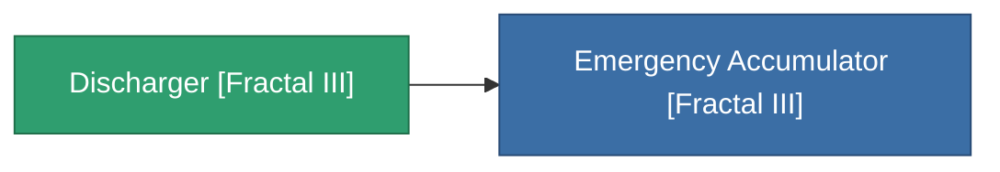

<!-- Generated by tools/generate from the live database (source: entitydefaults definition 4540, aggregatevalues via aggregatefields).
     Do not edit by hand; regenerate instead. -->

# Discharger [Fractal III]

|  |  |
|---|---|
| Definizione | `def_missionitem_asi_i_level00_exp3_03_t03` |
| Livello | – |
| Salute | 100 |
| Volume | 1 |
| Massa | 50 |
| Categoria | Mission items |

_Nessuna statistica — questo oggetto non porta valori aggregati._

<!-- production:generated -->
## Usato in produzione

**Componente di 1 oggetti** — tutto ciò che lo usa in produzione:

