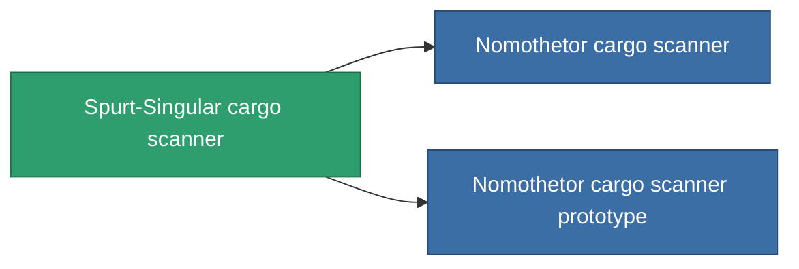

<!-- Generated by tools/generate from the live database (source: entitydefaults definition 774, aggregatevalues via aggregatefields).
     Do not edit by hand; regenerate instead. -->

# Spurt-Singular cargo scanner

|  |  |
|---|---|
| Definizione | `def_named1_cargo_scanner` |
| Livello | T2 |
| Salute | 100 |
| Volume | 0.5 |
| Massa | 90 |
| Categoria | Modules / Sensors & scanning |
| Tier line | [Standard cargo scanner](/it/content/items/standard-cargo-scanner/) (T1) → **Spurt-Singular cargo scanner** (T2) → [Nomothetor cargo scanner](/it/content/items/named2-cargo-scanner/) (T3) → [Visioner cargo scanner](/it/content/items/named3-cargo-scanner/) (T4) |

## Statistiche

| Campo | Valore |
|---|---|
| core_usage | 45 |
| cpu_usage | 18 |
| cycle_time | 10k |
| falloff | 20 |
| optimal_range | 15 |
| powergrid_usage | 9 |

<!-- production:generated -->
## Produzione

**Prodotto da 4 componenti, livello di ricerca 4** — assembra i componenti per costruirlo (lista completa in [Ricette](/it/content/recipes/)):

**Piano:** [Spurt-Singular cargo scanner CT](/it/content/items/named1-cargo-scanner-cprg/)

<svg class="prod-card-icon" aria-hidden="true"><use href="#mi-grid"/></svg><a class="prod-card-name" href="/it/content/items/axicol/">Cryoperine</a>

richiesto: <b>250</b>

<svg class="prod-card-icon" aria-hidden="true"><use href="#mi-crystal"/></svg><a class="prod-card-name" href="/it/content/items/robotshard-common-basic/">Damaged common fragment</a>

richiesto: <b>30</b>

<svg class="prod-card-icon" aria-hidden="true"><use href="#mi-grid"/></svg><a class="prod-card-name" href="/it/content/items/standard-cargo-scanner/">Standard cargo scanner</a>

richiesto: <b>1</b>

<svg class="prod-card-icon" aria-hidden="true"><use href="#mi-grid"/></svg><a class="prod-card-name" href="/it/content/items/titanium/">Titanium</a>

richiesto: <b>50</b>

## Usato in produzione

**Componente di 2 oggetti** — tutto ciò che lo usa in produzione:

