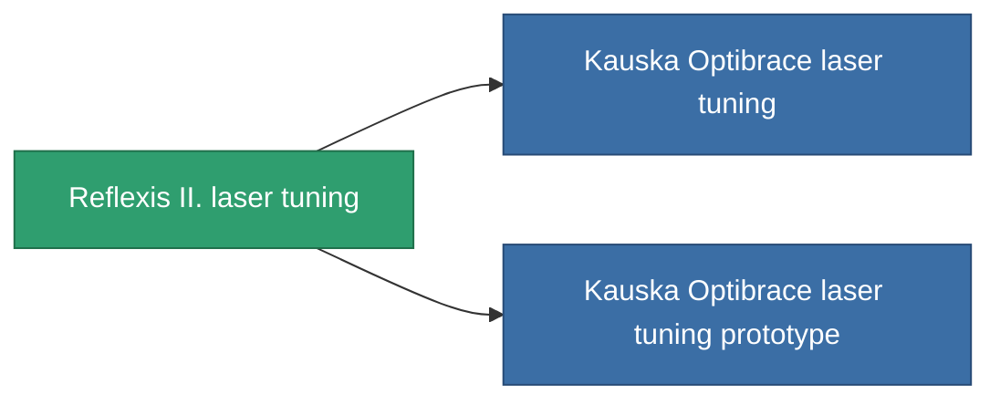

<!-- Generated by tools/generate from the live database (source: entitydefaults definition 930, aggregatevalues via aggregatefields).
     Do not edit by hand; regenerate instead. -->

# Reflexis II. laser tuning

|  |  |
|---|---|
| Definizione | `def_named1_damage_mod_laser` |
| Livello | T2 |
| Salute | 100 |
| Volume | 0.5 |
| Massa | 90 |
| Categoria | Modules / Weapons |
| Tier line | [Standard laser tuning](/it/content/items/standard-damage-mod-laser/) (T1) → **Reflexis II. laser tuning** (T2) → [Kauska Optibrace laser tuning](/it/content/items/named2-damage-mod-laser/) (T3) → [Oqulus laser tuning](/it/content/items/named3-damage-mod-laser/) (T4) |

## Statistiche

| Campo | Valore |
|---|---|
| cpu_usage | 19 |
| damage_laser_modifier | 0.15 |
| powergrid_usage | 9 |

<!-- production:generated -->
## Produzione

**Prodotto da 8 componenti, livello di ricerca 4** — assembra i componenti per costruirlo (lista completa in [Ricette](/it/content/recipes/)):

**Piano:** [Reflexis II. laser tuning CT](/it/content/items/named1-damage-mod-laser-cprg/)

<svg class="prod-card-icon" aria-hidden="true"><use href="#mi-grid"/></svg><a class="prod-card-name" href="/it/content/items/axicol/">Cryoperine</a>

richiesto: <b>100</b>

<svg class="prod-card-icon" aria-hidden="true"><use href="#mi-grid"/></svg><a class="prod-card-name" href="/it/content/items/axicoline/">Axicoline</a>

richiesto: <b>50</b>

<svg class="prod-card-icon" aria-hidden="true"><use href="#mi-grid"/></svg><a class="prod-card-name" href="/it/content/items/polynucleit/">Polynucleit</a>

richiesto: <b>50</b>

<svg class="prod-card-icon" aria-hidden="true"><use href="#mi-grid"/></svg><a class="prod-card-name" href="/it/content/items/prilumium/">Prilumium</a>

richiesto: <b>100</b>

<svg class="prod-card-icon" aria-hidden="true"><use href="#mi-crystal"/></svg><a class="prod-card-name" href="/it/content/items/robotshard-common-basic/">Damaged common fragment</a>

richiesto: <b>15</b>

<svg class="prod-card-icon" aria-hidden="true"><use href="#mi-crystal"/></svg><a class="prod-card-name" href="/it/content/items/robotshard-thelodica-basic/">Damaged thelodica fragment</a>

richiesto: <b>15</b>

<svg class="prod-card-icon" aria-hidden="true"><use href="#mi-robots"/></svg><a class="prod-card-name" href="/it/content/items/standard-damage-mod-laser/">Standard laser tuning</a>

richiesto: <b>1</b>

<svg class="prod-card-icon" aria-hidden="true"><use href="#mi-grid"/></svg><a class="prod-card-name" href="/it/content/items/titanium/">Titanium</a>

richiesto: <b>50</b>

## Usato in produzione

**Componente di 2 oggetti** — tutto ciò che lo usa in produzione:

