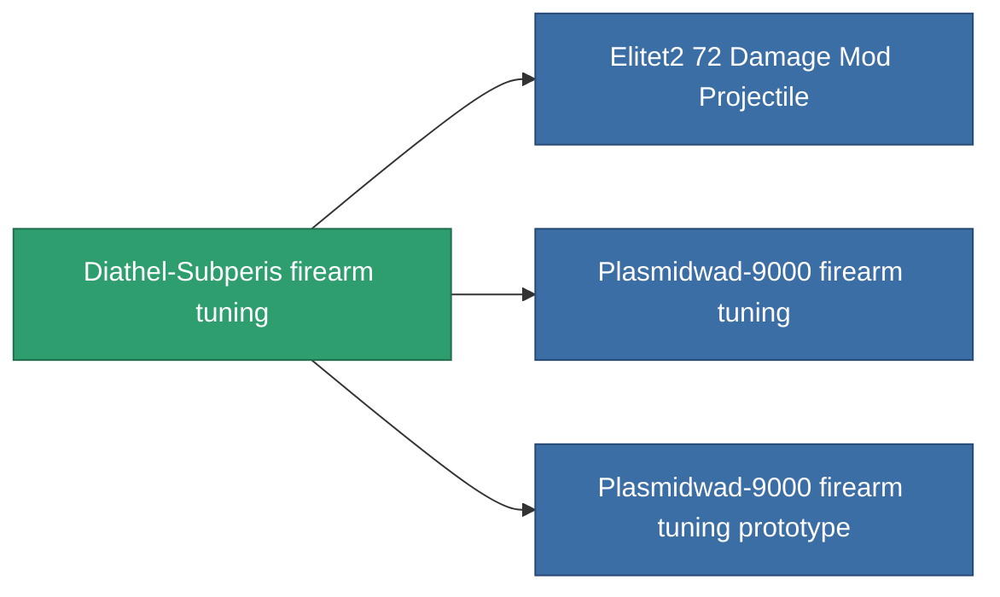

<!-- Generated by tools/generate from the live database (source: entitydefaults definition 933, aggregatevalues via aggregatefields).
     Do not edit by hand; regenerate instead. -->

# Diathel-Subperis firearm tuning

|  |  |
|---|---|
| Definizione | `def_named1_damage_mod_projectile` |
| Livello | T2 |
| Salute | 100 |
| Volume | 0.5 |
| Massa | 90 |
| Categoria | Modules / Enhancements |
| Tier line | [Standard firearm tuning](/it/content/items/standard-damage-mod-projectile/) (T1) → **Diathel-Subperis firearm tuning** (T2) → [Plasmidwad-9000 firearm tuning](/it/content/items/named2-damage-mod-projectile/) (T3) → [DVT-800g firearm tuning](/it/content/items/named3-damage-mod-projectile/) (T4) |

## Statistiche

| Campo | Valore |
|---|---|
| cpu_usage | 14 |
| damage_projectile_modifier | 0.15 |
| powergrid_usage | 4 |

<!-- production:generated -->
## Produzione

**Prodotto da 5 componenti, livello di ricerca 4** — assembra i componenti per costruirlo (lista completa in [Ricette](/it/content/recipes/)):

**Piano:** [Diathel-Subperis firearm tuning CT](/it/content/items/named1-damage-mod-projectile-cprg/)

<svg class="prod-card-icon" aria-hidden="true"><use href="#mi-grid"/></svg><a class="prod-card-name" href="/it/content/items/axicol/">Cryoperine</a>

richiesto: <b>200</b>

<svg class="prod-card-icon" aria-hidden="true"><use href="#mi-grid"/></svg><a class="prod-card-name" href="/it/content/items/axicoline/">Axicoline</a>

richiesto: <b>100</b>

<svg class="prod-card-icon" aria-hidden="true"><use href="#mi-crystal"/></svg><a class="prod-card-name" href="/it/content/items/robotshard-common-basic/">Damaged common fragment</a>

richiesto: <b>30</b>

<svg class="prod-card-icon" aria-hidden="true"><use href="#mi-panel"/></svg><a class="prod-card-name" href="/it/content/items/standard-damage-mod-projectile/">Standard firearm tuning</a>

richiesto: <b>1</b>

<svg class="prod-card-icon" aria-hidden="true"><use href="#mi-grid"/></svg><a class="prod-card-name" href="/it/content/items/titanium/">Titanium</a>

richiesto: <b>100</b>

## Usato in produzione

**Componente di 3 oggetti** — tutto ciò che lo usa in produzione:

