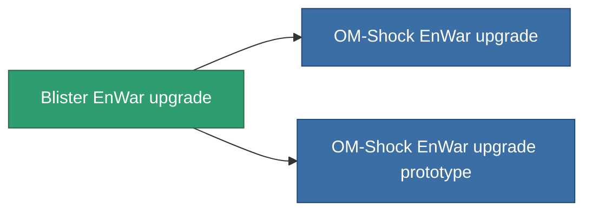

<!-- Generated by tools/generate from the live database (source: entitydefaults definition 4583, aggregatevalues via aggregatefields).
     Do not edit by hand; regenerate instead. -->

# Blister EnWar upgrade

|  |  |
|---|---|
| Definizione | `def_named1_energy_warfare_upgrade` |
| Livello | T2 |
| Salute | 100 |
| Volume | 1 |
| Massa | 225 |
| Categoria | Modules / Enhancements |
| Tier line | [Standard EnWar upgrade](/it/content/items/standard-energy-warfare-upgrade/) (T1) → **Blister EnWar upgrade** (T2) → [OM-Shock EnWar upgrade](/it/content/items/named2-energy-warfare-upgrade/) (T3) → [XT-Shock EnWar upgrade](/it/content/items/named3-energy-warfare-upgrade/) (T4) |

## Statistiche

| Campo | Valore |
|---|---|
| core_usage_energy_neutralizers_modifier | 1.1 |
| cpu_usage | 23 |
| energy_neutralized_amount_modifier | 1.2 |
| energy_vampired_amount_modifier | 1.1 |
| powergrid_usage | 41 |

<!-- production:generated -->
## Produzione

**Prodotto da 8 componenti, livello di ricerca 6** — assembra i componenti per costruirlo (lista completa in [Ricette](/it/content/recipes/)):

**Piano:** [Blister EnWar upgrade CT](/content/items/named1-energy-warfare-upgrade-cprg/)

<svg class="prod-card-icon" aria-hidden="true"><use href="#mi-grid"/></svg><a class="prod-card-name" href="/it/content/items/axicol/">Cryoperine</a>

richiesto: <b>150</b>

<svg class="prod-card-icon" aria-hidden="true"><use href="#mi-grid"/></svg><a class="prod-card-name" href="/it/content/items/axicoline/">Axicoline</a>

richiesto: <b>50</b>

<svg class="prod-card-icon" aria-hidden="true"><use href="#mi-grid"/></svg><a class="prod-card-name" href="/it/content/items/phlobotil/">Phlobotil</a>

richiesto: <b>50</b>

<svg class="prod-card-icon" aria-hidden="true"><use href="#mi-crystal"/></svg><a class="prod-card-name" href="/it/content/items/robotshard-common-basic/">Damaged common fragment</a>

richiesto: <b>15</b>

<svg class="prod-card-icon" aria-hidden="true"><use href="#mi-crystal"/></svg><a class="prod-card-name" href="/it/content/items/robotshard-pelistal-basic/">Damaged pelistal fragment</a>

richiesto: <b>15</b>

<svg class="prod-card-icon" aria-hidden="true"><use href="#mi-grid"/></svg><a class="prod-card-name" href="/it/content/items/standard-energy-warfare-upgrade/">Standard EnWar upgrade</a>

richiesto: <b>1</b>

<svg class="prod-card-icon" aria-hidden="true"><use href="#mi-grid"/></svg><a class="prod-card-name" href="/it/content/items/titanium/">Titanium</a>

richiesto: <b>50</b>

<svg class="prod-card-icon" aria-hidden="true"><use href="#mi-grid"/></svg><a class="prod-card-name" href="/it/content/items/vitricyl/">Vitricyl</a>

richiesto: <b>150</b>

## Usato in produzione

**Componente di 2 oggetti** — tutto ciò che lo usa in produzione:

