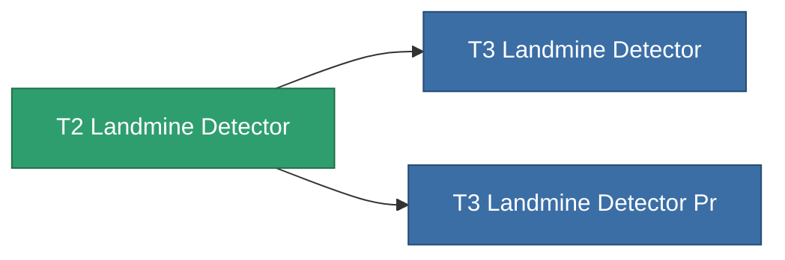

<!-- Generated by tools/generate from the live database (source: entitydefaults definition 8314, aggregatevalues via aggregatefields).
     Do not edit by hand; regenerate instead. -->

# T2 Landmine Detector

|  |  |
|---|---|
| Definizione | `def_named1_landmine_detector` |
| Livello | T2 |
| Salute | 100 |
| Volume | 1.5 |
| Massa | 900 |
| Categoria | Modules / Enhancements |
| Tier line | **T2 Landmine Detector** (T2) → [T3 Landmine Detector](/it/content/items/named2-landmine-detector/) (T3) → [T4 Landmine Detector](/it/content/items/named3-landmine-detector/) (T4) |

## Statistiche

| Campo | Valore |
|---|---|
| core_usage | 14 |
| cpu_usage | 18 |
| cycle_time | 10k |
| effect_mine_detection_range_modifier | 1.3 |
| powergrid_usage | 6 |

<!-- production:generated -->
## Produzione

**Prodotto da 4 componenti** — assembra i componenti per costruirlo (lista completa in [Ricette](/it/content/recipes/)):

**Piano:** [T2 Landmine Detector Cprg](/it/content/items/named1-landmine-detector-cprg/)

<svg class="prod-card-icon" aria-hidden="true"><use href="#mi-grid"/></svg><a class="prod-card-name" href="/it/content/items/axicol/">Cryoperine</a>

richiesto: <b>400</b>

<svg class="prod-card-icon" aria-hidden="true"><use href="#mi-crystal"/></svg><a class="prod-card-name" href="/it/content/items/robotshard-common-basic/">Damaged common fragment</a>

richiesto: <b>30</b>

<svg class="prod-card-icon" aria-hidden="true"><use href="#mi-grid"/></svg><a class="prod-card-name" href="/it/content/items/standart-landmine-detector/">Standart Landmine Detector</a>

richiesto: <b>1</b>

<svg class="prod-card-icon" aria-hidden="true"><use href="#mi-grid"/></svg><a class="prod-card-name" href="/it/content/items/titanium/">Titanium</a>

richiesto: <b>100</b>

## Usato in produzione

**Componente di 2 oggetti** — tutto ciò che lo usa in produzione:

