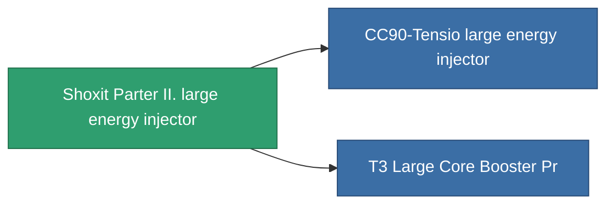

<!-- Generated by tools/generate from the live database (source: entitydefaults definition 828, aggregatevalues via aggregatefields).
     Do not edit by hand; regenerate instead. -->

# Shoxit Parter II. large energy injector

|  |  |
|---|---|
| Definizione | `def_named1_large_core_booster` |
| Livello | T2 |
| Salute | 100 |
| Volume | 2 |
| Massa | 1440 |
| Categoria | Modules / Enhancements |
| Tier line | [Standard large energy injector](/it/content/items/standard-large-core-booster/) (T1) → **Shoxit Parter II. large energy injector** (T2) → [CC90-Tensio large energy injector](/it/content/items/named2-large-core-booster/) (T3) → [Rymur DTTO large energy injector](/it/content/items/named3-large-core-booster/) (T4) |

## Statistiche

| Campo | Valore |
|---|---|
| core_usage | 0 |
| cpu_usage | 345 |
| cycle_time | 6.05k |
| powergrid_usage | 1.125k |

<!-- production:generated -->
## Produzione

**Prodotto da 5 componenti** — assembra i componenti per costruirlo (lista completa in [Ricette](/it/content/recipes/)):

**Piano:** [T2 Large Core Booster Cprg](/content/items/named1-large-core-booster-cprg/)

<svg class="prod-card-icon" aria-hidden="true"><use href="#mi-grid"/></svg><a class="prod-card-name" href="/it/content/items/axicol/">Cryoperine</a>

richiesto: <b>600</b>

<svg class="prod-card-icon" aria-hidden="true"><use href="#mi-crystal"/></svg><a class="prod-card-name" href="/it/content/items/robotshard-common-basic/">Damaged common fragment</a>

richiesto: <b>90</b>

<svg class="prod-card-icon" aria-hidden="true"><use href="#mi-grid"/></svg><a class="prod-card-name" href="/it/content/items/specimen-sap-item-flux/">Specimen Sap Item Flux</a>

richiesto: <b>5</b>

<svg class="prod-card-icon" aria-hidden="true"><use href="#mi-grid"/></svg><a class="prod-card-name" href="/it/content/items/standard-large-core-booster/">Standard large energy injector</a>

richiesto: <b>1</b>

<svg class="prod-card-icon" aria-hidden="true"><use href="#mi-grid"/></svg><a class="prod-card-name" href="/it/content/items/titanium/">Titanium</a>

richiesto: <b>300</b>

## Usato in produzione

**Componente di 2 oggetti** — tutto ciò che lo usa in produzione:

