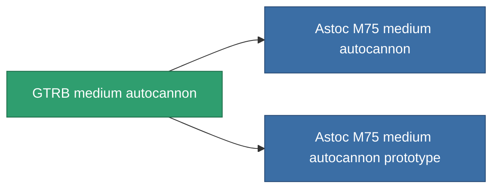

<!-- Generated by tools/generate from the live database (source: entitydefaults definition 1030, aggregatevalues via aggregatefields).
     Do not edit by hand; regenerate instead. -->

# GTRB medium autocannon

|  |  |
|---|---|
| Definizione | `def_named1_longrange_medium_autocannon` |
| Livello | T2 |
| Salute | 100 |
| Volume | 1.2 |
| Massa | 585 |
| Categoria | Modules / Weapons |
| Tier line | **GTRB medium autocannon** (T2) → [Astoc M75 medium autocannon](/it/content/items/named2-longrange-medium-autocannon/) (T3) → [Znatvoy-Berjiar-IA medium autocannon](/it/content/items/named3-longrange-medium-autocannon/) (T4) |

## Statistiche

| Campo | Valore |
|---|---|
| accuracy | 18 |
| core_usage | 1 |
| cpu_usage | 12 |
| cycle_time | 8k |
| damage_modifier | 2 |
| falloff | 28 |
| least_optimal | 5 |
| optimal_range | 22 |
| powergrid_usage | 130 |

<!-- production:generated -->
## Produzione

**Prodotto da 4 componenti, livello di ricerca 4** — assembra i componenti per costruirlo (lista completa in [Ricette](/it/content/recipes/)):

**Piano:** [GTRB medium autocannon CT](/it/content/items/named1-longrange-medium-autocannon-cprg/)

<svg class="prod-card-icon" aria-hidden="true"><use href="#mi-grid"/></svg><a class="prod-card-name" href="/it/content/items/axicol/">Cryoperine</a>

richiesto: <b>100</b>

<svg class="prod-card-icon" aria-hidden="true"><use href="#mi-grid"/></svg><a class="prod-card-name" href="/it/content/items/axicoline/">Axicoline</a>

richiesto: <b>200</b>

<svg class="prod-card-icon" aria-hidden="true"><use href="#mi-robots"/></svg><a class="prod-card-name" href="/it/content/items/longrange-standard-medium-autocannon/">Standard medium autocannon</a>

richiesto: <b>1</b>

<svg class="prod-card-icon" aria-hidden="true"><use href="#mi-grid"/></svg><a class="prod-card-name" href="/it/content/items/titanium/">Titanium</a>

richiesto: <b>100</b>

## Usato in produzione

**Componente di 2 oggetti** — tutto ciò che lo usa in produzione:

