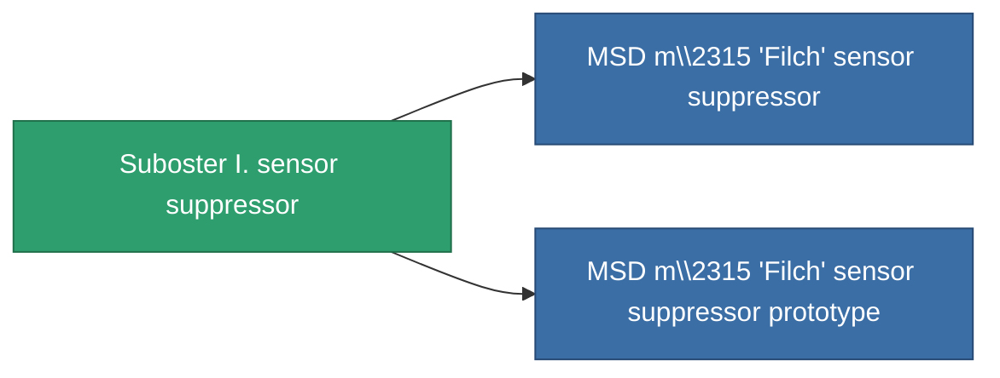

<!-- Generated by tools/generate from the live database (source: entitydefaults definition 792, aggregatevalues via aggregatefields).
     Do not edit by hand; regenerate instead. -->

# Suboster I. sensor suppressor

|  |  |
|---|---|
| Definizione | `def_named1_sensor_dampener` |
| Livello | T2 |
| Salute | 100 |
| Volume | 0.5 |
| Massa | 135 |
| Categoria | Modules / Sensors & scanning |
| Tier line | [Standard sensor suppressor](/it/content/items/standard-sensor-dampener/) (T1) → **Suboster I. sensor suppressor** (T2) → [MSD m\2315 'Filch' sensor suppressor](/it/content/items/named2-sensor-dampener/) (T3) → [Stellis sensor suppressor](/it/content/items/named3-sensor-dampener/) (T4) |

## Statistiche

| Campo | Valore |
|---|---|
| core_usage | 14 |
| cpu_usage | 33 |
| cycle_time | 5k |
| ecm_strength | 60 |
| effect_sensor_dampener_locking_range_modifier | 0.85 |
| effect_sensor_dampener_locking_time_modifier | 1.3 |
| falloff | 0 |
| optimal_range | 30 |
| powergrid_usage | 19 |

<!-- production:generated -->
## Produzione

**Prodotto da 8 componenti, livello di ricerca 4** — assembra i componenti per costruirlo (lista completa in [Ricette](/it/content/recipes/)):

**Piano:** [Suboster I. sensor suppressor CT](/content/items/named1-sensor-dampener-cprg/)

<svg class="prod-card-icon" aria-hidden="true"><use href="#mi-grid"/></svg><a class="prod-card-name" href="/it/content/items/axicol/">Cryoperine</a>

richiesto: <b>100</b>

<svg class="prod-card-icon" aria-hidden="true"><use href="#mi-grid"/></svg><a class="prod-card-name" href="/it/content/items/axicoline/">Axicoline</a>

richiesto: <b>50</b>

<svg class="prod-card-icon" aria-hidden="true"><use href="#mi-grid"/></svg><a class="prod-card-name" href="/it/content/items/polynucleit/">Polynucleit</a>

richiesto: <b>50</b>

<svg class="prod-card-icon" aria-hidden="true"><use href="#mi-grid"/></svg><a class="prod-card-name" href="/it/content/items/prilumium/">Prilumium</a>

richiesto: <b>100</b>

<svg class="prod-card-icon" aria-hidden="true"><use href="#mi-crystal"/></svg><a class="prod-card-name" href="/it/content/items/robotshard-common-basic/">Damaged common fragment</a>

richiesto: <b>15</b>

<svg class="prod-card-icon" aria-hidden="true"><use href="#mi-crystal"/></svg><a class="prod-card-name" href="/it/content/items/robotshard-thelodica-basic/">Damaged thelodica fragment</a>

richiesto: <b>15</b>

<svg class="prod-card-icon" aria-hidden="true"><use href="#mi-grid"/></svg><a class="prod-card-name" href="/it/content/items/standard-sensor-dampener/">Standard sensor suppressor</a>

richiesto: <b>1</b>

<svg class="prod-card-icon" aria-hidden="true"><use href="#mi-grid"/></svg><a class="prod-card-name" href="/it/content/items/titanium/">Titanium</a>

richiesto: <b>50</b>

## Usato in produzione

**Componente di 2 oggetti** — tutto ciò che lo usa in produzione:

