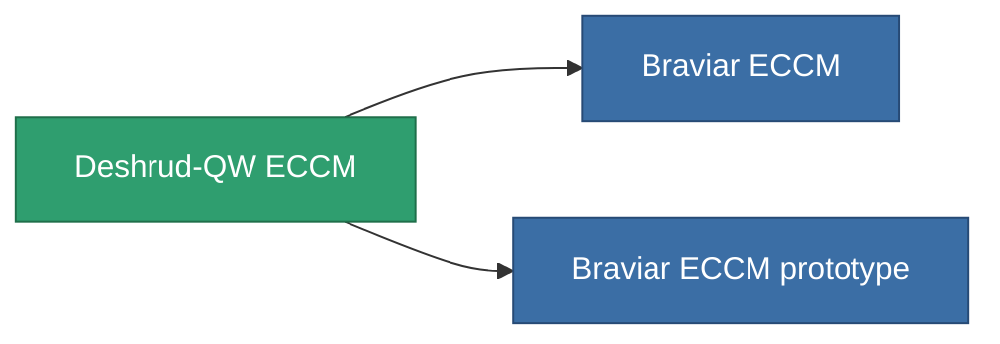

<!-- Generated by tools/generate from the live database (source: entitydefaults definition 796, aggregatevalues via aggregatefields).
     Do not edit by hand; regenerate instead. -->

# Deshrud-QW ECCM

|  |  |
|---|---|
| Definizione | `def_named2_eccm` |
| Livello | T3 |
| Salute | 100 |
| Volume | 0.5 |
| Massa | 100 |
| Categoria | Modules / Enhancements |
| Tier line | [Standard ECCM](/it/content/items/standard-eccm/) (T1) → [Wallex ECCM](/it/content/items/named1-eccm/) (T2) → **Deshrud-QW ECCM** (T3) → [Braviar ECCM](/it/content/items/named3-eccm/) (T4) |

## Statistiche

| Campo | Valore |
|---|---|
| cpu_usage | 26 |
| powergrid_usage | 16 |
| sensor_strength_modifier | 65 |

<!-- production:generated -->
## Produzione

**Prodotto da 8 componenti, livello di ricerca 4** — assembra i componenti per costruirlo (lista completa in [Ricette](/it/content/recipes/)):

**Piano:** [Deshrud-QW ECCM CT](/it/content/items/named2-eccm-cprg/)

<svg class="prod-card-icon" aria-hidden="true"><use href="#mi-grid"/></svg><a class="prod-card-name" href="/it/content/items/alligior/">Alligior</a>

richiesto: <b>25</b>

<svg class="prod-card-icon" aria-hidden="true"><use href="#mi-grid"/></svg><a class="prod-card-name" href="/it/content/items/axicol/">Cryoperine</a>

richiesto: <b>75</b>

<svg class="prod-card-icon" aria-hidden="true"><use href="#mi-grid"/></svg><a class="prod-card-name" href="/it/content/items/espitium/">Espitium</a>

richiesto: <b>75</b>

<svg class="prod-card-icon" aria-hidden="true"><use href="#mi-grid"/></svg><a class="prod-card-name" href="/it/content/items/named1-eccm/">Wallex ECCM</a>

richiesto: <b>1</b>

<svg class="prod-card-icon" aria-hidden="true"><use href="#mi-grid"/></svg><a class="prod-card-name" href="/it/content/items/plasteosine/">Plasteosine</a>

richiesto: <b>25</b>

<svg class="prod-card-icon" aria-hidden="true"><use href="#mi-crystal"/></svg><a class="prod-card-name" href="/it/content/items/robotshard-common-advanced/">Functional common fragment</a>

richiesto: <b>20</b>

<svg class="prod-card-icon" aria-hidden="true"><use href="#mi-crystal"/></svg><a class="prod-card-name" href="/it/content/items/robotshard-common-basic/">Damaged common fragment</a>

richiesto: <b>20</b>

<svg class="prod-card-icon" aria-hidden="true"><use href="#mi-grid"/></svg><a class="prod-card-name" href="/it/content/items/titanium/">Titanium</a>

richiesto: <b>50</b>

## Usato in produzione

**Componente di 2 oggetti** — tutto ciò che lo usa in produzione:

