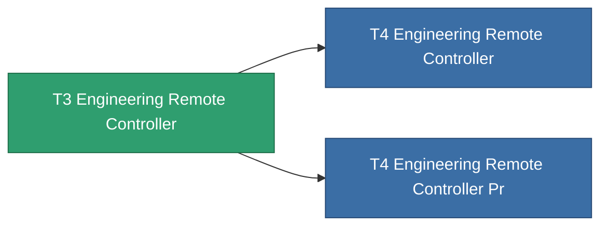

<!-- Generated by tools/generate from the live database (source: entitydefaults definition 9012, aggregatevalues via aggregatefields).
     Do not edit by hand; regenerate instead. -->

# T3 Engineering Remote Controller

|  |  |
|---|---|
| Definizione | `def_named2_engineering_remote_controller` |
| Livello | T3 |
| Salute | 100 |
| Volume | 1 |
| Massa | 1 |
| Categoria | Modules / Remote control |
| Tier line | [Standard Engineering Remote Controller](/it/content/items/standard-engineering-remote-controller/) (T1) → [T2 Engineering Remote Controller](/it/content/items/named1-engineering-remote-controller/) (T2) → **T3 Engineering Remote Controller** (T3) → [T4 Engineering Remote Controller](/it/content/items/named3-engineering-remote-controller/) (T4) |

## Statistiche

| Campo | Valore |
|---|---|
| core_usage | 165 |
| cpu_usage | 90 |
| cycle_time | 7.5k |
| powergrid_usage | 83 |
| remote_control_bandwidth_max | 0 |
| remote_control_lifetime | 300k |
| remote_control_operational_range | 30 |
| turret_amplification_accuracy_modifier | 1 |
| turret_amplification_armor_max_modifier | 1 |
| turret_amplification_core_max_modifier | 1 |
| turret_amplification_core_recharge_time_modifier | 1 |
| turret_amplification_cycle_time_modifier | 1 |
| turret_amplification_damage_modifier | 1 |
| turret_amplification_locking_time_modifier | 1 |
| turret_amplification_long_range_modifier | 1 |
| turret_amplification_reactor_radiation_modifier | 1 |

<!-- production:generated -->
## Produzione

**Prodotto da 6 componenti** — assembra i componenti per costruirlo (lista completa in [Ricette](/it/content/recipes/)):

**Piano:** [T3 Engineering Remote Controller Cprg](/it/content/items/named2-engineering-remote-controller-cprg/)

<svg class="prod-card-icon" aria-hidden="true"><use href="#mi-grid"/></svg><a class="prod-card-name" href="/it/content/items/axicol/">Cryoperine</a>

richiesto: <b>250</b>

<svg class="prod-card-icon" aria-hidden="true"><use href="#mi-grid"/></svg><a class="prod-card-name" href="/it/content/items/axicoline/">Axicoline</a>

richiesto: <b>100</b>

<svg class="prod-card-icon" aria-hidden="true"><use href="#mi-grid"/></svg><a class="prod-card-name" href="/it/content/items/espitium/">Espitium</a>

richiesto: <b>175</b>

<svg class="prod-card-icon" aria-hidden="true"><use href="#mi-grid"/></svg><a class="prod-card-name" href="/it/content/items/hydrobenol/">Hydrobenol</a>

richiesto: <b>50</b>

<svg class="prod-card-icon" aria-hidden="true"><use href="#mi-grid"/></svg><a class="prod-card-name" href="/it/content/items/named1-engineering-remote-controller/">T2 Engineering Remote Controller</a>

richiesto: <b>1</b>

<svg class="prod-card-icon" aria-hidden="true"><use href="#mi-grid"/></svg><a class="prod-card-name" href="/it/content/items/titanium/">Titanium</a>

richiesto: <b>50</b>

## Usato in produzione

**Componente di 2 oggetti** — tutto ciò che lo usa in produzione:

