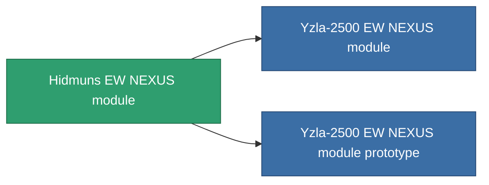

<!-- Generated by tools/generate from the live database (source: entitydefaults definition 2584, aggregatevalues via aggregatefields).
     Do not edit by hand; regenerate instead. -->

# Hidmuns EW NEXUS module

|  |  |
|---|---|
| Definizione | `def_named2_gang_assist_ewar_range_module` |
| Livello | T3 |
| Salute | 100 |
| Volume | 0.2 |
| Massa | 50 |
| Categoria | Modules / Enhancements |
| Tier line | [Standard EW NEXUS module](/it/content/items/standard-gang-assist-ewar-range-module/) (T1) → [Yzla-1500 EW NEXUS module](/it/content/items/named1-gang-assist-ewar-range-module/) (T2) → **Hidmuns EW NEXUS module** (T3) → [Yzla-2500 EW NEXUS module](/it/content/items/named3-gang-assist-ewar-range-module/) (T4) |
| Nota | ew_optimalt novel |

## Statistiche

| Campo | Valore |
|---|---|
| core_usage | 36 |
| cpu_usage | 88 |
| cycle_time | 10k |
| default_effect_range | 100 |
| effect_ew_optimal_range_modifier | 1.05 |
| powergrid_usage | 36 |

<!-- production:generated -->
## Produzione

**Prodotto da 8 componenti, livello di ricerca 6** — assembra i componenti per costruirlo (lista completa in [Ricette](/it/content/recipes/)):

**Piano:** [Hidmuns EW NEXUS module CT](/content/items/named2-gang-assist-ewar-range-module-cprg/)

<svg class="prod-card-icon" aria-hidden="true"><use href="#mi-grid"/></svg><a class="prod-card-name" href="/it/content/items/axicol/">Cryoperine</a>

richiesto: <b>250</b>

<svg class="prod-card-icon" aria-hidden="true"><use href="#mi-grid"/></svg><a class="prod-card-name" href="/it/content/items/axicoline/">Axicoline</a>

richiesto: <b>50</b>

<svg class="prod-card-icon" aria-hidden="true"><use href="#mi-grid"/></svg><a class="prod-card-name" href="/it/content/items/espitium/">Espitium</a>

richiesto: <b>250</b>

<svg class="prod-card-icon" aria-hidden="true"><use href="#mi-grid"/></svg><a class="prod-card-name" href="/it/content/items/hydrobenol/">Hydrobenol</a>

richiesto: <b>50</b>

<svg class="prod-card-icon" aria-hidden="true"><use href="#mi-panel"/></svg><a class="prod-card-name" href="/it/content/items/named1-gang-assist-ewar-range-module/">Yzla-1500 EW NEXUS module</a>

richiesto: <b>1</b>

<svg class="prod-card-icon" aria-hidden="true"><use href="#mi-crystal"/></svg><a class="prod-card-name" href="/it/content/items/robotshard-common-advanced/">Functional common fragment</a>

richiesto: <b>20</b>

<svg class="prod-card-icon" aria-hidden="true"><use href="#mi-crystal"/></svg><a class="prod-card-name" href="/it/content/items/robotshard-common-basic/">Damaged common fragment</a>

richiesto: <b>20</b>

<svg class="prod-card-icon" aria-hidden="true"><use href="#mi-grid"/></svg><a class="prod-card-name" href="/it/content/items/titanium/">Titanium</a>

richiesto: <b>50</b>

## Usato in produzione

**Componente di 2 oggetti** — tutto ciò che lo usa in produzione:

