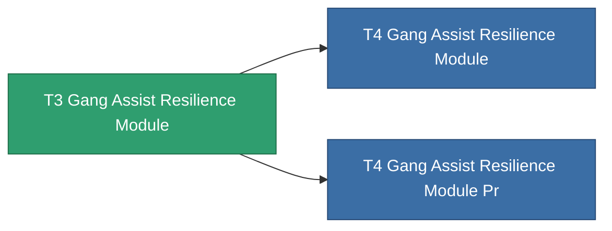

<!-- Generated by tools/generate from the live database (source: entitydefaults definition 2611, aggregatevalues via aggregatefields).
     Do not edit by hand; regenerate instead. -->

# T3 Gang Assist Resilience Module

|  |  |
|---|---|
| Definizione | `def_named2_gang_assist_resilience_module` |
| Livello | T3 |
| Salute | 100 |
| Volume | 0.2 |
| Massa | 50 |
| Categoria | Modules / Enhancements |
| Tier line | [Standard Gang Assist Resilience Module](/it/content/items/standard-gang-assist-resilience-module/) (T1) → [T2 Gang Assist Resilience Module](/it/content/items/named1-gang-assist-resilience-module/) (T2) → **T3 Gang Assist Resilience Module** (T3) → [T4 Gang Assist Resilience Module](/it/content/items/named3-gang-assist-resilience-module/) (T4) |
| Nota | shield absorbtion ratiot javit |

## Statistiche

| Campo | Valore |
|---|---|
| core_usage | 36 |
| cpu_usage | 88 |
| cycle_time | 10k |
| default_effect_range | 100 |
| effect_devastate_resilience_modifier | 1.05 |
| powergrid_usage | 36 |

<!-- production:generated -->
## Produzione

**Prodotto da 5 componenti, livello di ricerca 6** — assembra i componenti per costruirlo (lista completa in [Ricette](/it/content/recipes/)):

**Piano:** [T3 Gang Assist Resilience Module Cprg](/content/items/named2-gang-assist-resilience-module-cprg/)

<svg class="prod-card-icon" aria-hidden="true"><use href="#mi-panel"/></svg><a class="prod-card-name" href="/it/content/items/named1-gang-assist-resilience-module/">T2 Gang Assist Resilience Module</a>

richiesto: <b>1</b>

<svg class="prod-card-icon" aria-hidden="true"><use href="#mi-crystal"/></svg><a class="prod-card-name" href="/it/content/items/robotshard-pelistal-advanced/">Functional pelistal fragment</a>

richiesto: <b>10</b>

<svg class="prod-card-icon" aria-hidden="true"><use href="#mi-crystal"/></svg><a class="prod-card-name" href="/it/content/items/robotshard-pelistal-basic/">Damaged pelistal fragment</a>

richiesto: <b>10</b>

<svg class="prod-card-icon" aria-hidden="true"><use href="#mi-crystal"/></svg><a class="prod-card-name" href="/it/content/items/robotshard-thelodica-advanced/">Functional thelodica fragment</a>

richiesto: <b>10</b>

<svg class="prod-card-icon" aria-hidden="true"><use href="#mi-crystal"/></svg><a class="prod-card-name" href="/it/content/items/robotshard-thelodica-basic/">Damaged thelodica fragment</a>

richiesto: <b>10</b>

## Usato in produzione

**Componente di 2 oggetti** — tutto ciò che lo usa in produzione:

