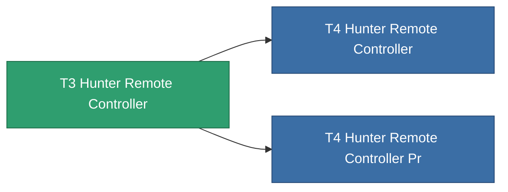

<!-- Generated by tools/generate from the live database (source: entitydefaults definition 8993, aggregatevalues via aggregatefields).
     Do not edit by hand; regenerate instead. -->

# T3 Hunter Remote Controller

|  |  |
|---|---|
| Definizione | `def_named2_hunter_remote_controller` |
| Livello | T3 |
| Salute | 100 |
| Volume | 100 |
| Massa | 450 |
| Categoria | Modules / Remote control |
| Tier line | [Standard Hunter Remote Controller](/it/content/items/standard-hunter-remote-controller/) (T1) → [T2 Hunter Remote Controller](/it/content/items/named1-hunter-remote-controller/) (T2) → **T3 Hunter Remote Controller** (T3) → [T4 Hunter Remote Controller](/it/content/items/named3-hunter-remote-controller/) (T4) |
| Nota | Deploys an autonomous hunter drone -- PvE ammo hunts Niani NPCs, PvP ammo hunts hostile-standing players. |

## Statistiche

| Campo | Valore |
|---|---|
| core_usage | 160 |
| cpu_usage | 270 |
| cycle_time | 4k |
| detection_range | 120 |
| powergrid_usage | 69 |
| remote_control_bandwidth_max | 1 |
| remote_control_lifetime | 2.16M |
| remote_control_operational_range | 180 |

<!-- production:generated -->
## Produzione

**Prodotto da 6 componenti** — assembra i componenti per costruirlo (lista completa in [Ricette](/it/content/recipes/)):

**Piano:** [T3 Hunter Remote Controller Cprg](/content/items/named2-hunter-remote-controller-cprg/)

<svg class="prod-card-icon" aria-hidden="true"><use href="#mi-grid"/></svg><a class="prod-card-name" href="/it/content/items/axicol/">Cryoperine</a>

richiesto: <b>125</b>

<svg class="prod-card-icon" aria-hidden="true"><use href="#mi-grid"/></svg><a class="prod-card-name" href="/it/content/items/axicoline/">Axicoline</a>

richiesto: <b>100</b>

<svg class="prod-card-icon" aria-hidden="true"><use href="#mi-grid"/></svg><a class="prod-card-name" href="/it/content/items/espitium/">Espitium</a>

richiesto: <b>300</b>

<svg class="prod-card-icon" aria-hidden="true"><use href="#mi-grid"/></svg><a class="prod-card-name" href="/it/content/items/hydrobenol/">Hydrobenol</a>

richiesto: <b>100</b>

<svg class="prod-card-icon" aria-hidden="true"><use href="#mi-grid"/></svg><a class="prod-card-name" href="/it/content/items/named1-hunter-remote-controller/">T2 Hunter Remote Controller</a>

richiesto: <b>1</b>

<svg class="prod-card-icon" aria-hidden="true"><use href="#mi-grid"/></svg><a class="prod-card-name" href="/it/content/items/titanium/">Titanium</a>

richiesto: <b>100</b>

## Usato in produzione

**Componente di 2 oggetti** — tutto ciò che lo usa in produzione:

