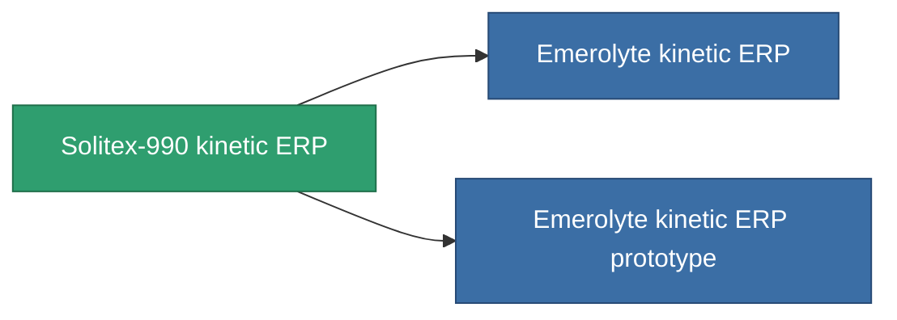

<!-- Generated by tools/generate from the live database (source: entitydefaults definition 3295, aggregatevalues via aggregatefields).
     Do not edit by hand; regenerate instead. -->

# Solitex-990 kinetic ERP

|  |  |
|---|---|
| Definizione | `def_named2_kinetic_kers` |
| Livello | T3 |
| Salute | 100 |
| Volume | 1 |
| Massa | 500 |
| Categoria | Modules / Enhancements |
| Tier line | [Standard kinetic ERP](/it/content/items/standard-kinetic-kers/) (T1) → [Hegatex-1000 kinetic ERP](/it/content/items/named1-kinetic-kers/) (T2) → **Solitex-990 kinetic ERP** (T3) → [Emerolyte kinetic ERP](/it/content/items/named3-kinetic-kers/) (T4) |

## Statistiche

| Campo | Valore |
|---|---|
| chemical_damage_to_core_modifier | 0.25 |
| cpu_usage | 53 |
| explosive_damage_to_core_modifier | 0.125 |
| kinetic_damage_to_core_modifier | 0.6 |
| powergrid_usage | 17 |
| thermal_damage_to_core_modifier | 0.125 |

<!-- production:generated -->
## Produzione

**Prodotto da 10 componenti, livello di ricerca 7** — assembra i componenti per costruirlo (lista completa in [Ricette](/it/content/recipes/)):

**Piano:** [Solitex-990 kinetic ERP CT](/content/items/named2-kinetic-kers-cprg/)

<svg class="prod-card-icon" aria-hidden="true"><use href="#mi-grid"/></svg><a class="prod-card-name" href="/it/content/items/alligior/">Alligior</a>

richiesto: <b>100</b>

<svg class="prod-card-icon" aria-hidden="true"><use href="#mi-grid"/></svg><a class="prod-card-name" href="/it/content/items/espitium/">Espitium</a>

richiesto: <b>200</b>

<svg class="prod-card-icon" aria-hidden="true"><use href="#mi-grid"/></svg><a class="prod-card-name" href="/it/content/items/metachropin/">Metachropin</a>

richiesto: <b>100</b>

<svg class="prod-card-icon" aria-hidden="true"><use href="#mi-grid"/></svg><a class="prod-card-name" href="/it/content/items/named1-kinetic-kers/">Hegatex-1000 kinetic ERP</a>

richiesto: <b>1</b>

<svg class="prod-card-icon" aria-hidden="true"><use href="#mi-grid"/></svg><a class="prod-card-name" href="/it/content/items/prilumium/">Prilumium</a>

richiesto: <b>200</b>

<svg class="prod-card-icon" aria-hidden="true"><use href="#mi-crystal"/></svg><a class="prod-card-name" href="/it/content/items/robotshard-common-advanced/">Functional common fragment</a>

richiesto: <b>3</b>

<svg class="prod-card-icon" aria-hidden="true"><use href="#mi-crystal"/></svg><a class="prod-card-name" href="/it/content/items/robotshard-common-basic/">Damaged common fragment</a>

richiesto: <b>2</b>

<svg class="prod-card-icon" aria-hidden="true"><use href="#mi-crystal"/></svg><a class="prod-card-name" href="/it/content/items/robotshard-thelodica-advanced/">Functional thelodica fragment</a>

richiesto: <b>3</b>

<svg class="prod-card-icon" aria-hidden="true"><use href="#mi-crystal"/></svg><a class="prod-card-name" href="/it/content/items/robotshard-thelodica-basic/">Damaged thelodica fragment</a>

richiesto: <b>2</b>

<svg class="prod-card-icon" aria-hidden="true"><use href="#mi-grid"/></svg><a class="prod-card-name" href="/it/content/items/titanium/">Titanium</a>

richiesto: <b>200</b>

## Usato in produzione

**Componente di 2 oggetti** — tutto ciò che lo usa in produzione:

