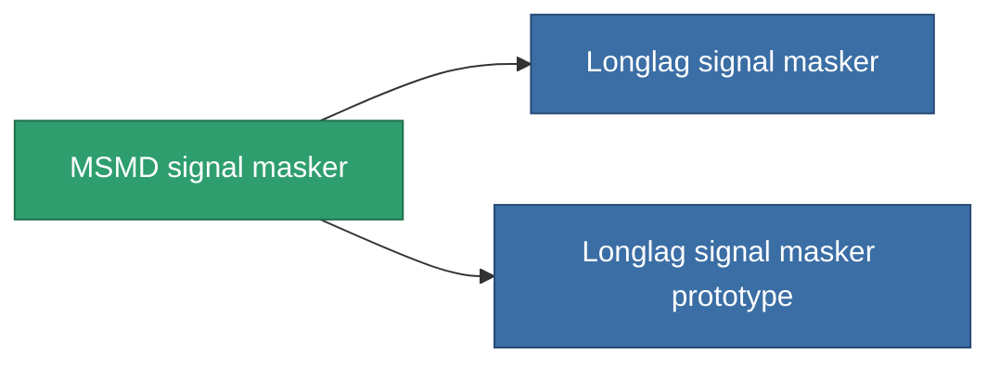

<!-- Generated by tools/generate from the live database (source: entitydefaults definition 2903, aggregatevalues via aggregatefields).
     Do not edit by hand; regenerate instead. -->

# MSMD signal masker

|  |  |
|---|---|
| Definizione | `def_named2_stealth_modul` |
| Livello | T3 |
| Salute | 100 |
| Volume | 0.5 |
| Massa | 250 |
| Categoria | Modules / Enhancements |
| Tier line | [Standard signal masker](/it/content/items/standard-stealth-modul/) (T1) → [Mimique signal masker](/it/content/items/named1-stealth-modul/) (T2) → **MSMD signal masker** (T3) → [Longlag signal masker](/it/content/items/named3-stealth-modul/) (T4) |

## Statistiche

| Campo | Valore |
|---|---|
| core_usage | 2.15 |
| cpu_usage | 100 |
| cycle_time | 10k |
| effect_stealth_strength_modifier | 45 |
| powergrid_usage | 5 |

<!-- production:generated -->
## Produzione

**Prodotto da 8 componenti, livello di ricerca 8** — assembra i componenti per costruirlo (lista completa in [Ricette](/it/content/recipes/)):

**Piano:** [MSMD signal masker CT](/content/items/named2-stealth-modul-cprg/)

<svg class="prod-card-icon" aria-hidden="true"><use href="#mi-grid"/></svg><a class="prod-card-name" href="/it/content/items/alligior/">Alligior</a>

richiesto: <b>25</b>

<svg class="prod-card-icon" aria-hidden="true"><use href="#mi-grid"/></svg><a class="prod-card-name" href="/it/content/items/axicol/">Cryoperine</a>

richiesto: <b>225</b>

<svg class="prod-card-icon" aria-hidden="true"><use href="#mi-grid"/></svg><a class="prod-card-name" href="/it/content/items/espitium/">Espitium</a>

richiesto: <b>225</b>

<svg class="prod-card-icon" aria-hidden="true"><use href="#mi-grid"/></svg><a class="prod-card-name" href="/it/content/items/named1-stealth-modul/">Mimique signal masker</a>

richiesto: <b>1</b>

<svg class="prod-card-icon" aria-hidden="true"><use href="#mi-grid"/></svg><a class="prod-card-name" href="/it/content/items/plasteosine/">Plasteosine</a>

richiesto: <b>25</b>

<svg class="prod-card-icon" aria-hidden="true"><use href="#mi-crystal"/></svg><a class="prod-card-name" href="/it/content/items/robotshard-common-advanced/">Functional common fragment</a>

richiesto: <b>40</b>

<svg class="prod-card-icon" aria-hidden="true"><use href="#mi-crystal"/></svg><a class="prod-card-name" href="/it/content/items/robotshard-common-basic/">Damaged common fragment</a>

richiesto: <b>40</b>

<svg class="prod-card-icon" aria-hidden="true"><use href="#mi-grid"/></svg><a class="prod-card-name" href="/it/content/items/titanium/">Titanium</a>

richiesto: <b>200</b>

## Usato in produzione

**Componente di 2 oggetti** — tutto ciò che lo usa in produzione:

