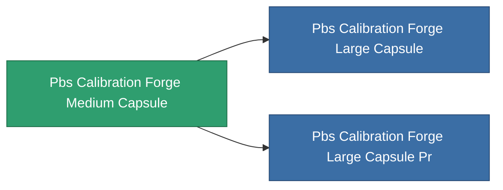

<!-- Generated by tools/generate from the live database (source: entitydefaults definition 4789, aggregatevalues via aggregatefields).
     Do not edit by hand; regenerate instead. -->

# Pbs Calibration Forge Medium Capsule

|  |  |
|---|---|
| Definizione | `def_pbs_calibration_forge_medium_capsule` |
| Livello | T2 |
| Salute | 100 |
| Volume | 187 |
| Massa | 187000 |
| Categoria | Special & other / Miscellaneous |

## Statistiche

| Campo | Valore |
|---|---|
| armor_max | 250k |
| core_max | 2.75k |
| resist_chemical | 75 |
| resist_explosive | 75 |
| resist_kinetic | 75 |
| resist_thermal | 75 |
| signature_radius | 65 |
| stealth_strength | 50 |

<!-- production:generated -->
## Produzione

**Prodotto da 13 componenti** — assembra i componenti per costruirlo (lista completa in [Ricette](/it/content/recipes/)):

**Piano:** [Advanced calibration lab foundation CT](/content/items/pbs-calibration-forge-medium-capsule-cprg/)

<svg class="prod-card-icon" aria-hidden="true"><use href="#mi-grid"/></svg><a class="prod-card-name" href="/it/content/items/alligior/">Alligior</a>

richiesto: <b>2.5k</b>

<svg class="prod-card-icon" aria-hidden="true"><use href="#mi-grid"/></svg><a class="prod-card-name" href="/it/content/items/axicol/">Cryoperine</a>

richiesto: <b>1.2k</b>

<svg class="prod-card-icon" aria-hidden="true"><use href="#mi-grid"/></svg><a class="prod-card-name" href="/it/content/items/axicoline/">Axicoline</a>

richiesto: <b>1.2k</b>

<svg class="prod-card-icon" aria-hidden="true"><use href="#mi-grid"/></svg><a class="prod-card-name" href="/it/content/items/espitium/">Espitium</a>

richiesto: <b>2.5k</b>

<svg class="prod-card-icon" aria-hidden="true"><use href="#mi-grid"/></svg><a class="prod-card-name" href="/it/content/items/gamma-buildblock/">Coalimin</a>

richiesto: <b>2.5k</b>

<svg class="prod-card-icon" aria-hidden="true"><use href="#mi-grid"/></svg><a class="prod-card-name" href="/it/content/items/gamma-defblock/">Bochilum</a>

richiesto: <b>1.2k</b>

<svg class="prod-card-icon" aria-hidden="true"><use href="#mi-grid"/></svg><a class="prod-card-name" href="/it/content/items/gamma-energyblock/">Tiraizin</a>

richiesto: <b>1.2k</b>

<svg class="prod-card-icon" aria-hidden="true"><use href="#mi-grid"/></svg><a class="prod-card-name" href="/it/content/items/gamma-offenseblock/">Turilium</a>

richiesto: <b>1.2k</b>

<svg class="prod-card-icon" aria-hidden="true"><use href="#mi-grid"/></svg><a class="prod-card-name" href="/it/content/items/hydrobenol/">Hydrobenol</a>

richiesto: <b>2.5k</b>

<svg class="prod-card-icon" aria-hidden="true"><use href="#mi-home"/></svg><a class="prod-card-name" href="/it/content/items/pbs-calibration-forge-small-capsule/">Pbs Calibration Forge Small Capsule</a>

richiesto: <b>1</b>

<svg class="prod-card-icon" aria-hidden="true"><use href="#mi-grid"/></svg><a class="prod-card-name" href="/it/content/items/plasteosine/">Plasteosine</a>

richiesto: <b>1.2k</b>

<svg class="prod-card-icon" aria-hidden="true"><use href="#mi-grid"/></svg><a class="prod-card-name" href="/it/content/items/titanium/">Titanium</a>

richiesto: <b>2.5k</b>

<svg class="prod-card-icon" aria-hidden="true"><use href="#mi-grid"/></svg><a class="prod-card-name" href="/it/content/items/unimetal/">Briochit</a>

richiesto: <b>5.0k</b>

## Usato in produzione

**Componente di 2 oggetti** — tutto ciò che lo usa in produzione:

