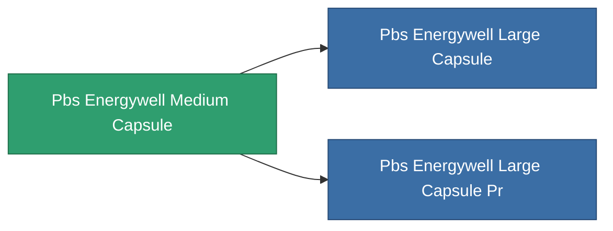

<!-- Generated by tools/generate from the live database (source: entitydefaults definition 5356, aggregatevalues via aggregatefields).
     Do not edit by hand; regenerate instead. -->

# Pbs Energywell Medium Capsule

|  |  |
|---|---|
| Definizione | `def_pbs_energywell_medium_capsule` |
| Livello | T2 |
| Salute | 100 |
| Volume | 225 |
| Massa | 225000 |
| Categoria | Special & other / Miscellaneous |

## Statistiche

| Campo | Valore |
|---|---|
| armor_max | 25k |
| core_max | 20M |
| core_recharge_time | 345.6k |
| resist_chemical | 75 |
| resist_explosive | 75 |
| resist_kinetic | 75 |
| resist_thermal | 75 |
| signature_radius | 25 |
| stealth_strength | 50 |

<!-- production:generated -->
## Produzione

**Prodotto da 10 componenti** — assembra i componenti per costruirlo (lista completa in [Ricette](/it/content/recipes/)):

**Piano:** [Advanced energy well foundation CT](/content/items/pbs-energywell-medium-capsule-cprg/)

<svg class="prod-card-icon" aria-hidden="true"><use href="#mi-grid"/></svg><a class="prod-card-name" href="/it/content/items/alligior/">Alligior</a>

richiesto: <b>1.2k</b>

<svg class="prod-card-icon" aria-hidden="true"><use href="#mi-grid"/></svg><a class="prod-card-name" href="/it/content/items/axicol/">Cryoperine</a>

richiesto: <b>325</b>

<svg class="prod-card-icon" aria-hidden="true"><use href="#mi-grid"/></svg><a class="prod-card-name" href="/it/content/items/espitium/">Espitium</a>

richiesto: <b>675</b>

<svg class="prod-card-icon" aria-hidden="true"><use href="#mi-grid"/></svg><a class="prod-card-name" href="/it/content/items/gamma-buildblock/">Coalimin</a>

richiesto: <b>675</b>

<svg class="prod-card-icon" aria-hidden="true"><use href="#mi-grid"/></svg><a class="prod-card-name" href="/it/content/items/gamma-defblock/">Bochilum</a>

richiesto: <b>675</b>

<svg class="prod-card-icon" aria-hidden="true"><use href="#mi-grid"/></svg><a class="prod-card-name" href="/it/content/items/gamma-energyblock/">Tiraizin</a>

richiesto: <b>300</b>

<svg class="prod-card-icon" aria-hidden="true"><use href="#mi-home"/></svg><a class="prod-card-name" href="/it/content/items/pbs-energywell-small-capsule/">Pbs Energywell Small Capsule</a>

richiesto: <b>1</b>

<svg class="prod-card-icon" aria-hidden="true"><use href="#mi-grid"/></svg><a class="prod-card-name" href="/it/content/items/plasteosine/">Plasteosine</a>

richiesto: <b>675</b>

<svg class="prod-card-icon" aria-hidden="true"><use href="#mi-grid"/></svg><a class="prod-card-name" href="/it/content/items/titanium/">Titanium</a>

richiesto: <b>675</b>

<svg class="prod-card-icon" aria-hidden="true"><use href="#mi-grid"/></svg><a class="prod-card-name" href="/it/content/items/unimetal/">Briochit</a>

richiesto: <b>1.2k</b>

## Usato in produzione

**Componente di 2 oggetti** — tutto ciò che lo usa in produzione:

