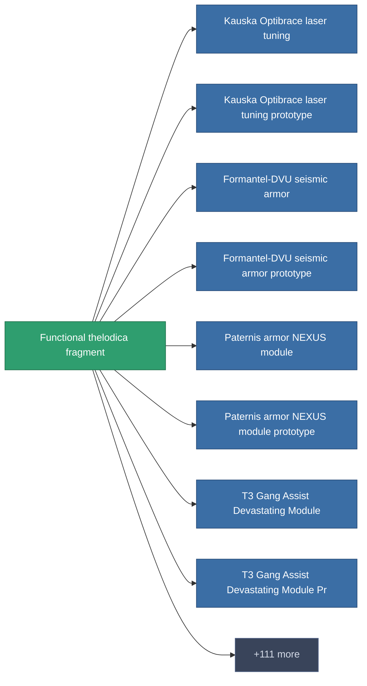

<!-- Generated by tools/generate from the live database (source: entitydefaults definition 1984, aggregatevalues via aggregatefields).
     Do not edit by hand; regenerate instead. -->

# Functional thelodica fragment

|  |  |
|---|---|
| Definizione | `def_robotshard_thelodica_advanced` |
| Livello | – |
| Salute | 100 |
| Volume | 0.01 |
| Massa | 1 |
| Categoria | Materials |

_Nessuna statistica — questo oggetto non porta valori aggregati._

<!-- production:generated -->
## Produzione

**Prodotto da 3 componenti** — assembra i componenti per costruirlo (lista completa in [Ricette](/it/content/recipes/)):

<svg class="prod-card-icon" aria-hidden="true"><use href="#mi-grid"/></svg><a class="prod-card-name" href="/it/content/items/metachropin/">Metachropin</a>

richiesto: <b>2</b>

<svg class="prod-card-icon" aria-hidden="true"><use href="#mi-grid"/></svg><a class="prod-card-name" href="/it/content/items/polynucleit/">Polynucleit</a>

richiesto: <b>2</b>

<svg class="prod-card-icon" aria-hidden="true"><use href="#mi-grid"/></svg><a class="prod-card-name" href="/it/content/items/prilumium/">Prilumium</a>

richiesto: <b>2</b>

## Usato in produzione

**Componente di 119 oggetti** — un campione di ciò che si può produrre con esso (lista completa in [Ricette](/it/content/recipes/)).

