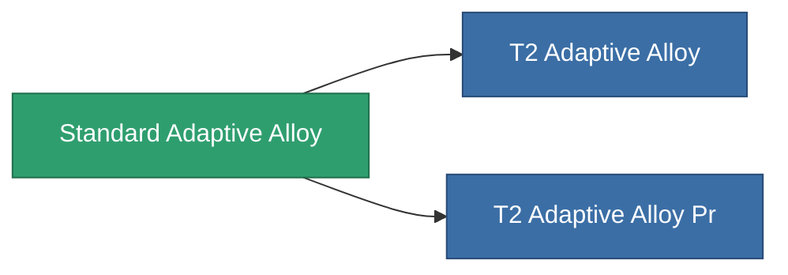

<!-- Generated by tools/generate from the live database (source: entitydefaults definition 8788, aggregatevalues via aggregatefields).
     Do not edit by hand; regenerate instead. -->

# Standard Adaptive Alloy

|  |  |
|---|---|
| Definizione | `def_standard_adaptive_alloy` |
| Livello | T1 |
| Salute | 100 |
| Volume | 1.5 |
| Massa | 500 |
| Categoria | Modules / Enhancements |
| Tier line | **Standard Adaptive Alloy** (T1) → [T2 Adaptive Alloy](/it/content/items/named1-adaptive-alloy/) (T2) → [T3 Adaptive Alloy](/it/content/items/named2-adaptive-alloy/) (T3) → [T4 Adaptive Alloy](/it/content/items/named3-adaptive-alloy/) (T4) |

## Statistiche

| Campo | Valore |
|---|---|
| adaptive_resist_points | 60 |
| cpu_usage | 38 |
| powergrid_usage | 12 |

<!-- production:generated -->
## Produzione

**Prodotto da 9 componenti, livello di ricerca 3** — assembra i componenti per costruirlo (lista completa in [Ricette](/it/content/recipes/)):

**Piano:** [Standard Adaptive Alloy Cprg](/it/content/items/standard-adaptive-alloy-cprg/)

<svg class="prod-card-icon" aria-hidden="true"><use href="#mi-grid"/></svg><a class="prod-card-name" href="/it/content/items/axicol/">Cryoperine</a>

richiesto: <b>200</b>

<svg class="prod-card-icon" aria-hidden="true"><use href="#mi-grid"/></svg><a class="prod-card-name" href="/it/content/items/chollonin/">Chollonin</a>

richiesto: <b>25</b>

<svg class="prod-card-icon" aria-hidden="true"><use href="#mi-grid"/></svg><a class="prod-card-name" href="/it/content/items/isopropentol/">Isopropentol</a>

richiesto: <b>65</b>

<svg class="prod-card-icon" aria-hidden="true"><use href="#mi-grid"/></svg><a class="prod-card-name" href="/it/content/items/metachropin/">Metachropin</a>

richiesto: <b>65</b>

<svg class="prod-card-icon" aria-hidden="true"><use href="#mi-grid"/></svg><a class="prod-card-name" href="/it/content/items/plasteosine/">Plasteosine</a>

richiesto: <b>500</b>

<svg class="prod-card-icon" aria-hidden="true"><use href="#mi-grid"/></svg><a class="prod-card-name" href="/it/content/items/prilumium/">Prilumium</a>

richiesto: <b>25</b>

<svg class="prod-card-icon" aria-hidden="true"><use href="#mi-grid"/></svg><a class="prod-card-name" href="/it/content/items/statichnol/">Statichnol</a>

richiesto: <b>65</b>

<svg class="prod-card-icon" aria-hidden="true"><use href="#mi-grid"/></svg><a class="prod-card-name" href="/it/content/items/titanium/">Titanium</a>

richiesto: <b>200</b>

<svg class="prod-card-icon" aria-hidden="true"><use href="#mi-grid"/></svg><a class="prod-card-name" href="/it/content/items/vitricyl/">Vitricyl</a>

richiesto: <b>25</b>

## Usato in produzione

**Componente di 2 oggetti** — tutto ciò che lo usa in produzione:

