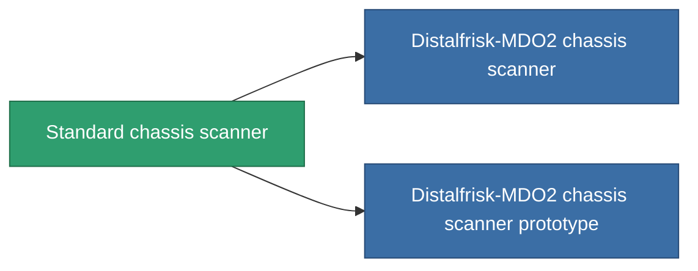

<!-- Generated by tools/generate from the live database (source: entitydefaults definition 46, aggregatevalues via aggregatefields).
     Do not edit by hand; regenerate instead. -->

# Standard chassis scanner

|  |  |
|---|---|
| Definizione | `def_standard_chassis_scanner` |
| Livello | T1 |
| Salute | 100 |
| Volume | 0.5 |
| Massa | 200 |
| Categoria | Modules / Sensors & scanning |
| Tier line | **Standard chassis scanner** (T1) → [Distalfrisk-MDO2 chassis scanner](/it/content/items/named1-chassis-scanner/) (T2) → [Stalis CS3 chassis scanner](/it/content/items/named2-chassis-scanner/) (T3) → [sy-D-930 chassis scanner](/it/content/items/named3-chassis-scanner/) (T4) |

## Statistiche

| Campo | Valore |
|---|---|
| core_usage | 20 |
| cpu_usage | 15 |
| cycle_time | 7.5k |
| falloff | 10 |
| optimal_range | 30 |
| powergrid_usage | 5 |

<!-- production:generated -->
## Produzione

**Prodotto da 2 componenti, livello di ricerca 3** — assembra i componenti per costruirlo (lista completa in [Ricette](/it/content/recipes/)):

**Piano:** [Standard chassis scanner CT](/it/content/items/standard-chassis-scanner-cprg/)

<svg class="prod-card-icon" aria-hidden="true"><use href="#mi-grid"/></svg><a class="prod-card-name" href="/it/content/items/axicol/">Cryoperine</a>

richiesto: <b>250</b>

<svg class="prod-card-icon" aria-hidden="true"><use href="#mi-grid"/></svg><a class="prod-card-name" href="/it/content/items/titanium/">Titanium</a>

richiesto: <b>50</b>

## Usato in produzione

**Componente di 2 oggetti** — tutto ciò che lo usa in produzione:

