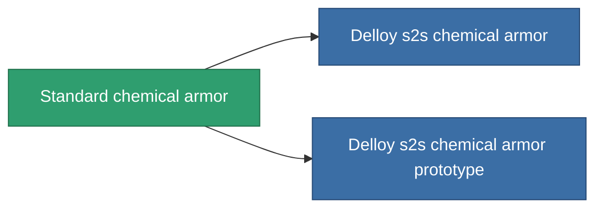

<!-- Generated by tools/generate from the live database (source: entitydefaults definition 25, aggregatevalues via aggregatefields).
     Do not edit by hand; regenerate instead. -->

# Standard chemical armor

|  |  |
|---|---|
| Definizione | `def_standard_chm_armor_hardener` |
| Livello | T1 |
| Salute | 100 |
| Volume | 1 |
| Massa | 100 |
| Categoria | Modules / Armor |
| Tier line | **Standard chemical armor** (T1) → [Delloy s2s chemical armor](/it/content/items/named1-chm-armor-hardener/) (T2) → [RePro I. chemical armor](/it/content/items/named2-chm-armor-hardener/) (T3) → [Impetar chemical armor](/it/content/items/named3-chm-armor-hardener/) (T4) |

## Statistiche

| Campo | Valore |
|---|---|
| core_usage | 13 |
| cpu_usage | 25 |
| cycle_time | 10k |
| effect_resist_chemical | 100 |
| powergrid_usage | 5 |
| resist_chemical | 25 |

<!-- production:generated -->
## Produzione

**Prodotto da 3 componenti, livello di ricerca 3** — assembra i componenti per costruirlo (lista completa in [Ricette](/it/content/recipes/)):

**Piano:** [Standard chemical armor CT](/it/content/items/standard-chm-armor-hardener-cprg/)

<svg class="prod-card-icon" aria-hidden="true"><use href="#mi-grid"/></svg><a class="prod-card-name" href="/it/content/items/axicol/">Cryoperine</a>

richiesto: <b>100</b>

<svg class="prod-card-icon" aria-hidden="true"><use href="#mi-grid"/></svg><a class="prod-card-name" href="/it/content/items/plasteosine/">Plasteosine</a>

richiesto: <b>250</b>

<svg class="prod-card-icon" aria-hidden="true"><use href="#mi-grid"/></svg><a class="prod-card-name" href="/it/content/items/titanium/">Titanium</a>

richiesto: <b>100</b>

## Usato in produzione

**Componente di 2 oggetti** — tutto ciò che lo usa in produzione:

