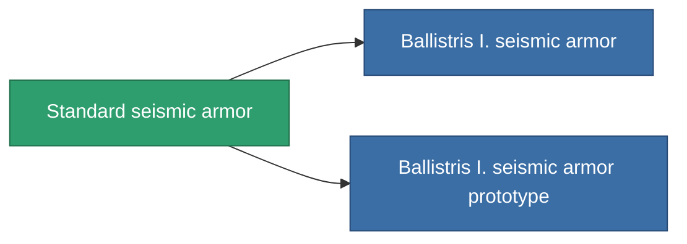

<!-- Generated by tools/generate from the live database (source: entitydefaults definition 27, aggregatevalues via aggregatefields).
     Do not edit by hand; regenerate instead. -->

# Standard seismic armor

|  |  |
|---|---|
| Definizione | `def_standard_exp_armor_hardener` |
| Livello | T1 |
| Salute | 100 |
| Volume | 1 |
| Massa | 100 |
| Categoria | Modules / Armor |
| Tier line | **Standard seismic armor** (T1) → [Ballistris I. seismic armor](/it/content/items/named1-exp-armor-hardener/) (T2) → [Formantel-DVU seismic armor](/it/content/items/named2-exp-armor-hardener/) (T3) → [Sheltor seismic armor](/it/content/items/named3-exp-armor-hardener/) (T4) |

## Statistiche

| Campo | Valore |
|---|---|
| core_usage | 13 |
| cpu_usage | 25 |
| cycle_time | 10k |
| effect_resist_explosive | 100 |
| powergrid_usage | 5 |
| resist_explosive | 25 |

<!-- production:generated -->
## Produzione

**Prodotto da 5 componenti, livello di ricerca 3** — assembra i componenti per costruirlo (lista completa in [Ricette](/it/content/recipes/)):

**Piano:** [Standard seismic armor CT](/it/content/items/standard-exp-armor-hardener-cprg/)

<svg class="prod-card-icon" aria-hidden="true"><use href="#mi-grid"/></svg><a class="prod-card-name" href="/it/content/items/axicol/">Cryoperine</a>

richiesto: <b>50</b>

<svg class="prod-card-icon" aria-hidden="true"><use href="#mi-grid"/></svg><a class="prod-card-name" href="/it/content/items/chollonin/">Chollonin</a>

richiesto: <b>50</b>

<svg class="prod-card-icon" aria-hidden="true"><use href="#mi-grid"/></svg><a class="prod-card-name" href="/it/content/items/plasteosine/">Plasteosine</a>

richiesto: <b>125</b>

<svg class="prod-card-icon" aria-hidden="true"><use href="#mi-grid"/></svg><a class="prod-card-name" href="/it/content/items/statichnol/">Statichnol</a>

richiesto: <b>125</b>

<svg class="prod-card-icon" aria-hidden="true"><use href="#mi-grid"/></svg><a class="prod-card-name" href="/it/content/items/titanium/">Titanium</a>

richiesto: <b>100</b>

## Usato in produzione

**Componente di 2 oggetti** — tutto ciò che lo usa in produzione:

