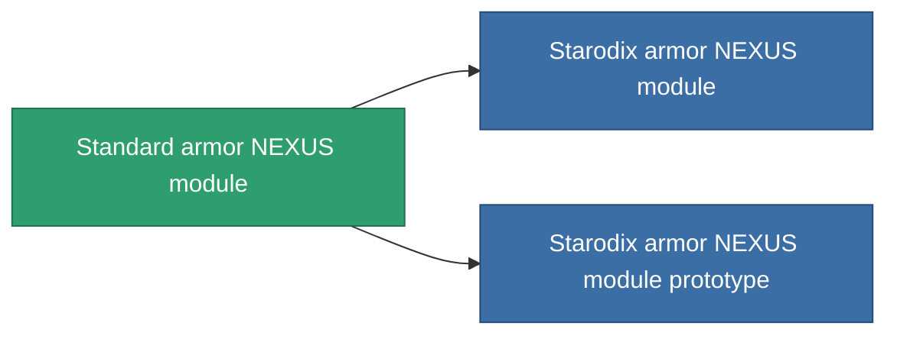

<!-- Generated by tools/generate from the live database (source: entitydefaults definition 877, aggregatevalues via aggregatefields).
     Do not edit by hand; regenerate instead. -->

# Standard armor NEXUS module

|  |  |
|---|---|
| Definizione | `def_standard_gang_assist_defense_module` |
| Livello | T1 |
| Salute | 100 |
| Volume | 0.2 |
| Massa | 10 |
| Categoria | Modules / Enhancements |
| Tier line | **Standard armor NEXUS module** (T1) → [Starodix armor NEXUS module](/it/content/items/named1-gang-assist-defense-module/) (T2) → [Paternis armor NEXUS module](/it/content/items/named2-gang-assist-defense-module/) (T3) → [TSP-Hindoo armor NEXUS module](/it/content/items/named3-gang-assist-defense-module/) (T4) |
| Nota | armor hp 1% /ext lvl |

## Statistiche

| Campo | Valore |
|---|---|
| core_usage | 35 |
| cpu_usage | 85 |
| cycle_time | 10k |
| default_effect_range | 100 |
| effect_armor_max_modifier | 1.02 |
| powergrid_usage | 35 |

<!-- production:generated -->
## Produzione

**Prodotto da 5 componenti, livello di ricerca 4** — assembra i componenti per costruirlo (lista completa in [Ricette](/it/content/recipes/)):

**Piano:** [Standard armor NEXUS module CT](/content/items/standard-gang-assist-defense-module-cprg/)

<svg class="prod-card-icon" aria-hidden="true"><use href="#mi-grid"/></svg><a class="prod-card-name" href="/it/content/items/axicol/">Cryoperine</a>

richiesto: <b>250</b>

<svg class="prod-card-icon" aria-hidden="true"><use href="#mi-grid"/></svg><a class="prod-card-name" href="/it/content/items/metachropin/">Metachropin</a>

richiesto: <b>50</b>

<svg class="prod-card-icon" aria-hidden="true"><use href="#mi-grid"/></svg><a class="prod-card-name" href="/it/content/items/plasteosine/">Plasteosine</a>

richiesto: <b>50</b>

<svg class="prod-card-icon" aria-hidden="true"><use href="#mi-grid"/></svg><a class="prod-card-name" href="/it/content/items/prilumium/">Prilumium</a>

richiesto: <b>250</b>

<svg class="prod-card-icon" aria-hidden="true"><use href="#mi-grid"/></svg><a class="prod-card-name" href="/it/content/items/titanium/">Titanium</a>

richiesto: <b>50</b>

## Usato in produzione

**Componente di 2 oggetti** — tutto ciò che lo usa in produzione:

