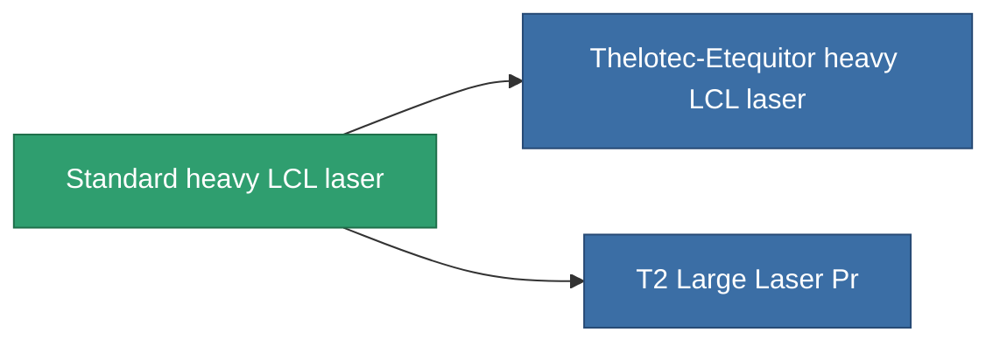

<!-- Generated by tools/generate from the live database (source: entitydefaults definition 59, aggregatevalues via aggregatefields).
     Do not edit by hand; regenerate instead. -->

# Standard heavy LCL laser

|  |  |
|---|---|
| Definizione | `def_standard_large_laser` |
| Livello | T1 |
| Salute | 100 |
| Volume | 1.5 |
| Massa | 1000 |
| Categoria | Modules / Weapons |
| Tier line | **Standard heavy LCL laser** (T1) → [Thelotec-Etequitor heavy LCL laser](/it/content/items/named1-large-laser/) (T2) → [Thelotec-Apocalyptor heavy LCL laser](/it/content/items/named2-large-laser/) (T3) → [Kauska Heatpin II. heavy LCL laser](/it/content/items/named3-large-laser/) (T4) |

## Statistiche

| Campo | Valore |
|---|---|
| accuracy | 34.5 |
| core_usage | 11.76 |
| cpu_usage | 62.5 |
| cycle_time | 5k |
| damage_modifier | 1.91 |
| falloff | 10 |
| optimal_range | 22.5 |
| powergrid_usage | 350 |

<!-- production:generated -->
## Produzione

**Prodotto da 4 componenti** — assembra i componenti per costruirlo (lista completa in [Ricette](/it/content/recipes/)):

**Piano:** [Standard Large Laser Cprg](/it/content/items/standard-large-laser-cprg/)

<svg class="prod-card-icon" aria-hidden="true"><use href="#mi-grid"/></svg><a class="prod-card-name" href="/it/content/items/axicoline/">Axicoline</a>

richiesto: <b>150</b>

<svg class="prod-card-icon" aria-hidden="true"><use href="#mi-grid"/></svg><a class="prod-card-name" href="/it/content/items/polynucleit/">Polynucleit</a>

richiesto: <b>150</b>

<svg class="prod-card-icon" aria-hidden="true"><use href="#mi-grid"/></svg><a class="prod-card-name" href="/it/content/items/specimen-sap-item-flux/">Specimen Sap Item Flux</a>

richiesto: <b>10</b>

<svg class="prod-card-icon" aria-hidden="true"><use href="#mi-grid"/></svg><a class="prod-card-name" href="/it/content/items/titanium/">Titanium</a>

richiesto: <b>150</b>

## Usato in produzione

**Componente di 2 oggetti** — tutto ciò che lo usa in produzione:

