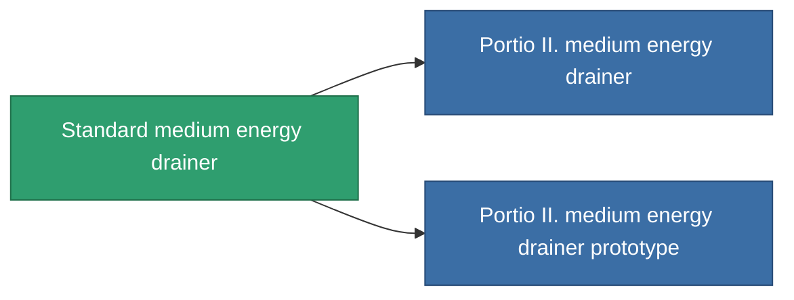

<!-- Generated by tools/generate from the live database (source: entitydefaults definition 36, aggregatevalues via aggregatefields).
     Do not edit by hand; regenerate instead. -->

# Standard medium energy drainer

|  |  |
|---|---|
| Definizione | `def_standard_medium_energy_vampire` |
| Livello | T1 |
| Salute | 100 |
| Volume | 1 |
| Massa | 500 |
| Categoria | Modules / Shield |
| Tier line | **Standard medium energy drainer** (T1) → [Portio II. medium energy drainer](/it/content/items/named1-medium-energy-vampire/) (T2) → [V90-Quadres medium energy drainer](/it/content/items/named2-medium-energy-vampire/) (T3) → [Filch-AM medium energy drainer](/it/content/items/named3-medium-energy-vampire/) (T4) |

## Statistiche

| Campo | Valore |
|---|---|
| core_usage | 15 |
| cpu_usage | 55 |
| cycle_time | 10k |
| energy_dispersion | 10 |
| energy_vampired_amount | 90 |
| falloff | 0 |
| optimal_range | 25 |
| powergrid_usage | 175 |

<!-- production:generated -->
## Produzione

**Prodotto da 3 componenti, livello di ricerca 4** — assembra i componenti per costruirlo (lista completa in [Ricette](/it/content/recipes/)):

**Piano:** [Standard medium energy drainer CT](/content/items/standard-medium-energy-vampire-cprg/)

<svg class="prod-card-icon" aria-hidden="true"><use href="#mi-grid"/></svg><a class="prod-card-name" href="/it/content/items/axicol/">Cryoperine</a>

richiesto: <b>400</b>

<svg class="prod-card-icon" aria-hidden="true"><use href="#mi-grid"/></svg><a class="prod-card-name" href="/it/content/items/axicoline/">Axicoline</a>

richiesto: <b>200</b>

<svg class="prod-card-icon" aria-hidden="true"><use href="#mi-grid"/></svg><a class="prod-card-name" href="/it/content/items/titanium/">Titanium</a>

richiesto: <b>200</b>

## Usato in produzione

**Componente di 2 oggetti** — tutto ciò che lo usa in produzione:

