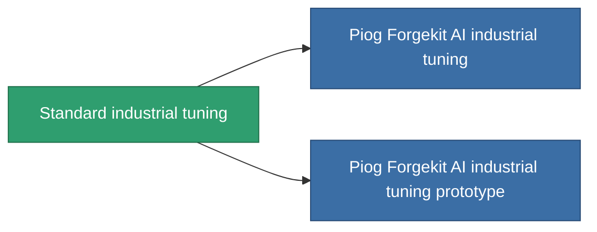

<!-- Generated by tools/generate from the live database (source: entitydefaults definition 56, aggregatevalues via aggregatefields).
     Do not edit by hand; regenerate instead. -->

# Standard industrial tuning

|  |  |
|---|---|
| Definizione | `def_standard_mining_upgrade` |
| Livello | T1 |
| Salute | 100 |
| Volume | 1 |
| Massa | 100 |
| Categoria | Modules / Enhancements |
| Tier line | **Standard industrial tuning** (T1) → [Piog Forgekit AI industrial tuning](/it/content/items/named1-mining-upgrade/) (T2) → [Fraktura SCV industrial tuning](/it/content/items/named2-mining-upgrade/) (T3) → [Piog Forgekit BW1 industrial tuning](/it/content/items/named3-mining-upgrade/) (T4) |

## Statistiche

| Campo | Valore |
|---|---|
| cpu_usage | 35 |
| harvesting_amount_modifier | 1.05 |
| mining_amount_modifier | 1.05 |
| powergrid_usage | 20 |

<!-- production:generated -->
## Produzione

**Prodotto da 2 componenti, livello di ricerca 3** — assembra i componenti per costruirlo (lista completa in [Ricette](/it/content/recipes/)):

**Piano:** [Standard industrial tuning CT](/it/content/items/standard-mining-upgrade-cprg/)

<svg class="prod-card-icon" aria-hidden="true"><use href="#mi-grid"/></svg><a class="prod-card-name" href="/it/content/items/axicol/">Cryoperine</a>

richiesto: <b>200</b>

<svg class="prod-card-icon" aria-hidden="true"><use href="#mi-grid"/></svg><a class="prod-card-name" href="/it/content/items/titanium/">Titanium</a>

richiesto: <b>50</b>

## Usato in produzione

**Componente di 2 oggetti** — tutto ciò che lo usa in produzione:

