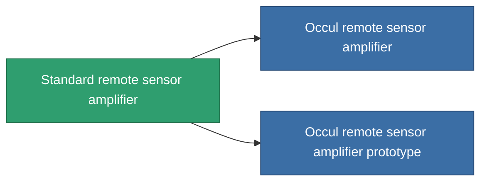

<!-- Generated by tools/generate from the live database (source: entitydefaults definition 44, aggregatevalues via aggregatefields).
     Do not edit by hand; regenerate instead. -->

# Standard remote sensor amplifier

|  |  |
|---|---|
| Definizione | `def_standard_remote_sensor_booster` |
| Livello | T1 |
| Salute | 100 |
| Volume | 0.5 |
| Massa | 100 |
| Categoria | Modules / Sensors & scanning |
| Tier line | **Standard remote sensor amplifier** (T1) → [Occul remote sensor amplifier](/it/content/items/named1-remote-sensor-booster/) (T2) → [Da Gama-PLS10 remote sensor amplifier](/it/content/items/named2-remote-sensor-booster/) (T3) → [Ambassador-RU2 remote sensor amplifier](/it/content/items/named3-remote-sensor-booster/) (T4) |

## Statistiche

| Campo | Valore |
|---|---|
| core_usage | 14 |
| cpu_usage | 20 |
| cycle_time | 10k |
| effect_sensor_booster_locking_range_modifier | 1.3 |
| effect_sensor_booster_locking_time_modifier | 0.8 |
| falloff | 0 |
| optimal_range | 30 |
| powergrid_usage | 7 |

<!-- production:generated -->
## Produzione

**Prodotto da 2 componenti, livello di ricerca 3** — assembra i componenti per costruirlo (lista completa in [Ricette](/it/content/recipes/)):

**Piano:** [Standard remote sensor amplifier CT](/content/items/standard-remote-sensor-booster-cprg/)

<svg class="prod-card-icon" aria-hidden="true"><use href="#mi-grid"/></svg><a class="prod-card-name" href="/it/content/items/axicol/">Cryoperine</a>

richiesto: <b>400</b>

<svg class="prod-card-icon" aria-hidden="true"><use href="#mi-grid"/></svg><a class="prod-card-name" href="/it/content/items/titanium/">Titanium</a>

richiesto: <b>100</b>

## Usato in produzione

**Componente di 2 oggetti** — tutto ciò che lo usa in produzione:

