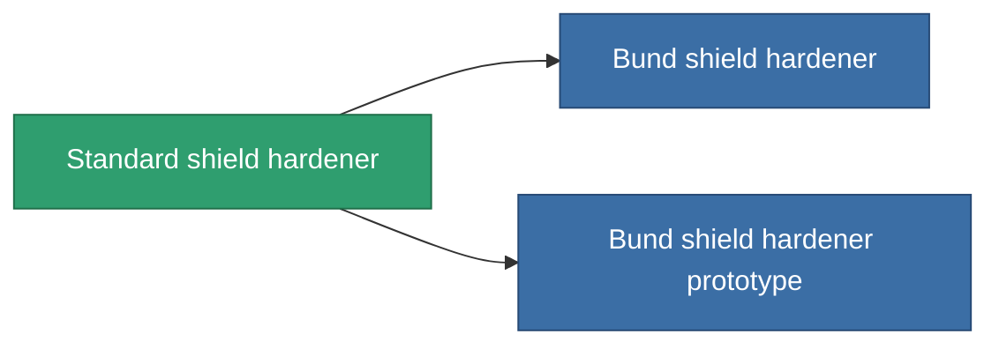

<!-- Generated by tools/generate from the live database (source: entitydefaults definition 31, aggregatevalues via aggregatefields).
     Do not edit by hand; regenerate instead. -->

# Standard shield hardener

|  |  |
|---|---|
| Definizione | `def_standard_shield_hardener` |
| Livello | T1 |
| Salute | 100 |
| Volume | 0.5 |
| Massa | 300 |
| Categoria | Modules / Shield |
| Tier line | **Standard shield hardener** (T1) → [Bund shield hardener](/it/content/items/named1-shield-hardener/) (T2) → [Patronus shield hardener](/it/content/items/named2-shield-hardener/) (T3) → [Guardian shield hardener](/it/content/items/named3-shield-hardener/) (T4) |
| Nota | ettol a modultol tud jobban mudkodni a pajzs = kevesebb lesz a core csokkenes 5%kal |

## Statistiche

| Campo | Valore |
|---|---|
| cpu_usage | 50 |
| powergrid_usage | 20 |
| shield_absorbtion_modifier | 1.2 |

<!-- production:generated -->
## Produzione

**Prodotto da 5 componenti, livello di ricerca 3** — assembra i componenti per costruirlo (lista completa in [Ricette](/it/content/recipes/)):

**Piano:** [Standard shield hardener CT](/it/content/items/standard-shield-hardener-cprg/)

<svg class="prod-card-icon" aria-hidden="true"><use href="#mi-grid"/></svg><a class="prod-card-name" href="/it/content/items/axicol/">Cryoperine</a>

richiesto: <b>200</b>

<svg class="prod-card-icon" aria-hidden="true"><use href="#mi-grid"/></svg><a class="prod-card-name" href="/it/content/items/isopropentol/">Isopropentol</a>

richiesto: <b>150</b>

<svg class="prod-card-icon" aria-hidden="true"><use href="#mi-grid"/></svg><a class="prod-card-name" href="/it/content/items/plasteosine/">Plasteosine</a>

richiesto: <b>150</b>

<svg class="prod-card-icon" aria-hidden="true"><use href="#mi-grid"/></svg><a class="prod-card-name" href="/it/content/items/titanium/">Titanium</a>

richiesto: <b>50</b>

<svg class="prod-card-icon" aria-hidden="true"><use href="#mi-grid"/></svg><a class="prod-card-name" href="/it/content/items/vitricyl/">Vitricyl</a>

richiesto: <b>200</b>

## Usato in produzione

**Componente di 2 oggetti** — tutto ciò che lo usa in produzione:

