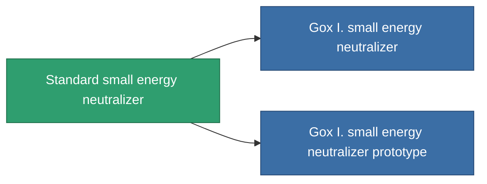

<!-- Generated by tools/generate from the live database (source: entitydefaults definition 38, aggregatevalues via aggregatefields).
     Do not edit by hand; regenerate instead. -->

# Standard small energy neutralizer

|  |  |
|---|---|
| Definizione | `def_standard_small_energy_neutralizer` |
| Livello | T1 |
| Salute | 100 |
| Volume | 0.5 |
| Massa | 100 |
| Categoria | Modules / Shield |
| Tier line | **Standard small energy neutralizer** (T1) → [Gox I. small energy neutralizer](/it/content/items/named1-small-energy-neutralizer/) (T2) → [600GFX-Spasm small energy neutralizer](/it/content/items/named2-small-energy-neutralizer/) (T3) → [Cerba small energy neutralizer](/it/content/items/named3-small-energy-neutralizer/) (T4) |
| Nota | range = optimal_range *  energy_transferers_optimal_range_modifier    cel core -= energy_neutralized_amount  sajat core -= energy_neutralized_amount - 10% |

## Statistiche

| Campo | Valore |
|---|---|
| core_usage | 45 |
| cpu_usage | 25 |
| cycle_time | 8k |
| energy_dispersion | 4 |
| energy_neutralized_amount | 50 |
| falloff | 0 |
| optimal_range | 12.5 |
| powergrid_usage | 40 |

<!-- production:generated -->
## Produzione

**Prodotto da 5 componenti, livello di ricerca 2** — assembra i componenti per costruirlo (lista completa in [Ricette](/it/content/recipes/)):

**Piano:** [Standard small energy neutralizer CT](/content/items/standard-small-energy-neutralizer-cprg/)

<svg class="prod-card-icon" aria-hidden="true"><use href="#mi-grid"/></svg><a class="prod-card-name" href="/it/content/items/axicol/">Cryoperine</a>

richiesto: <b>100</b>

<svg class="prod-card-icon" aria-hidden="true"><use href="#mi-grid"/></svg><a class="prod-card-name" href="/it/content/items/axicoline/">Axicoline</a>

richiesto: <b>50</b>

<svg class="prod-card-icon" aria-hidden="true"><use href="#mi-grid"/></svg><a class="prod-card-name" href="/it/content/items/phlobotil/">Phlobotil</a>

richiesto: <b>50</b>

<svg class="prod-card-icon" aria-hidden="true"><use href="#mi-grid"/></svg><a class="prod-card-name" href="/it/content/items/titanium/">Titanium</a>

richiesto: <b>50</b>

<svg class="prod-card-icon" aria-hidden="true"><use href="#mi-grid"/></svg><a class="prod-card-name" href="/it/content/items/vitricyl/">Vitricyl</a>

richiesto: <b>100</b>

## Usato in produzione

**Componente di 2 oggetti** — tutto ciò che lo usa in produzione:

