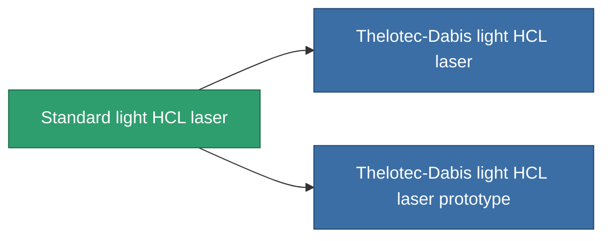

<!-- Generated by tools/generate from the live database (source: entitydefaults definition 57, aggregatevalues via aggregatefields).
     Do not edit by hand; regenerate instead. -->

# Standard light HCL laser

|  |  |
|---|---|
| Definizione | `def_standard_small_laser` |
| Livello | T1 |
| Salute | 100 |
| Volume | 0.5 |
| Massa | 250 |
| Categoria | Modules / Weapons |
| Tier line | **Standard light HCL laser** (T1) → [Thelotec-Dabis light HCL laser](/it/content/items/named1-small-laser/) (T2) → [Pikolo light HCL laser](/it/content/items/named2-small-laser/) (T3) → [Thelotec-Stroyar light HCL laser](/it/content/items/named3-small-laser/) (T4) |

## Statistiche

| Campo | Valore |
|---|---|
| accuracy | 4 |
| core_usage | 4 |
| cpu_usage | 20 |
| cycle_time | 4k |
| damage_modifier | 1 |
| falloff | 10 |
| least_optimal | 5 |
| optimal_range | 15 |
| powergrid_usage | 40 |

<!-- production:generated -->
## Produzione

**Prodotto da 3 componenti, livello di ricerca 2** — assembra i componenti per costruirlo (lista completa in [Ricette](/it/content/recipes/)):

**Piano:** [Standard light HCL laser CT](/content/items/standard-small-laser-cprg/)

<svg class="prod-card-icon" aria-hidden="true"><use href="#mi-grid"/></svg><a class="prod-card-name" href="/it/content/items/axicoline/">Axicoline</a>

richiesto: <b>50</b>

<svg class="prod-card-icon" aria-hidden="true"><use href="#mi-grid"/></svg><a class="prod-card-name" href="/it/content/items/polynucleit/">Polynucleit</a>

richiesto: <b>50</b>

<svg class="prod-card-icon" aria-hidden="true"><use href="#mi-grid"/></svg><a class="prod-card-name" href="/it/content/items/titanium/">Titanium</a>

richiesto: <b>50</b>

## Usato in produzione

**Componente di 2 oggetti** — tutto ciò che lo usa in produzione:

