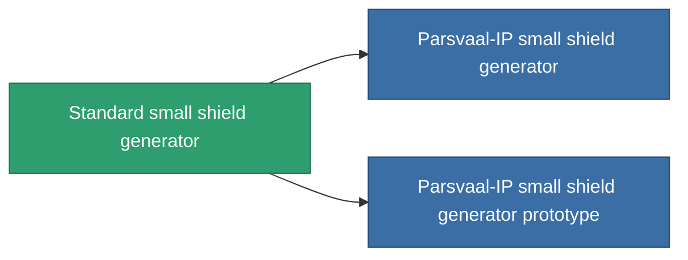

<!-- Generated by tools/generate from the live database (source: entitydefaults definition 28, aggregatevalues via aggregatefields).
     Do not edit by hand; regenerate instead. -->

# Standard small shield generator

|  |  |
|---|---|
| Definizione | `def_standard_small_shield_generator` |
| Livello | T1 |
| Salute | 100 |
| Volume | 0.3 |
| Massa | 200 |
| Categoria | Modules / Shield |
| Tier line | **Standard small shield generator** (T1) → [Parsvaal-IP small shield generator](/it/content/items/named1-small-shield-generator/) (T2) → [Ovostec-Yellowray small shield generator](/it/content/items/named2-small-shield-generator/) (T3) → [SBA-200 Forebrace small shield generator](/it/content/items/named3-small-shield-generator/) (T4) |
| Nota | damage to core = shield_absorbtion * shield_absorbtion_modifier  amig ez a modul fut addig nincs damage, csak a core-bol von le.  |

## Statistiche

| Campo | Valore |
|---|---|
| core_usage | 1 |
| cpu_usage | 45 |
| cycle_time | 2.75k |
| powergrid_usage | 50 |
| shield_absorbtion | 2 |
| shield_radius | 4.5 |

<!-- production:generated -->
## Produzione

**Prodotto da 5 componenti, livello di ricerca 2** — assembra i componenti per costruirlo (lista completa in [Ricette](/it/content/recipes/)):

**Piano:** [Standard small shield generator CT](/content/items/standard-small-shield-generator-cprg/)

<svg class="prod-card-icon" aria-hidden="true"><use href="#mi-grid"/></svg><a class="prod-card-name" href="/it/content/items/axicol/">Cryoperine</a>

richiesto: <b>100</b>

<svg class="prod-card-icon" aria-hidden="true"><use href="#mi-grid"/></svg><a class="prod-card-name" href="/it/content/items/isopropentol/">Isopropentol</a>

richiesto: <b>200</b>

<svg class="prod-card-icon" aria-hidden="true"><use href="#mi-grid"/></svg><a class="prod-card-name" href="/it/content/items/plasteosine/">Plasteosine</a>

richiesto: <b>200</b>

<svg class="prod-card-icon" aria-hidden="true"><use href="#mi-grid"/></svg><a class="prod-card-name" href="/it/content/items/titanium/">Titanium</a>

richiesto: <b>100</b>

<svg class="prod-card-icon" aria-hidden="true"><use href="#mi-grid"/></svg><a class="prod-card-name" href="/it/content/items/vitricyl/">Vitricyl</a>

richiesto: <b>100</b>

## Usato in produzione

**Componente di 2 oggetti** — tutto ciò che lo usa in produzione:

