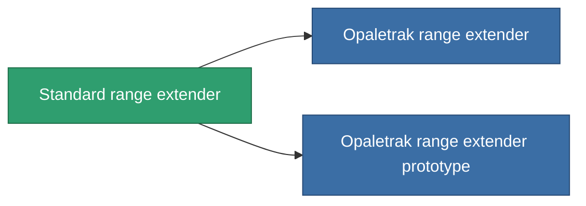

<!-- Generated by tools/generate from the live database (source: entitydefaults definition 913, aggregatevalues via aggregatefields).
     Do not edit by hand; regenerate instead. -->

# Standard range extender

|  |  |
|---|---|
| Definizione | `def_standard_tracking_upgrade` |
| Livello | T1 |
| Salute | 100 |
| Volume | 0.1 |
| Massa | 50 |
| Categoria | Modules / Enhancements |
| Tier line | **Standard range extender** (T1) → [Opaletrak range extender](/it/content/items/named1-tracking-upgrade/) (T2) → [Unotron 60s-'Crack shot' range extender](/it/content/items/named2-tracking-upgrade/) (T3) → [ATCS-gh50 range extender](/it/content/items/named3-tracking-upgrade/) (T4) |

## Statistiche

| Campo | Valore |
|---|---|
| cpu_usage | 35 |
| optimal_range_modifier | 1.1 |
| powergrid_usage | 100 |

<!-- production:generated -->
## Produzione

**Prodotto da 3 componenti, livello di ricerca 3** — assembra i componenti per costruirlo (lista completa in [Ricette](/it/content/recipes/)):

**Piano:** [Standard range extender CT](/it/content/items/standard-tracking-upgrade-cprg/)

<svg class="prod-card-icon" aria-hidden="true"><use href="#mi-grid"/></svg><a class="prod-card-name" href="/it/content/items/axicol/">Cryoperine</a>

richiesto: <b>300</b>

<svg class="prod-card-icon" aria-hidden="true"><use href="#mi-grid"/></svg><a class="prod-card-name" href="/it/content/items/axicoline/">Axicoline</a>

richiesto: <b>150</b>

<svg class="prod-card-icon" aria-hidden="true"><use href="#mi-grid"/></svg><a class="prod-card-name" href="/it/content/items/titanium/">Titanium</a>

richiesto: <b>100</b>

## Usato in produzione

**Componente di 2 oggetti** — tutto ciò che lo usa in produzione:

