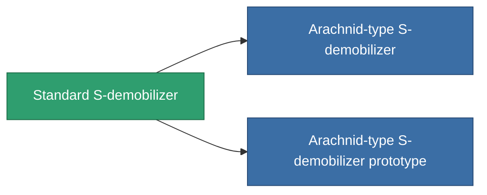

<!-- Generated by tools/generate from the live database (source: entitydefaults definition 49, aggregatevalues via aggregatefields).
     Do not edit by hand; regenerate instead. -->

# Standard S-demobilizer

|  |  |
|---|---|
| Definizione | `def_standard_webber` |
| Livello | T1 |
| Salute | 100 |
| Volume | 0.5 |
| Massa | 100 |
| Categoria | Modules / Enhancements |
| Tier line | **Standard S-demobilizer** (T1) → [Arachnid-type S-demobilizer](/it/content/items/named1-webber/) (T2) → [NNt. IX S-demobilizer](/it/content/items/named2-webber/) (T3) → [NNt. IY S-demobilizer](/it/content/items/named3-webber/) (T4) |

## Statistiche

| Campo | Valore |
|---|---|
| core_usage | 16 |
| cpu_usage | 45 |
| cycle_time | 5k |
| effect_massivness_speed_max_modifier | 0.65 |
| falloff | 0 |
| optimal_range | 12 |
| powergrid_usage | 15 |

<!-- production:generated -->
## Produzione

**Prodotto da 3 componenti, livello di ricerca 3** — assembra i componenti per costruirlo (lista completa in [Ricette](/it/content/recipes/)):

**Piano:** [Standard S-demobilizer CT](/content/items/standard-webber-cprg/)

<svg class="prod-card-icon" aria-hidden="true"><use href="#mi-grid"/></svg><a class="prod-card-name" href="/it/content/items/axicol/">Cryoperine</a>

richiesto: <b>350</b>

<svg class="prod-card-icon" aria-hidden="true"><use href="#mi-grid"/></svg><a class="prod-card-name" href="/it/content/items/axicoline/">Axicoline</a>

richiesto: <b>100</b>

<svg class="prod-card-icon" aria-hidden="true"><use href="#mi-grid"/></svg><a class="prod-card-name" href="/it/content/items/titanium/">Titanium</a>

richiesto: <b>100</b>

## Usato in produzione

**Componente di 2 oggetti** — tutto ciò che lo usa in produzione:

