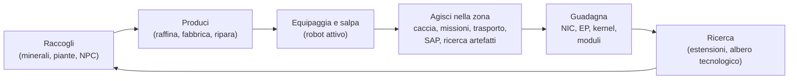

# Cosa puoi fare nel gioco

Ogni azione del giocatore, organizzata per sistema. Il nome del comando è l'identificatore
lato server — il client presenta queste azioni nella propria interfaccia utente. Le spiegazioni dettagliate per ciascuna azione
si trovano nelle pagine dedicate ai singoli sistemi.

Il ciclo del gioco in sintesi: guadagna e spendi per scalare i livelli tecnologici (tier).

## Sistemi

| Sistema | Pagina | Cosa comprende |
|---|---|---|
| Primi passi | [getting-started](/it/features/getting-started/) | creazione/selezione dei personaggi, primo robot, basi dell'account |
| Movimento | [movement](/it/features/movement/) | zone, attracco, coda, teletrasporti, salti spark, portali |
| Raccolta | [gathering](/it/features/gathering/) | scansione, estrazione, raccolta di risorse |
| Combattimento | [combat](/it/features/combat/) | combattimento, tipi di danno, interferenza, allarmi, rapporti di abbattimento, SOS |
| NPC e caccia PVE | [npcs](/it/features/npcs/) | gradi e fazioni degli NPC, debolezze, tipi di spawn, TAP, tattiche |
| Esplorazione | [exploration](/it/features/exploration/) | artefatti e reliquie |
| Robot ed equipaggiamento | [robots](/it/features/robots/) | selezione dei robot, moduli, munizioni, configurazioni salvate, colorazioni |
| Moduli ed equipaggiamento | [modules](/it/features/modules/) | famiglie di moduli e regole pratiche di fitting |
| Spark | [sparks](/it/features/sparks/) | autorizzazione dello spark, cambio spark, bonus alle abilità |
| Ricerca | [research](/it/features/research/) | estensioni (albero delle abilità), EP, albero tecnologico |
| Personaggio | [character](/it/features/character/) | finestra del personaggio: scheda estensioni (albero abilità) e spark |
| Produzione | [production](/it/features/production/) | linee di produzione, raffinazione, riparazione, ritrattamento, prototipi, CPRG |
| Mercato e commercio | [market](/it/features/market/) | ordini di mercato, scambi diretti, negozio di oggetti, crediti |
| Gruppi | [groups](/it/features/groups/) | corporazioni, alleanze, gang (flotte) |
| Stazioni base energetiche | [pbs](/it/features/pbs/) | strutture PBS, territori, collegamenti |
| Missioni | [missions](/it/features/missions/) | missioni sul campo, agenti, terminali |
| Trasporto | [transport](/it/features/transport/) | spedizione di oggetti tra le basi |
| Oggetti e inventario | [items](/it/features/items/) | contenitori, impilamento, nomi degli oggetti, riscattabili, pacchi regalo |
| Sociale | [social](/it/features/social/) | posta, canali, amici, reputazioni (standing), pagine gialle, notizie, sondaggi |
| Intrusione | [intrusion](/it/features/intrusion/) | modalità di assalto ai siti NPC |
| Avamposti e SAP | [outposts](/it/features/outposts/) | controllo degli avamposti, stabilità, i quattro tipi di SAP |
| Sonde di prossimità | [probes](/it/features/probes/) | sonde di sorveglianza della zona |
| Server e riferimenti | [server](/it/features/server/) | info sul server, punteggi record, dati di riferimento, acquisti |
| FAQ | [faq](/it/features/faq/) | tutorial, scelta della fazione, primi passi, terminologia |
| Lore | [lore](/it/features/lore/) | l'ambientazione: Nia, i Niani, il Sindacato |
| Configurazione client e PC | [client-setup](/it/features/client-setup/) | esecuzione del client, multi-boxing, ridimensionamento dell'interfaccia utente |

### Riferimenti

| Pagina | Cosa comprende |
|---|---|
| [Panoramica dell'interfaccia client](/it/features/ui/) | L'interfaccia in stile EVE: barra superiore, pulsante Schiera/Attracca, categorie di azioni, pannello di stato non attraccato e convenzioni utilizzate in questo wiki |

Le tabelle delle statistiche delle entità si trovano nella sezione generata [Content](/content/).

## Inventario completo delle azioni

### Primi passi e account

| Azione | Comando |
|---|---|
| Crea un personaggio | `characterCreate` |
| Seleziona (gioca come) un personaggio | `characterSelect` |
| Elimina un personaggio | `characterDelete` |
| Rinomina un personaggio | `characterRename` |
| Verifica se un nome è disponibile | `characterCheckNick` |
| Richiedi il robot iniziale | `requestStarterRobot` |
| Richiedi la cassa iniziale | `requestInfiniteBox` |
| Dati di configurazione nuovo personaggio | `characterWizardData` |
| Visualizza il mio profilo | `characterGetMyProfile` |
| Visualizza i profili di altri personaggi | `characterGetProfiles` |
| Cerca personaggi | `characterSearch` |
| Elenca personaggi | `characterList` |
| Ottieni/imposta impostazioni del personaggio | `characterSettingsGet`, `characterSettingsSet` |
| Imposta avatar | `characterSetAvatar` |
| Imposta messaggio di stato/umore | `characterSetMoodmessage` |
| Imposta una nota privata su un personaggio | `characterSetNote` / `characterGetNote` |
| Imposta / cancella base principale | `characterSetHomeBase`, `characterClearHomeBase` |
| Trasferisci crediti tra i propri personaggi | `characterTransferCredit` |
| Blocca/consenti scambi su un personaggio | `characterSetBlockTrades` |
| Cambia e-mail / password dell'account | `changeSessionEmail`, `changeSessionPassword` |
| Visualizza cronologia EP per attività | `accountEpForActivityHistory` |
| Visualizza cronologia transazioni dell'account | `accountGetTransactionHistory` |
| Disconnessione / gestione della connessione | `signOut`, `connectionStart`, `connectionEnd`, `ping`, `quit`, `isOnline`, `transferData`, `welcome` |
| Chi è online | `getCharactersOnline`, `getAccountsWithCharacters` |
| Cronologie del personaggio | `characterNickHistory`, `characterCorporationHistory`, `characterTransactionHistory`, `characterListNpcDeath` |

### Movimento e zone

| Azione | Comando |
|---|---|
| Attracca a una base / PBS | `dock` |
| Salpa / lascia l'attracco | `undock` |
| Attracco forzato (emergenza) | `forceDock` |
| Controlla la coda di ingresso nella zona | `zoneGetQueueInfo` |
| Imposta preferenza lunghezza della coda | `zoneSetQueueLength` |
| Annulla l'attesa in coda | `zoneCancelEnterQueue` |
| Ottieni info sulla zona | `getZoneInfo` |
| Elenca settori di una zona | `zoneSectorList` |
| Elenca edifici della zona | `zoneGetBuildings` |
| Invia SOS (richiesta di aiuto) | `zoneSOS` |
| Elenca teletrasporti disponibili | `teleportList` |
| Usa un teletrasporto | `teleportUse` |
| Teletrasportati a un oggetto di zona | `teleportToZoneObject` |
| Elenca canali di teletrasporto | `teleportGetChannelList` |
| Interroga canali di teletrasporto globali | `teleportQueryWorldChannels` |
| Elenca cariche spark | `sparkList` |
| Cambia spark attivo | `sparkChange` |
| Rimuovi uno spark | `sparkRemove` |
| Sblocca uno spark | `sparkUnlock` |
| Elenca / imposta / usa / elimina teletrasporti spark | `sparkTeleportList`, `sparkTeleportSet`, `sparkTeleportUse`, `sparkTeleportDelete` |
| Rinomina un portale | `gateSetName` |
| Info base / proprietà / strutture / i miei oggetti alla base | `baseGetInfo`, `baseGetOwnershipInfo`, `baseListFacilities`, `baseGetMyItems` |
| Imposta permessi di attracco alla base | `baseSetDockingRights` |

### Raccolta e scansione

| Azione | Comando |
|---|---|
| Scansiona la zona (scansione minerali/piante/strutture schierabili) | `zoneUploadScanResult` |
| Elenca i risultati della mia scansione mineraria | `mineralScanResultList` |
| Crea un oggetto da un risultato di scansione | `mineralScanResultCreateItem` |
| Elimina un risultato di scansione | `mineralScanResultDelete` |
| Sposta risultati di scansione tra contenitori | `mineralScanResultMove` |
| Carica dati di scansione da un oggetto | `mineralScanResultUploadFromItem` |
| Conta oggetti in una zona (controllo visibilità) | `itemCountOnZone`, `itemCount` |
| Chiosco: visualizza / consegna oggetti | `kioskInfo`, `kioskSubmitItem` |
| Usa un oggetto (generico — incluse risorse raccoglibili) | `useItem` |

### Combattimento

| Azione | Comando |
|---|---|
| Attiva / disattiva allarme di combattimento | `alarmStart` (il termine dell'allarme è gestito dal server) |
| Visualizza i miei rapporti di abbattimento | `getMyKillReports` |
| Visualizza i miei record personali | `getMyHighScores` |
| Visualizza record del server | `getHighScores` |

### Robot ed equipaggiamento

| Azione | Comando |
|---|---|
| Seleziona robot attivo | `selectActiveRobot` |
| Svuota un robot (scarica tutto) | `robotEmpty` |
| Ottieni info sul robot | `getRobotInfo` |
| Ottieni info sull'equipaggiamento del robot | `getRobotFittingInfo` |
| Equipaggia un modulo | `equipModule` |
| Rimuovi un modulo | `removeModule` |
| Sostituisci moduli | `changeModule` |
| Equipaggia munizioni | `equipAmmo` |
| Sostituisci munizioni | `changeAmmo` |
| Rimuovi munizioni | `unEquipAmmo` |
| Imposta colorazione robot | `setRobotTint` |
| Salva / elenca / applica / elimina configurazioni salvate | `fittingPresetSave`, `fittingPresetList`, `fittingPresetApply`, `fittingPresetDelete` |

### Ricerca (estensioni e albero tecnologico)

| Azione | Comando |
|---|---|
| Elenca categorie di estensioni | `extensionCategoryList` |
| Ottieni tutte le estensioni | `extensionGetAll` |
| Elenca estensioni apprese | `extensionLearntList` |
| Elenca prerequisiti | `extensionPrerequireList` |
| Acquista un'estensione con punti | `extensionBuyForPoints` |
| Acquista un potenziamento EP | `extensionBuyEpBoost` |
| Ottieni punti disponibili | `extensionGetAvailablePoints` |
| Ottieni parametri dei punti | `extensionGetPointParameters` |
| Cronologia estensioni | `extensionHistory` |
| Rimuovi un livello di estensione | `extensionRemoveLevel` |
| Ripristina estensioni del personaggio | `extensionResetCharacter` |
| Libera EP bloccati | `extensionFreeLockedEp` |
| Visualizza registro giornaliero EP per attività | `epForActivityDailyLog` |
| Ottieni livelli di ricerca | `getResearchLevels` |
| Albero tecnologico: ricerca un nodo | `techTreeResearch` |
| Albero tecnologico: sblocca un nodo | `techTreeUnlock` |
| Albero tecnologico: dona | `techTreeDonate` |
| Albero tecnologico: info / registri | `techTreeInfo`, `techTreeGetLogs` |

### Produzione

| Azione | Comando |
|---|---|
| Elenca linee di produzione | `productionLineList` |
| Avvia una linea | `productionLineStart` |
| Calibra una linea | `productionLineCalibrate` |
| Imposta cicli su una linea | `productionLineSetRounds` |
| Elimina una linea | `productionLineDelete` |
| Interroga prossimo ciclo di una linea | `productionQueryLineNextRound` |
| Annulla produzione | `productionCancel` |
| Raffina (interroga + esegui) | `productionRefine`, `productionRefineQuery` |
| Ripara (interroga + esegui) | `productionRepair`, `productionRepairQuery` |
| Ritrattamento (interroga + esegui) | `productionReprocess`, `productionReprocessQuery` |
| Ricerca componenti (interroga + esegui) | `productionResearch`, `productionResearchQuery` |
| Prototipa (avvia + interroga) | `productionPrototypeStart`, `productionPrototypeQuery` |
| Unisci kit di ricerca (esegui + interroga) | `productionMergeResearchKitsMulti`, `productionMergeResearchKitsMultiQuery` |
| Forgia CPRG (esegui + interroga) | `productionCPRGForge`, `productionCPRGForgeQuery` |
| Info CPRG | `productionCPRGInfo` |
| Ottieni CPRG da una linea (ottieni + interroga) | `productionGetCPRGFromLine`, `productionGetCPRGFromLineQuery` |
| Assicurazione di produzione: acquista / elenca / interroga / elimina | `productionInsuranceBuy`, `productionInsuranceList`, `productionInsuranceQuery`, `productionInsuranceDelete` |
| Elenca componenti di produzione | `productionComponentsList` |
| Info struttura / descrizione | `productionFacilityInfo`, `productionFacilityDescription` |
| Cosa è in corso (personale / corporazione) | `productionInProgress`, `productionInProgressCorporation` |
| Cronologia di produzione | `productionHistory` |
| Info server di produzione | `productionServerInfo` |

### Mercato e commercio

| Azione | Comando |
|---|---|
| Crea un ordine di vendita | `marketCreateSellOrder` |
| Crea un ordine di acquisto | `marketCreateBuyOrder` |
| Modifica un ordine | `marketModifyOrder` |
| Annulla un oggetto / ordine | `marketCancelItem` |
| Acquista un oggetto direttamente | `marketBuyItem` |
| Elenca oggetti sul mercato | `marketItemList` |
| Elenca oggetti a me disponibili | `marketAvailableItems` |
| Elenca oggetti entro un raggio | `marketItemsInRange` |
| Elenca i miei oggetti sul mercato | `marketGetMyItems` |
| Info mercato | `marketGetInfo` |
| Prezzi medi (mercato / definizione / globale) | `marketGetAveragePrices`, `marketGetDefinitionAveragePrice`, `marketGlobalAveragePrices` |
| Modifica tassa di mercato / visualizza registro tasse | `marketTaxChange`, `marketTaxLogList` |
| Inizia uno scambio | `tradeBegin` |
| Imposta / ritira la mia offerta | `tradeSetOffer`, `tradeRetractOffer` |
| Accetta uno scambio | `tradeAccept` |
| Annulla uno scambio | `tradeCancel` |
| Scambio completato / stato | `tradeFinished`, `tradeState` |
| Negozio di oggetti: elenca / acquista | `itemShopList`, `itemShopBuy` |
| Trasferisci crediti a un altro personaggio | `characterTransferCredit` |

### Gruppi (corporazioni, alleanze, gang)

| Azione | Comando |
|---|---|
| Crea una corporazione | `corporationCreate` |
| Candidati a / invita in una corporazione | `corporationApply`, `corporationCharacterInvite` |
| Accetta candidatura / elenca candidature | `corporationAcceptApplication`, `corporationListApplications` |
| Le mie candidature: elenca / elimina | `corporationListMyApplications`, `corporationDeleteMyApplication` |
| Elimina una candidatura (ufficiale) | `corporationDeleteApplication` |
| Rispondi a un invito | `corporationInviteReply` |
| Lascia / annulla abbandono corporazione | `corporationLeave`, `corporationCancelLeave` |
| Espelli un membro / imposta ruolo membro | `corporationRemoveMember`, `corporationSetMemberRole` |
| Rinuncia a tutti i miei ruoli | `corporationDropRoles` |
| Imposta membri come neutrali | `corporationSetMembersNeutral` |
| Info corporazione / le mie info / cerca | `corporationInfo`, `corporationGetMyInfo`, `corporationSearch` |
| Reputazioni corporazione / reputazione | `corporationGetMyStandings`, `corporationGetReputation` |
| Dona alla corporazione / preleva dalla corporazione | `corporationDonate`, `corporationPayOut` |
| Trasferisci crediti della corporazione | `corporationTransfer` |
| Rinomina / imposta colore / imposta info | `corporationRename`, `corporationSetColor`, `corporationSetInfo` |
| Ottieni delegati | `corporationGetDelegates` |
| Stato subentro CEO / proponiti come CEO | `corporationCEOTakeOverStatus`, `corporationVolunteerForCEO` |
| Votazioni corporazione: avvia / imposta argomento / elenca / vota / elimina | `corporationVoteStart`, `corporationVoteSetTopic`, `corporationVoteList`, `corporationVoteCast`, `corporationVoteDelete` |
| Bacheca: avvia / elenca / nuove voci / pubblica / modera / elimina | `corporationBulletinStart`, `corporationBulletinList`, `corporationBulletinNewEntries`, `corporationBulletinEntry`, `corporationBulletinModerate`, `corporationBulletinDelete`, `corporationBulletinEntryDelete`, `corporationBulletinDetails` |
| Hangar: noleggia / paga affitto / costo affitto / chiudi | `corporationRentHangar`, `corporationHangarPayRent`, `corporationHangarRentPrice`, `corporationHangarClose` |
| Hangar: elenca (tutti / sulla base) | `corporationHangarListAll`, `corporationHangarListOnBase` |
| Hangar: cartelle (crea / elimina) | `corporationHangarFolderCreate`, `corporationHangarFolderDelete` |
| Hangar: imposta accesso / imposta nome | `corporationHangarSetAccess`, `corporationHangarSetName` |
| Registri hangar: elenca / imposta / cancella | `corporationHangarLogList`, `corporationHangarLogSet`, `corporationHangarLogClear` |
| Documenti corporazione: config / crea / elenca / apri / elimina / trasferisci / noleggia / monitora / interrompi monitoraggio / aggiorna corpo / elenca registri / imposta registri | `corporationDocumentConfig`, `corporationDocumentCreate`, `corporationDocumentList`, `corporationDocumentOpen`, `corporationDocumentDelete`, `corporationDocumentTransfer`, `corporationDocumentRent`, `corporationDocumentMonitor`, `corporationDocumentUnmonitor`, `corporationDocumentUpdateBody`, `corporationDocumentRegisterList`, `corporationDocumentRegisterSet` |
| Cronologie: registro / ruoli membro / ruoli corporazione / ruoli / nome / transazioni | `corporationLogHistory`, `corporationMemberRoleHistory`, `corporationRoleHistory`, `corporationNameHistory`, `corporationTransactionHistory` |
| Info alleanza / valori predefiniti / cronologia ruoli | `allianceGetMyInfo`, `allianceGetDefaults`, `allianceRoleHistory` |
| Gang (flotta): crea / elimina / info | `gangCreate`, `gangDelete`, `gangInfo` |
| Gang: invita / rispondi / espelli / abbandona | `gangInvite`, `gangInviteReply`, `gangKick`, `gangLeave` |
| Gang: imposta leader / imposta ruolo | `gangSetLeader`, `gangSetRole` |

### Stazioni base energetiche (PBS) e territori

| Azione | Comando |
|---|---|
| Ottieni rete PBS | `PBSGetNetwork` |
| Info nodo PBS | `PBSNodeInfo` |
| Rinomina un nodo PBS | `PBSRenameNode` |
| Crea / interrompi un collegamento PBS | `PBSMakeConnection`, `PBSBreakConnection` |
| Imposta peso del collegamento | `PBSSetConnectionWeight` |
| Imposta stato online del PBS | `PBSSetOnline` |
| Imposta un effetto PBS | `PBSSetEffect` |
| Verifica schieramento (posso schierare qui?) | `PBSCheckDeployment` |
| Elenca i miei territori | `PBSGetTerritories` |
| Imposta visibilità territorio | `PBSSetTerritoryVisibility` |
| Imposta limite di reputazione (standing) | `PBSSetStandingLimit` |
| Imposta offset di rinforzo | `PBSSetReinforceOffset` |
| Ottieni / imposta info di rimborso | `PBSGetReimburseInfo`, `PBSSetReimburseInfo` |
| Alimenta un PBS con oggetti | `PBSFeedableInfo`, `PBSFeedItems` |
| Imposta decostruzione base | `PBSSetBaseDeconstruct` |
| Registri PBS | `PBSGetLog` |

### Missioni

| Azione | Comando |
|---|---|
| Avvia una missione | `missionStart` |
| Avvia una missione da una zona | `missionStartFromZone` |
| Annulla una missione | `missionAbort` |
| Consegna (consegna missione) | `missionDeliver` |
| Dati missione / opzioni / rifornimenti | `missionData`, `missionGetOptions`, `missionGetSupply` |
| Elenca agenti di missione | `missionListAgents` |
| Elenca le mie missioni in corso | `missionListRunning` |
| Registro missioni | `missionLogList` |
| Aggiungi un partecipante a una missione | `missionPlayerAddsParticipant` |
| Info terminale da campo | `fieldTerminalInfo` |

### Trasporto (spedizione oggetti)

| Azione | Comando |
|---|---|
| Invia una richiesta di trasporto | `transportAssignmentSubmit` |
| Accetta un trasporto (come corriere) | `transportAssignmentTake` |
| Elenca trasporti | `transportAssignmentList` |
| Elenca contenuto del trasporto | `transportAssignmentListContent` |
| Info contenitore per un trasporto | `transportAssignmentContainerInfo` |
| Consegna un trasporto | `transportAssignmentDeliver` |
| Ritira il mio trasporto | `transportAssignmentRetrieve` |
| Annulla / rinuncia a un trasporto | `transportAssignmentCancel`, `transportAssignmentGiveUp` |
| Un trasporto è in corso? | `transportAssignmentRunning` |
| Registro trasporti | `transportAssignmentLog` |

### Oggetti e inventario

| Azione | Comando |
|---|---|
| Elenca contenuto di un contenitore | `listContainer` |
| Impacchetta oggetti (in una borsa/cassa) | `packItems` |
| Spacchetta oggetti | `unpackItems` |
| Raggruppa oggetti | `stackItems`, `stackTo`, `stackSelection` |
| Separa una quantità | `unStackAmount` |
| Sposta oggetti tra contenitori | `relocateItems` |
| Cestina oggetti | `trashItems` |
| Rinomina un oggetto | `setItemName` |
| Usa un oggetto | `useItem` |
| Usa un oggetto lotteria | `useLotteryItem` |
| Oggetti riscattabili: elenca / riscatta / attiva | `redeemableItemList`, `redeemableItemRedeem`, `redeemableItemActivate` |
| Pacchi regalo: elenca / riscatta | `goodiePackList`, `goodiePackRedeem` |
| Apri un regalo | `giftOpen` |
| Rimborsa un oggetto | `ReimburseItem` |

### Sociale

| Azione | Comando |
|---|---|
| Posta: elenca / apri / invia / elimina / conteggio nuovi / cartelle usate / sposta in cartella / elimina cartella | `mailList`, `mailOpen`, `mailSend`, `mailDelete`, `mailNewCount`, `mailUsedFolders`, `mailMoveToFolder`, `mailDeleteFolder` |
| Posta di massa (corporazione): invia / elenca / apri / elimina / conteggio nuovi | `massMailSend`, `massMailList`, `massMailOpen`, `massMailDelete`, `massMailNewCount` |
| Amici: invia / rispondi / conferma / elimina / blocca / elenca | `socialFriendRequest`, `socialFriendRequestReply`, `socialConfirmPendingFriendRequest`, `socialDeleteFriend`, `socialBlockFriend`, `socialGetMyList` |
| Canali chat: crea / entra / lascia / parla | `channelCreate`, `channelJoin`, `channelLeave`, `channelTalk` |
| Canali: elenca (tutti / i miei) | `channelList`, `channelMyList`, `channelListAll` |
| Canali: espelli / banna / sbanna / ruoli / silenzia / password / argomento / notifica | `channelKick`, `channelBan`, `channelRemoveBan`, `channelModifyMemberRole`, `channelGlobalMute`, `channelGetMutedCharacters`, `channelGetBannedMembers`, `channelSetPassword`, `channelSetTopic`, `channelNotification` |
| Chat diretta | `chat` |
| Reputazioni (standing): elenca / cronologia | `standingList`, `standingHistory` |
| Imposta reputazione (dove consentito) | `setStanding` |
| Reputazioni predefinite (alleanze / corporazioni) | `getStandingForDefaultAlliances`, `getStandingForDefaultCorporations` |
| Pagine gialle: ottieni / invia / elimina / cerca | `yellowPagesGet`, `yellowPagesSubmit`, `yellowPagesDelete`, `yellowPagesSearch` |
| Notizie: categorie / elenca / conteggio nuove | `newsCategory`, `getNews`, `freshNewsCount` |
| Sondaggi: visualizza / rispondi | `pollGet`, `pollAnswer` |

### Intrusione

| Azione | Comando |
|---|---|
| Consegna un oggetto SAP | `intrusionSAPSubmitItem` |
| Ottieni info sull'oggetto SAP | `intrusionSAPGetItemInfo`, `intrusionSAPItemInfo` |
| Imposta soglia di difesa | `intrusionSetDefenseThreshold` |
| Imposta bonus effetto sito | `intrusionSiteSetEffectBonus` |
| Potenzia una struttura | `intrusionUpgradeFacility` |
| Info sito | `getIntrusionSiteInfo` |
| Registri: personali / pubblici / i miei siti / stabilità | `getIntrusionLog`, `getIntrusionPublicLog`, `getIntrusionMySitesLog`, `getIntrusionStabilityLog` |
| Soglie bonus stabilità | `getStabilityBonusThresholds` |
| Imposta messaggio del sito | `setIntrusionSiteMessage` |

### Sonde di prossimità

| Azione | Comando |
|---|---|
| Elenca le mie sonde | `proximityProbeList` |
| Info registrazione sonda | `proximityProbeGetRegistrationInfo` |
| Imposta registrazione su una sonda | `proximityProbeRegisterSet` |
| Rimuovi una registrazione della sonda | `proximityProbeRemove` |
| Assegna un nome a una sonda | `proximityProbeSetName` |

### Server e riferimenti

| Azione | Comando |
|---|---|
| Info server | `serverInfoGet`, `systemInfo` |
| Record di punteggio (server / personali) | `getHighScores`, `getMyHighScores` |
| Elenco dei varchi (rift) | `getRifts` |
| Dati di riferimento: effetti / enum / valori predefiniti entità / campi aggregati / unità config definizione / distanze | `getEffects`, `getEnums`, `getEntityDefaults`, `getAggregateFields`, `getDefinitionConfigUnits`, `getDistances` |
| Riepilogo oggetti (dati di riferimento client) | `getItemSummary` |
| Elenca comandi server (riferimento lato client) | `getCommands` |
| Negozio: elenca prodotti / avvia / completa transazione | `steamGetProducts`, `steamStartTransaction`, `steamFinishTransaction` |