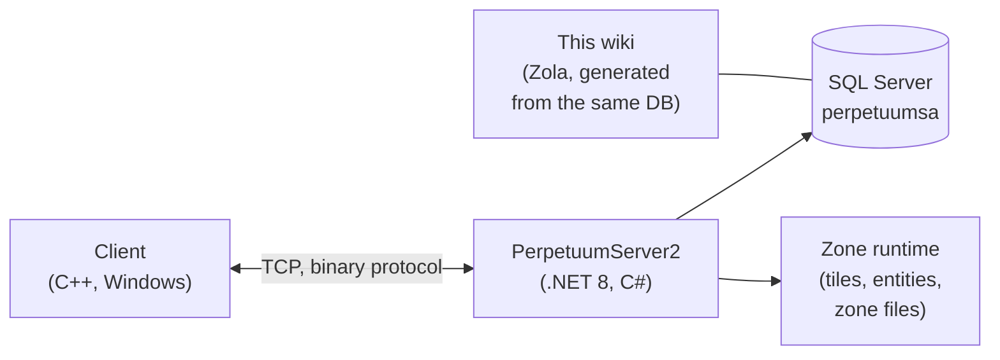

# Home sviluppatori

Una panoramica ad alto livello di come funziona il gioco, dal punto di vista di uno sviluppatore o DevOps.
Pagine di approfondimento dedicate sono in arrivo: per il momento, questa è la guida introduttiva.

## I componenti

- **Client** — il client di gioco di Perpetuum (Windows; consulta [Client & PC setup](/it/features/client-setup/) per istruzioni su come eseguirlo, incluso su Linux). Comunica con il server tramite un protocollo binario TCP; ogni azione del giocatore è un *comando* con un nome specifico (gli stessi nomi usati in questo wiki nell'[action inventory](/it/features/#inventario-completo-delle-azioni)).
- **Server (PerpetuumServer2)** — un codebase in C#/.NET 8. Un singolo processo esegue l'intero server: il livello di connessione, la logica di gioco (robot, zone, missioni, mercato, produzione, ricerca) e il runtime delle zone che gestisce a intervalli regolari (tick) il mondo a tile di ogni zona (terreno, entità, teletrasporti).
- **Database** — SQL Server, database `perpetuumsa`. Contiene i contenuti statici di gioco (valori predefiniti delle entità, ricette, estensioni, albero tecnologico, negozio, descrizioni dei teletrasporti) e tutto lo stato dinamico (personaggi, robot, contenitori, mercato, stato delle zone).
- **File di zona** — le zone sono griglie di tile (livelli di altitudine + livelli di controllo, 2 byte per tile) fornite in archivi `.gbf` e modificabili per singola zona; consulta il [zone file format](/it/formats/zone-files/).
- **Dati di riferimento** — all'avvio, il client scarica le tabelle delle statistiche dal server (consulta [Server & reference](/it/features/server/)).

## Esecuzione

- Il server viene eseguito in Docker Compose insieme a SQL Server (il progetto `perpetuumserver2`); il container del database è ciò da cui legge il generatore di questo wiki.
- Il contenuto statico viene validato rispetto ai file di regole **plantrules**; il generatore C# del wiki (`make generate`) opera nello stesso ecosistema e legge lo stesso database, quindi ogni tabella generata su questo sito riflette i dati effettivi del server.
- Le mappe dei teletrasporti di zona presenti su questo wiki sono renderizzate a partire dagli stessi livelli di altitudine usati dal gioco stesso.

## Dove proseguire

- **[Formats](/it/formats/)** — guida di riferimento dei campi per sviluppatori: come ogni campo di statistica viene memorizzato (colonna DB, chiave del file di regole, byte del livello binario) e utilizzato, con esempi pratici.
- **[Server & reference](/it/features/server/)** — i meta-sistemi: informazioni sul server, punteggi record (high scores), i dati di riferimento scaricati dal client e il negozio di gioco.

> Sono previste ulteriori pagine per sviluppatori (protocollo, ciclo di vita delle zone, deployment) — questa pagina rappresenta il loro punto di approdo.